<div align="center">


# Kalam

### Draw the app you need. Own it forever.

Kalam is an app that makes apps. Type a few lines, photograph a paper sketch, say it out loud, film it or draw it. Kalam turns the request into a checked app that lives on your phone and keeps working with no signal. Built for **#BuildHybridAI 2026** on **Firebase AI Logic** hybrid inference: templates and Gemini Nano on the device first, Gemini in the cloud only when the job needs it.

[](#hybrid-ai) [](#where-the-firebase-ai-logic-code-lives) [](#where-the-on-device-model-runs) [](#set-it-up) [](#platforms) [](#mcp-server) [](LICENSE)

[**Live demo**](https://kalam-hybrid.web.app) · [**Try it now**](#try-it-now) · [**How Kalam uses Firebase AI Logic**](#how-kalam-uses-firebase-ai-logic) · [**Download**](#download) · [How it works](#how-kalam-works) · [Hybrid AI](#hybrid-ai) · [Screenshots](#screenshots) · [Architecture](#architecture) · [Set it up](#set-it-up) · [Privacy and security](#privacy-and-security)

<picture>
  <source media="(prefers-color-scheme: dark)" srcset="docs/media/hero-dark.webp">
  
</picture>

</div>

## Try it now

**Live app:** <https://kalam-hybrid.web.app>

**Judges account.** It is a normal user account that holds nothing private, and the password is public on purpose:

| Email | Password |
|---|---|
| `judges.kalam@example.com` | `KalamJudges2026` |

1. Open the live app and press **Make your first app**. Kalam asks you to sign in.
2. Stay on **Sign in**, type the email and password, and press **Sign in with email**.
3. A sheet asks **Keep your apps in your account?** Choose **Apps and their records**, type the passphrase `KalamJudges2026` in both boxes, and press **Keep my apps**. The passphrase is what locks the records on the device before they are uploaded.
4. Open **Shelf**. **Home Expenses**, an expense tracker in rupees with 6 entries (₹5,208 in total), is there. Open it, add an expense, or press **Reports**.

If you choose **Apps only** in step 3, the app arrives without its entries, because that choice never uploads records. This was checked on 2026-11-26 in a fresh browser profile with no local data, both ways.

You can also make your own account: on the sign-in screen choose **Create account** (name, email, password), or use **Continue with Google**. Everyone who signs in as the judges account sees the same app, so please do not type anything personal into it, and please leave **Remove my apps from my account** in Settings alone.

To watch the hybrid AI work, make an app from the **Make** tab and open **Activity**: every result is labelled **Template**, **On device** or **Cloud**. Gemini Nano needs desktop Chrome with the model downloaded ([setup](#gemini-nano-in-chrome)). The cloud path needs an ordinary browser session, because App Check on the live site uses reCAPTCHA Enterprise, which scores an automated browser as a bot. How it all fits together is in [How Kalam uses Firebase AI Logic](#how-kalam-uses-firebase-ai-logic).

> **Sign in once, then it is yours offline.** Kalam needs a Google or email sign-in to use. After the first sign-in, your apps open, run and save with no network. Building a new app may need the cloud. Using an app never does.

> **State of the build (2026-11-26).** Hybrid inference is recorded end to end on the web: Gemini Nano in Chrome, Gemini in the cloud through Firebase AI Logic, one fallback between them, App Check on every cloud call, and offline use. The Android and iOS apps build and pass smoke flows in CI. [Verification](#verification) lists every claim with its evidence and its gaps.

---

## What Kalam is

You describe the app you need. Kalam reads it, shows you in plain words what it understood, builds it, checks it, and puts it on your shelf. The result is not generated code. It is a **KalamSpec**: a small JSON description of screens, saved lists, buttons and formulas. One shared runtime renders and runs every KalamSpec, so a generated app can never run a script.

| Way in | What you give Kalam |
|---|---|
| **Type** | A few lines in your own words, up to 4,000 characters |
| **Photo or sketch** | A picture of a paper register or a drawing, up to 4 photos |
| **Voice** | A spoken description, turned into text you can correct |
| **Video** | A clip of up to 60 seconds, reduced to a few keyframes on the device |
| **Draw** | The built-in Drawing Studio: pen, shapes, text and component stamps such as button, list and total |

You can mix them in one request. Anything that will go to the cloud is marked before you build.

Kalam is for people who already keep their business in a paper register: a tailor's order book, a kirana credit ledger, a tuition fee list, an attendance sheet. It works in ten languages (English, Hindi, Gujarati, Marathi, Bengali, Tamil, Telugu, Kannada, Malayalam and Punjabi).

**Why hybrid.** Most requests do not need a big model. A counter, an expense tracker or a checklist is a template with a few parameters. Small jobs such as reading a voice command, classifying a note or filling in a template fit a small model that runs on the device. Whole-app generation from a vague request, reading a sketch and hard repairs need a large cloud model. Kalam sends each job to the cheapest place that can do it well, and it tells you where it ran.

## How Kalam works

[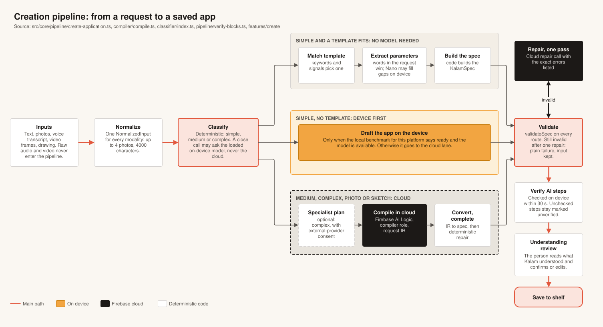](docs/diagrams/04-creation-pipeline.svg)

*Click any diagram to open it at full size. Editable sources are the `.drawio` files next to each SVG in [`docs/diagrams`](docs/diagrams).*

1. **Normalize.** Every input becomes one `NormalizedInput`. Raw audio and raw video never enter the pipeline: speech becomes a transcript and video becomes keyframes first.
2. **Classify.** A rule-based classifier (no model) calls the request simple, medium or complex.
3. **Build.** A simple request that fits one of the 11 templates is built by code, with Gemini Nano filling any missing parameters on the device. Everything else goes to the cloud compiler.
4. **Validate.** Every result, from any route, goes through the same `validateSpec`: JSON size, a security scan, schema, limits, references and formulas. If it fails, there is **one** repair call. If it still fails, you get a plain message and your input is kept.
5. **Review, then save.** Kalam reads back what it understood: the screens, the fields, the sums. You fix anything it got wrong, then save to the shelf. The previous valid version of an app is always kept.

[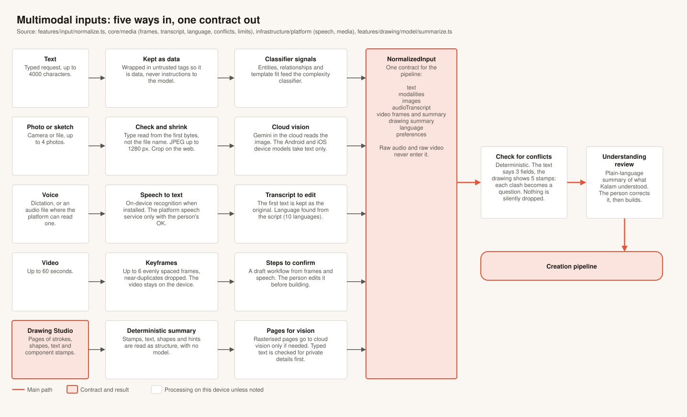](docs/diagrams/05-multimodal-inputs.svg)

## Hybrid AI

**Deterministic first. Device next. Cloud when justified.**

[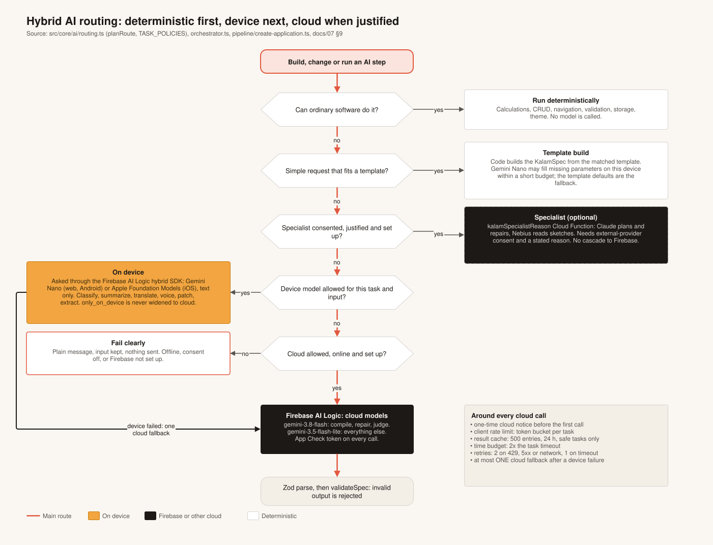](docs/diagrams/03-hybrid-ai-routing.svg)

| Tier | What runs there | Examples |
|---|---|---|
| **Template** (no model) | Ordinary code | Calculations, saving, sorting, formulas, navigation, theme, and every app built from a template |
| **On device** | Gemini Nano in Chrome and on Android, Apple Foundation Models on iOS, through the Firebase AI Logic hybrid SDK | Filling template parameters, voice commands, small edits, classify, summarize, translate, checking an AI step |
| **Cloud** | Gemini through Firebase AI Logic | Building a medium or complex app, reading a sketch, hard repair, checking the safety of a shared app |

**Rules the code enforces**

1. **Deterministic first.** Calculations, saving, navigation, formulas, theming and templates never call a model.
2. **Device first for small typed jobs.** Extract, classify, summarize, translate, voice commands and small edits prefer the device model.
3. **Measured, not assumed.** A job runs on the device only if that platform's benchmark for the job has not failed. The result of each benchmark is in [Verification](#verification). A simple request with no template tries the device only after its benchmark has passed.
4. **At most one cloud fallback.** If a small job fails on the device, the orchestrator makes one Firebase attempt, and only when cloud is allowed and the request was not marked device-only. There is no cascade of providers and no retry loop across providers.
5. **Consent clamps every decision.** Settings has **Hybrid** and **Offline only**, plus "Use cloud AI when needed" and "Allow specialist models". A request that must stay on the device is never widened to the cloud.
6. **Honest labels.** Every AI result is labelled **Template**, **On device** or **Cloud**. The label comes from the SDK's own `inferenceSource`, not from the mode that was requested. The **Activity** page shows counts by source, median latency, fallbacks and recent decisions, all stored locally.
7. **Validate everything.** Every model output is checked with Zod and semantic rules before it renders.

**Which task runs where** (`src/core/ai/routing.ts`)

[](docs/diagrams/19-task-registry-and-models.svg)

**Models.** Model ids live in one file, `src/core/ai/model-config.ts`. `gemini-3.8-flash` handles compile, repair and AI-step judging. `gemini-3.5-flash-lite` handles the small roles. A role can be overridden with Remote Config or with `EXPO_PUBLIC_AI_MODEL_<ROLE>`. The cloud backend is Firebase AI Logic on the Agent Platform backend, location `global`. The Gemini Developer API backend also works.

### Where the on-device model runs

| Platform | On-device model | How it reaches Firebase AI Logic |
|---|---|---|
| Web | Gemini Nano in desktop Chrome, through the Prompt API (`LanguageModel`) | The SDK's hybrid mode drives it directly. `on-device.web.ts` checks availability, starts the download and warms the model |
| Android | Gemini Nano through the ML Kit Prompt API on AICore, on supported phones | The Expo module `modules/kalam-nano` (Kotlin), exposed to the SDK as a Prompt API shaped `LanguageModel` |
| iOS | Apple Foundation Models (`SystemLanguageModel`), iOS 26 or later with Apple Intelligence on | The Expo module `modules/kalam-apple` (Swift), through the same adapter |
| MCP server (Node) | None | Optional cloud compile only, off by default |

On Android and iOS the device model takes text only, about 4,000 input tokens, and runs only while Kalam is on screen. Image requests go to the cloud. Without the native module, or on an unsupported phone, on-device status reads unavailable with the reason, and requests go to the cloud when allowed.

### App Check

| Platform | Release builds | Development builds |
|---|---|---|
| Web | reCAPTCHA Enterprise (v3 optional) | SDK debug token, registered in the Firebase console |
| Android | Play Integrity, from `modules/kalam-nano` | Debug token |
| iOS | App Attest with DeviceCheck fallback, from `modules/kalam-apple` | Debug token |

The Cloud Functions enforce App Check, and the specialist function accepts each token once. In the project used to develop Kalam, App Check enforcement for AI Logic is off, so unregistered clients still work. Turn enforcement on in your own project after you register your apps.

### Specialist providers

Claude (planning and repair) and Nebius (sketch reading) exist as server-side adapters inside one Cloud Function, `kalamSpecialistReason`. They are off by default, need their own consent switch, never run from the client, and are not part of the judging build. Firebase AI Logic is the primary path, and no benchmark yet shows a measurable benefit from the specialists over Firebase alone.

### Where the Firebase AI Logic code lives

| What | File |
|---|---|
| `getAI`, `getGenerativeModel`, hybrid `mode` (`only_on_device`, `prefer_on_device`, `only_in_cloud`, `prefer_in_cloud`), result `inferenceSource` | `src/infrastructure/firebase/firebase-provider.ts` |
| One lazy Firebase init, App Check before the first request | `src/infrastructure/firebase/app.ts` |
| App Check per platform | `app-check.web.ts`, `app-check.native.ts`, `app-check.ios.ts` in the same folder |
| Chrome Prompt API availability, download, warm-up | `src/infrastructure/firebase/on-device.web.ts` |
| Native on-device adapters | `on-device.native.ts`, `on-device.ios.ts`, `prompt-api.native.ts` |
| Routing policy and consent rules | `src/core/ai/routing.ts` |
| The single orchestrator, retries, event log | `src/core/ai/orchestrator.ts` |
| Cloud compiler with one repair pass | `src/core/compiler/compile.ts` |
| Specialist callable | `functions/src/index.ts`, `functions/src/providers.ts` |
| Real-call check scripts | `scripts/verify-firebase-ai.mjs`, `scripts/verify-cloud-compile.mjs`, `functions/scripts/verify-providers.mjs` |
| Recorded real runs | `docs/evidence/`, written by `scripts/record-evidence.mjs` |

## How Kalam uses Firebase AI Logic

> For the #BuildHybridAI 2026 judges. Every statement here was checked against the code in this repository, and the file is named next to it. Where something has not been verified, it says so. The recorded real runs are in [Evidence](#9-evidence-what-was-run-and-what-passed).

Kalam has one door to AI. A screen or a feature builds a request and calls `orchestrator.run()`. The orchestrator decides whether the request may run at all, and then hands it to one Firebase AI Logic provider, `createFirebaseProvider()` in `src/infrastructure/firebase/firebase-provider.ts`. That provider makes a **hybrid `GenerativeModel`** with both an on-device and a cloud configuration, and the Firebase AI Logic SDK chooses Gemini Nano on the device or a Gemini model in the cloud. Kalam labels each result with the SDK's own `inferenceSource`, never with the mode it asked for.

### The short version

| | |
|---|---|
| **SDK** | `firebase` 13.4.0, with `@firebase/ai` 3.1.0, imported from `firebase/ai`. Only `firebase-provider.ts` calls `getAI` and `getGenerativeModel`. The on-device adapters supply the model it drives |
| **Entry points used** | `getAI`, `getGenerativeModel`, `GoogleAIBackend`, `AgentPlatformBackend`, `InferenceMode`, `ThinkingLevel`, `HybridParams`, `response.inferenceSource`, `response.usageMetadata`, plus `firebase/app-check` and `firebase/remote-config` around it |
| **Hybrid modes** | All four SDK modes are mapped and used: `prefer_on_device`, `only_on_device`, `only_in_cloud`, `prefer_in_cloud`. Which one a task gets is decided by [policy code](#4-how-each-task-is-routed-and-why), not by the screen |
| **Cloud models** | `gemini-3.8-flash` for compiling, repair and judging. `gemini-3.5-flash-lite` for the small roles. Ids live only in `src/core/ai/model-config.ts` |
| **Cloud backend** | `AgentPlatformBackend`, location `global`, when `EXPO_PUBLIC_AI_BACKEND=agent_platform`. Otherwise `GoogleAIBackend`. The recorded runs and the development configuration use Agent Platform with `global` |
| **On-device model** | Gemini Nano through the Chrome Prompt API on the web. On Android the `kalam-nano` module, on iOS Apple Foundation Models through `kalam-apple`, both presented to the SDK as a Prompt API shaped `LanguageModel` |
| **App Check** | Set up with the Firebase app, and the provider waits for a token before every cloud request |
| **Output** | A JSON Schema goes to the model. Zod `parse` is the final authority. A failed parse is rejected, and an app build gets one repair call |
| **Fallback** | At most one cloud attempt after a failed device attempt, never a cascade |
| **Offline** | Templates, saved apps and device-eligible tasks keep working. Cloud-only tasks are refused before any request is sent |

### 1. Where Firebase AI Logic sits in the request path

[](docs/diagrams/03-hybrid-ai-routing.svg)

In that diagram the **On device** box and the **Firebase AI Logic** box are served by the same provider, and nothing reaches either of them except through the steps above. For one request:

1. **The feature builds a `StructuredRequest`** (`src/core/contracts/index.ts`): task type, prompt, a `jsonSchema`, a Zod-backed `parse`, and the mode it would like (`mode`). A feature never names a provider or a model.
2. **`orchestrator.run()`** (`src/core/ai/orchestrator.ts`) refuses oversized input (300,000 characters, 8 images, 1 recording, 18 MB inline), reuses a stored answer for safe-to-repeat tasks, and lets identical requests in flight share one call.
3. **`planRoute()`** (`src/core/ai/routing.ts`) applies the person's settings (**Hybrid** or **Offline only**, **Use cloud AI when needed**), connectivity, whether Firebase is configured, the per-task device benchmark gate and the capability registry. Its answer is one SDK mode, or a plain refusal.
4. **Before a cloud-bound call**, the one-time cloud notice is shown if it has not been accepted, and a per-task token bucket may hold the call back.
5. **`generateStructured()`** in `firebase-provider.ts` waits for an App Check token, builds the hybrid model and calls `generateContent`.
6. **The SDK picks the leg.** The provider reads `response.inferenceSource` and reports where the answer really came from.
7. **The answer is parsed.** `JSON.parse`, then the caller's Zod `parse`. Anything that does not validate is `invalid_output`.
8. **The orchestrator records an `InferenceEvent`** (route, source, model, latency, token counts, retries, fallback, prompt and schema versions) in the local database, and the **Activity** page reads it. Content is never recorded.

### 2. The hybrid setup, from the real code

#### 2.1 One lazy Firebase app, with App Check registered first

`src/infrastructure/firebase/app.ts`

```ts
export function getFirebaseApp(): FirebaseApp | undefined {
  if (app) return app;
  if (!isFirebaseConfigured()) return undefined;
  const existing = getApps()[0]; // fast refresh keeps the default app alive
  app = existing ?? initializeApp(config);
  if (!existing) setupAppCheck(app); // App Check before the first AI request picks up its token
  return app;
}
```

Nothing touches Firebase until an AI feature asks, so using a saved app never waits on it. Only public `EXPO_PUBLIC_*` identifiers are read here. `setupAppCheck` runs right after `initializeApp`, because the AI instance reads the App Check instance when it is made.

#### 2.2 App Check on the web

`src/infrastructure/firebase/app-check.web.ts`

```ts
const provider = process.env.EXPO_PUBLIC_APPCHECK_PROVIDER === 'v3'
  ? new ReCaptchaV3Provider(siteKey)
  : new ReCaptchaEnterpriseProvider(siteKey);
instance = initializeAppCheck(app, { provider, isTokenAutoRefreshEnabled: true });
```

```ts
export async function appCheckReady(timeoutMs: number): Promise<boolean> {
  if (!instance) return true; // App Check not set up: the SDK has no token to wait for
  let timer: ReturnType<typeof setTimeout> | undefined;
  const settled = getToken(instance).then(() => true, () => true);
  const late = new Promise<boolean>((resolve) => { timer = setTimeout(() => resolve(false), timeoutMs); });
  try {
    return await Promise.race([settled, late]);
  } finally {
    clearTimeout(timer);
  }
}
```

`reCAPTCHA Enterprise` is the default and `EXPO_PUBLIC_APPCHECK_PROVIDER=v3` selects reCAPTCHA v3. `firebase/ai` awaits the same App Check token before every cloud request and has no timeout of its own, so `appCheckReady` puts a ceiling on that wait. The Android and iOS versions are in `app-check.native.ts` and `app-check.ios.ts` (see [section 7](#7-app-check-and-security-around-every-cloud-call)).

#### 2.3 `getAI` and `getGenerativeModel`: the hybrid model

`src/infrastructure/firebase/firebase-provider.ts`

**The backend.** One `AI` instance is created lazily, on the first request.

```ts
function createBackend() {
  const backend = process.env.EXPO_PUBLIC_AI_BACKEND;
  if (backend === 'agent_platform') {
    const location = process.env.EXPO_PUBLIC_AI_LOCATION;
    return location ? new AgentPlatformBackend(location) : new AgentPlatformBackend();
  }
  return new GoogleAIBackend();
}
```

**The four modes.** Kalam's mode names map one to one onto the SDK's `InferenceMode`.

```ts
const SDK_MODE: Readonly<Record<InferenceMode, HybridParams['mode']>> = {
  only_on_device: SdkInferenceMode.ONLY_ON_DEVICE,
  prefer_on_device: SdkInferenceMode.PREFER_ON_DEVICE,
  only_in_cloud: SdkInferenceMode.ONLY_IN_CLOUD,
  prefer_in_cloud: SdkInferenceMode.PREFER_IN_CLOUD,
};
```

**The model itself.** This is the core of the integration: one `getGenerativeModel` call with a `mode`, an `inCloudParams` block for Gemini in the cloud and an `onDeviceParams` block for Gemini Nano.

```ts
const generativeModel = (placement: SchemaPlacement) => {
  ai ??= getAI(app, { backend: createBackend() });
  const promptOptions: LanguageModelPromptOptions & { signal: AbortSignal } = {
    responseConstraint: req.jsonSchema, signal: controller.signal,
  };
  const schemaNote = `Reply with one JSON value that matches this JSON Schema:\n${JSON.stringify(cloudSchema)}`;
  return getGenerativeModel(ai, {
    // The device models are not assumed to hear audio: a recording always goes to the cloud leg.
    mode: audio.length && req.mode === 'prefer_on_device' ? SDK_MODE.only_in_cloud : SDK_MODE[req.mode],
    inCloudParams: {
      model,
      systemInstruction: placement === 'config' ? req.system : [req.system, schemaNote].filter(Boolean).join('\n\n'),
      generationConfig: {
        responseMimeType: 'application/json',
        ...(placement === 'config' ? { responseJsonSchema: cloudSchema } : {}),
        // Gemini 3.x thinking tokens count against maxOutputTokens; a small cap truncates the JSON.
        // The cap is a ceiling, not a charge: billing counts tokens actually produced.
        maxOutputTokens:
          req.maxOutputTokens === undefined ? undefined : Math.max(req.maxOutputTokens, CLOUD_MIN_OUTPUT_TOKENS),
        thinkingConfig: { thinkingLevel: thinkingLevelFor(req.role) },
        ...(req.temperature === undefined ? {} : { temperature: req.temperature }),
      },
    },
    onDeviceParams: {
      createOptions: {
        expectedInputs: images.length ? [...(io.expectedInputs ?? []), { type: 'image' }] : io.expectedInputs,
        expectedOutputs: io.expectedOutputs,
        // The SDK drops systemInstruction on-device; a system initial prompt keeps instructions
        // separate from user content there too (docs/07 §17.4).
        initialPrompts: req.system ? [{ role: 'system', content: [{ type: 'text', value: req.system }] }] : undefined,
        signal: controller.signal,
      },
      promptOptions,
    },
  });
};
```

What each part does:

| Part | What it does |
|---|---|
| `getAI(app, { backend })` | Creates the Firebase AI Logic instance on the Agent Platform or Gemini Developer API backend. Created once, reused |
| `mode` | The routing decision from `planRoute`, translated by `SDK_MODE`. A recording in a `prefer_on_device` request is sent as `only_in_cloud`, because the device models are not assumed to hear audio |
| `inCloudParams.model` | `modelForRole(req.role)`: the model id for the request's role, from Remote Config, an `EXPO_PUBLIC_AI_MODEL_<ROLE>` override or the defaults in `model-config.ts` |
| `systemInstruction` | The task's instructions, kept apart from user content. In the `prompt` placement it also carries the schema (see [section 5](#5-structured-output-validation-and-repair)) |
| `generationConfig.responseMimeType` and `responseJsonSchema` | Constrained JSON output, so the cloud model is asked for the exact shape Kalam validates |
| `maxOutputTokens` | At least 2,048, because Gemini 3 thinking tokens count against it. It is a ceiling, not a charge |
| `thinkingConfig` | `ThinkingLevel.LOW` for every role, which keeps latency and cost down. `MINIMAL` was rejected by `gemini-3.8-flash` on Agent Platform with a 400 on 2026-11-18, as the code comment records |
| `onDeviceParams.createOptions` | The Prompt API session: expected text languages (English always, plus Spanish and Japanese when the request names them, the only other languages Chrome documents), an `image` input when images are sent, and the system prompt as an `initialPrompts` system turn, because the SDK drops `systemInstruction` on the device |
| `onDeviceParams.promptOptions.responseConstraint` | The same JSON Schema, given to Chrome for constrained decoding on the device |
| `signal` | One `AbortController` for timeout and cancel. The device leg may ignore signals, so the call is also raced against it |

Two details worth knowing. Hermes on Android has no `AbortSignal.any`, which `firebase/ai` calls on every cloud request, so `firebase-provider.ts` installs a small polyfill. And when a request is `prefer_on_device`, the provider checks the device status itself (1.5 s budget) so a failure is reported against the right leg, which the single cloud fallback depends on.

#### 2.4 Reading the result

```ts
let response: Awaited<ReturnType<typeof generate>>;
try {
  response = await generate('config');
} catch (e) {
  // A 400 means the service refused the request shape (not billed, never transient). Retrying
  // once without constrained decoding is a deterministic degrade, not a provider cascade.
  if (timedOut || req.mode === 'only_on_device' || !isSchemaRejection(e)) throw e;
  response = await generate('prompt');
}

const source = response.inferenceSource === 'on_device' ? 'on_device' : 'cloud';
const usedModel = source === 'on_device' ? ON_DEVICE_MODEL_NAME : model;
reportUsage(req, response.usageMetadata);
let raw: unknown;
try {
  raw = JSON.parse(stripFences(response.text()));
} catch {
  return fail('invalid_output', 'The model returned text that is not valid JSON.', source, usedModel);
}
const parsed = req.parse(raw);
if (!parsed.success) return fail('invalid_output', `Model output failed validation: ${parsed.error}`, source, usedModel);
return {
  success: true, output: parsed.data, provider: 'firebase', source, model: usedModel,
  latencyMs: Date.now() - started, fallbackUsed: isFallback(req.mode, source),
};
```

- The source is `response.inferenceSource` (`on_device` or cloud). The model name is the cloud model id, or `gemini-nano` when the device answered.
- `fallbackUsed` is true when the answer came from the other leg than the mode preferred (`isFallback` in `routing.ts`).
- A schema the service refuses (HTTP 400) is retried **once** without constrained decoding, with the schema in the system instruction. That is a deterministic degrade of the request shape, not a retry across providers.
- Token counts come from `response.usageMetadata`. Thinking tokens are billed as output, so they are counted there, and the on-device leg reports none.

#### 2.5 Models and configuration

`src/core/ai/model-config.ts` is the only place model ids live.

```ts
export const DEFAULT_MODELS: Readonly<Record<ModelRole, string>> = {
  compiler: 'gemini-3.8-flash',
  repair: 'gemini-3.8-flash',
  judge: 'gemini-3.8-flash',
  safety: 'gemini-3.5-flash-lite',
  local_assistant: 'gemini-3.5-flash-lite',
  edit: 'gemini-3.5-flash-lite',
  voice: 'gemini-3.5-flash-lite',
  ai_block: 'gemini-3.5-flash-lite',
  translation: 'gemini-3.5-flash-lite',
};
```

| Setting | Value or rule | File |
|---|---|---|
| Precedence for a model id | Remote Config `model_*` key, then `EXPO_PUBLIC_AI_MODEL_<ROLE>`, then the table above | `model-config.ts`, `remote-config.ts` |
| Remote Config | Loaded once per session, never awaited, and only when cloud use is allowed. Every value is checked with Zod, and an invalid one keeps the default. Whether the Firebase project has a Remote Config template published is not verified here, so the in-code defaults are what the recorded runs used | `remote-config.web.ts`, `src/core/ai/remote-config.ts` |
| Output token ceiling per role | compiler and repair 16,384, translation 8,192, edit and judge 4,096, ai_block 2,048, safety, voice and local_assistant 1,024 | `model-config.ts` |
| Thinking level | `LOW` | `firebase-provider.ts` |
| Timeouts | 90 s default. A compile or repair call waits 150 s | `limits.ts`, `compile.ts` |
| Prompt versions | One label per role (`compile-v2`, `repair-v2`, `judge-v1` and so on) recorded on every event | `model-config.ts` |

#### 2.6 The on-device leg per platform

On the web the SDK drives Chrome's `LanguageModel` directly, and `on-device.web.ts` only answers "can Nano run here?", starts the download from a user gesture and keeps the model warm. On Android and iOS, `on-device.native.ts` and `on-device.ios.ts` install an adapter as `globalThis.LanguageModel`, so the same hybrid router picks the phone or the cloud. The table in [Where the on-device model runs](#where-the-on-device-model-runs) lists each platform.

### 3. Every use of Firebase AI Logic

One row per use. "Hybrid" means the SDK chooses between Gemini Nano and the cloud model at the moment of the call. "On device" and "Cloud" mean the request is pinned to one leg.

| Feature | What Firebase AI Logic does there | Runs | API and mode | Source |
|---|---|---|---|---|
| Hybrid model setup | One `AI` instance, and one hybrid `GenerativeModel` per request with `inCloudParams` and `onDeviceParams` | Hybrid | `getAI`, `getGenerativeModel`, `HybridParams` | `src/infrastructure/firebase/firebase-provider.ts` |
| App Check on every cloud call | A token is attached to each cloud request. Kalam waits for it first, for up to 8 s | Cloud | `initializeAppCheck`, `ReCaptchaEnterpriseProvider`, `getToken`. Native: Play Integrity, App Attest | `app-check.web.ts`, `app-check.native.ts`, `app-check.ios.ts`, `app.ts` |
| Template app, parameters | Gemini Nano fills template parameters the rules did not capture. Template defaults are the fallback, so this never waits on the cloud | On device | `only_on_device`, task `extract_template_params`, 6 s budget | `src/core/pipeline/create-application.ts` |
| Build a medium or complex app | Gemini compiles the request into a schema-constrained intermediate form that Kalam turns into a KalamSpec | Cloud | `only_in_cloud` (a medium text request asks for `prefer_in_cloud` and `planRoute` makes it `only_in_cloud`), `gemini-3.8-flash` | `src/core/compiler/compile.ts` |
| Build a simple app with no template | The device is tried first, only where its benchmark for the job has passed and the model is loaded. No platform has a passed benchmark yet, so today this is cloud | Hybrid (gated) | `prefer_on_device`, task `create_app`, gate `create_simple_app` | `create-application.ts`, `src/core/ai/local-ready.ts` |
| Read a sketch, photo or drawing | The same compile call with the pictures attached as `inlineData` image parts | Cloud | `only_in_cloud`, task `interpret_sketch`, `gemini-3.8-flash` | `compile.ts`, `src/core/compiler/prompt.ts` |
| Understand a video | Up to 6 keyframes become the ordered steps of a task, which then feed the compiler | Cloud | `only_in_cloud`, task `interpret_sketch` | `src/core/media/workflow.ts` |
| Repair a failed build | One repair call that is told the exact validator problems | Cloud | task `repair_spec`, role `repair`, `gemini-3.8-flash`, the mode of the first pass | `compile.ts` |
| Edit an app in words | Plain rules handle the clear cases first. Otherwise Gemini Nano proposes a small patch. If nothing usable comes back, Gemini proposes a structural patch, optionally with a picture of the part pointed at | On device, then cloud (two separate calls) | `only_on_device` task `generate_patch`, then `only_in_cloud` task `modify_app`, role `edit` | `src/core/tasks/edit-service.ts` |
| Voice command in a running app | Maps the transcript to one of the app's own action ids | Hybrid | `prefer_on_device`, task `voice_action` | `src/core/tasks/voice-service.ts` |
| Turn a recording into text | Gemini hears the audio as an `inlineData` part and returns a transcript. Implemented and exercised by a script. The app screens do not call it yet (the web build asks the person to type the words) | Cloud | `only_in_cloud`, task `voice_action`, `gemini-3.5-flash-lite` | `src/core/tasks/transcribe-service.ts` |
| Translate an app's labels | Translates the labels in chunks | On device for a pair Chrome supports and 60 labels or fewer, otherwise cloud | `prefer_on_device` or `only_in_cloud`, task `translate` | `src/core/tasks/translate-service.ts` |
| Explain a report | One short sentence about the numbers on screen. A sentence with a number not in the report is rejected | Hybrid | `prefer_on_device`, or `only_on_device` when the person keeps it on the device, task `summarize` | `src/core/reports/explain.ts` |
| Ask your app a question, formula help | Turns a question into a formula that Kalam validates and then calculates itself | Hybrid | `prefer_on_device`, task `classify`, role `local_assistant` | `src/core/assistant/assistant.ts`, `src/core/formula-assist/suggest.ts` |
| AI steps inside a generated app | Reads a photo into fields, classifies, summarises or translates, as the author configured the step | Per step | `only_on_device` (fallback none), `prefer_on_device` (default) or `prefer_in_cloud` (a step the check showed is better in the cloud) | `src/core/tasks/ai-block-service.ts` |
| Check an AI step when it is built | Gemini writes 5 test cases, Gemini Nano runs every one, and Gemini grades summaries and translations for meaning. Passing is 4 of 5. For photos, Gemini reads sample photos as the reference and Nano reads the same photos | Cloud and device | `only_in_cloud` (role `judge`) and `only_on_device`, task `verify_ai_block` | `ai-block-service.ts` (`verify`) |
| Handwriting in the Drawing Studio | Reads a picture of the strokes. Digits are read by code first. Gemini Nano is next. The cloud is used only after the person agrees | On device, then cloud on request | `only_on_device`, then `only_in_cloud`, task `extract_data` | `src/features/drawing/handwriting-service.ts` |
| Close call on how complex a request is | Gemini Nano picks between two levels, only when it is loaded now | On device | `only_on_device`, task `classify`, 40 output tokens | `src/core/classifier/tie-break.ts` |
| Safety review before publishing to Kalam Bazaar | Gemini judges the listing text and the AI prompts in the app, when the rule-based checks found nothing to flag | Cloud | `only_in_cloud`, task `safety_review`, `gemini-3.5-flash-lite` | `src/core/bazaar/publish.ts`, `src/infrastructure/bazaar/bazaar-service.ts` |
| Model ids, prompt versions, feature flags | Firebase Remote Config, with Zod-checked values and in-code defaults | Config | `fetchAndActivate` | `src/infrastructure/firebase/remote-config.web.ts` |

Not in this table on purpose: the optional Claude and Nebius specialists (a Cloud Function, off by default, not Firebase AI Logic) and everything deterministic, such as calculations, saving, templates and formulas, which never call a model.

### 4. How each task is routed, and why

[](docs/diagrams/19-task-registry-and-models.svg)

The routing policy is a data table plus two small pure functions, so it runs in tests without a model (`orchestrator.test.ts`, `local-ready.test.ts`). This is the policy table.

`src/core/ai/routing.ts`

```ts
export const TASK_POLICIES: Readonly<Record<TaskType, TaskPolicy>> = {
  create_app: { role: 'compiler', onDevice: false, specialist: true, userFacing: false, cloudFallback: false, localWhenReady: true },
  plan_app: { role: 'compiler', onDevice: false, specialist: true, userFacing: false, cloudFallback: false },
  modify_app: { role: 'compiler', onDevice: false, specialist: true, userFacing: false, cloudFallback: false },
  interpret_sketch: { role: 'compiler', onDevice: false, specialist: true, userFacing: false, cloudFallback: false },
  repair_spec: { role: 'repair', onDevice: false, specialist: true, userFacing: false, cloudFallback: false },
  verify_ai_block: { role: 'judge', onDevice: false, specialist: false, userFacing: false, cloudFallback: false },
  safety_review: { role: 'safety', onDevice: false, specialist: false, userFacing: false, cloudFallback: false },
  generate_patch: { role: 'edit', onDevice: true, specialist: false, userFacing: true, cloudFallback: true },
  // Template parameters must never wait on the cloud: the deterministic template is the fallback.
  extract_template_params: { role: 'local_assistant', onDevice: true, specialist: false, userFacing: true, cloudFallback: false },
  extract_data: { role: 'ai_block', onDevice: true, specialist: false, userFacing: true, cloudFallback: true },
  classify: { role: 'local_assistant', onDevice: true, specialist: false, userFacing: true, cloudFallback: true },
  summarize: { role: 'ai_block', onDevice: true, specialist: false, userFacing: true, cloudFallback: true },
  translate: { role: 'translation', onDevice: true, specialist: false, userFacing: true, cloudFallback: true },
  voice_action: { role: 'voice', onDevice: true, specialist: false, userFacing: true, cloudFallback: true },
};
```

The reasons behind it:

| Task | Placement | Why |
|---|---|---|
| `create_app`, `plan_app`, `modify_app`, `interpret_sketch`, `repair_spec` | Cloud (`onDevice: false`). `plan_app` only runs for a consented specialist | Building a whole app, reading a picture and hard repair need a bigger model than Gemini Nano. Kalam does not assume Gemini Nano can build a whole app, so the device may only try a *simple* app, and only after its benchmark passes (`localWhenReady`) |
| `verify_ai_block`, `safety_review` | Cloud | Both are cloud tasks by design. The AI-step check needs a stronger reference to compare the device model against, and a publishing safety verdict is not left to a small local model |
| `extract_template_params` | Device only, no cloud fallback | The template defaults are the fallback, so a build never waits on the cloud |
| `classify`, `summarize`, `translate`, `extract_data`, `voice_action`, `generate_patch` | Device first, one cloud fallback allowed | Small typed jobs with short input and a schema-checked answer. The benchmark gate can still send one of them to the cloud |

Two functions apply the policy to the situation of the moment. First, may the device take this task at all?

```ts
export function onDeviceEligible(taskType: TaskType, complexity: ComplexityLevel | undefined, localReady?: LocalStatus): boolean {
  const policy = TASK_POLICIES[taskType];
  if (policy.onDevice) return localReady !== 'failed';
  return !!policy.localWhenReady && complexity === 'simple' && localReady === 'ready';
}
```

A task that prefers the device keeps it unless its recorded benchmark **failed**. A simple app with no template only gets the device after its benchmark **passed**. An unproven task keeps today's behaviour and never unlocks a new one. Then `planRoute` turns that into a mode:

<details>
<summary><code>planRoute</code> in full (src/core/ai/routing.ts)</summary>

```ts
export function planRoute(i: RouteInput): RouteDecision {
  const policy = TASK_POLICIES[i.taskType];
  const blocked = cloudBlock(i);

  // Specialists are external cloud providers: same cloud consent + explicit external consent +
  // a caller-supplied justification. Never a silent fallback (docs/07 §9.4–9.5).
  if (
    i.escalationReason && policy.specialist && !blocked && i.requestedMode !== 'only_on_device'
    && i.settings.allowExternalProviders && i.specialistConfigured
  ) {
    return { kind: 'specialist', note: i.escalationReason };
  }

  const deviceReady = i.onDevice === 'available' && !i.deviceLacks;
  if (!onDeviceEligible(i.taskType, i.complexity, i.localReady)) {
    // Nano cannot do this task (docs/07 §4.5), or it failed its benchmark for it (§6.7): cloud or a clear
    // failure. A caller's only_on_device is a privacy constraint and is never widened to cloud.
    const benchFailed = policy.onDevice;
    if (i.requestedMode === 'only_on_device') {
      return { kind: 'fail', code: 'model_unavailable', intended: 'on_device', message: benchFailed ? AI_COPY.localFailedGate : AI_COPY.taskNeedsCloud };
    }
    if (blocked) return { kind: 'fail', ...blocked, intended: 'cloud' };
    return {
      kind: 'firebase', mode: 'only_in_cloud',
      note: i.requestedMode === 'only_in_cloud' ? undefined : benchFailed ? 'on-device model failed its benchmark for this task' : 'task requires cloud reasoning',
    };
  }

  // The capability registry says the device model cannot take this input (docs/07 §14.6).
  if (i.deviceLacks && i.requestedMode === 'only_on_device') {
    return { kind: 'fail', code: 'unsupported_modality', intended: 'on_device', message: AI_COPY.deviceLacks(i.deviceLacks) };
  }
  const notReady = i.deviceLacks ? AI_COPY.deviceLacks(i.deviceLacks) : AI_COPY.deviceNotReady(i.onDevice);

  if (blocked) {
    // Consent/offline clamp: only the on-device leg is allowed, regardless of the requested mode.
    if (!deviceReady) return { kind: 'fail', code: blocked.code, intended: 'on_device', message: `${notReady} ${blocked.message}` };
    return { kind: 'firebase', mode: 'only_on_device', note: i.requestedMode === 'only_on_device' ? undefined : `cloud unavailable (${blocked.code})` };
  }

  if (i.requestedMode === 'only_on_device' && !deviceReady) {
    return { kind: 'fail', code: 'model_unavailable', intended: 'on_device', message: notReady };
  }
  // Cloud is allowed and the device cannot take this input: do not let the SDK try the device first.
  if (i.deviceLacks) return { kind: 'firebase', mode: 'only_in_cloud', note: `on-device model lacks ${i.deviceLacks}` };
  return { kind: 'firebase', mode: i.requestedMode };
}
```

</details>

Read as rules:

1. **A consented specialist wins only when asked for.** It needs an explicit reason from the caller, cloud consent, external-provider consent and a configured specialist. Otherwise this step is skipped.
2. **A task the device cannot or may not do goes to the cloud** as `only_in_cloud`, or fails clearly. A caller's `only_on_device` is a privacy constraint and is **never** widened to the cloud.
3. **If the capability registry says the device model cannot take the input** (Android and iOS models are text only), the request goes to the cloud when allowed, and the SDK is not allowed to try the device first.
4. **If the cloud is blocked** (Offline only, cloud consent off, offline, or Firebase not configured), only the device leg is allowed. If the device is not ready, the request fails with a plain message.
5. **Otherwise the requested mode is passed to the SDK**, which makes the final choice at the call.

The device benchmark gate is computed from recorded runs, never set by hand (`src/core/ai/local-ready.ts`). Measured on Chrome 158 on 2026-11-26: voice commands pass (21 of 23 correct, p95 3.8 s). Classify (83.3% against 85% needed), summarize (60% against 80%) and translate (75% against 90%) failed, so on the web those three go to the cloud. Extract, patch, template parameters and the simple-app attempt have no benchmark yet. The same numbers are in [Verification](#verification).

How the callers ask: the app-build path uses `compileMode()`, which pins sketches, photos, drawings, video and complex apps to the cloud, and the pipeline asks the device first only for a simple request that passed its gate.

```ts
export function compileMode(input: NormalizedInput, c: TaskClassification): InferenceMode {
  return hasVisualInput(input) || c.requiresMultimodalReasoning || c.complexity === 'complex'
    ? 'only_in_cloud'
    : 'prefer_in_cloud';
}
```

### 5. Structured output, validation and repair

Every model result is untrusted until it passes four checks.

**1. A schema goes to the model.** Each request carries a JSON Schema made from its Zod schema (`src/core/ai/json-schema.ts`). `sanitizeJsonSchema` keeps only the keywords Gemini documents as supported. For the cloud, `cloudResponseSchema` also drops array bounds, which made the service reject the compiler schema with a 400 on 2026-11-18, and adds `propertyOrdering` so the model writes a component's `type` before its other properties. The schema is sent as `responseJsonSchema` to the cloud and as `responseConstraint` to Chrome's Prompt API. If the service refuses the schema itself, the request is made once more with the schema in the system instruction.

**2. Zod decides.** The answer is JSON-parsed, with code fences stripped, and then passed to the caller's `parse`. The generation schema may be looser than the Zod schema, because Zod is the final authority. A failure becomes `invalid_output`.

**3. Task rules decide what the answer may do.** Examples from the code: a voice answer naming an action the app does not have is turned into "no action" and never executed (`voice-service.ts`). A formula from "Ask your app" is validated against the app's fields, then calculated by Kalam's own evaluator (`assistant.ts`). A report explanation that contains a number not in the report is rejected (`explain.ts`). Labels a translation did not return stay in the original language (`translate-service.ts`).

**4. An app must pass `validateSpec` before it exists.** For a build, the cloud's output goes through this path (`src/core/compiler/compile.ts`):

| Step | What happens |
|---|---|
| Schema | The model returns a compiler IR, checked against `compilerIRSchema` after `normalizeIR` cleans lengths the cloud schema cannot carry |
| Convert | `irToSpec` builds a KalamSpec |
| Deterministic repair | `completeSpec` adds and moves the screens and parts a valid app needs. If that makes the app invalid, the unrepaired app is validated instead |
| Validate | `validateSpec`: JSON size, a security scan, schema, limits, references and formulas |
| **One** repair call | If it is still invalid, `repair_spec` (role `repair`) gets the exact validator problems and the previous output. There is no second repair |
| Otherwise | A plain message, the person's description kept, clarifying questions. An invalid spec is never saved, and the previous valid version of an app is always kept |

Untrusted text, such as the person's request, a voice transcript, video notes and an app's own AI instructions, is wrapped in `<untrusted_*>` tags by `wrapUntrusted()` (`src/core/compiler/prompt.ts`), and the prompts say the tagged text is data. A generated app is data too: it runs on a finite action set with no `eval`.

Calls that fail for reasons that may pass are retried on the same provider only: two retries for a rate limit (429), a service error or a network drop, with exponential backoff and full jitter, and one for a timeout. The on-device leg is never retried. Compile and repair calls do not retry on a timeout, because the repair pass is the retry.

```ts
export const RETRY_LIMITS: Readonly<Partial<Record<AIErrorCode, number>>> = {
  quota: 2, provider_error: 2, offline: 2, timeout: 1,
};
```

### 6. The single cloud fallback rule

When a small job is tried on the device and fails **on the device**, the orchestrator makes **one** Firebase cloud attempt and takes whatever it answers. It is the only fallback in Kalam. The code in `src/core/ai/orchestrator.ts`:

<details>
<summary>The fallback in full</summary>

```ts
const localFailure = !first.success && first.source === 'on_device' && first.errorCode !== 'cancelled' && !req.signal?.aborted;
if (localFailure && decision.kind === 'firebase' && mode === 'prefer_on_device' && (policy.cloudFallback || policy.localWhenReady)) {
  // planRoute keeps prefer_on_device only when cloud is allowed, so this is the one permitted
  // fallback (lead decision 2). Whatever the cloud answers is final: no retry, no cascade.
  const failed = `on-device failed (${first.errorCode ?? 'error'})`;
  const noticeMissing = !(await noticeOk(settings, ctx));
  const held = noticeMissing ? undefined : await takeToken();
  const left = timeLeft();
  if (noticeMissing) {
    needsOk = !req.signal?.aborted;
    notes.push(`${failed}; cloud fallback skipped, the cloud notice is not accepted`);
  } else if (held === 'quota') {
    notes.push(`${failed}; cloud fallback skipped by the client rate limit`);
  } else if (held !== 'cancelled' && !left) {
    notes.push(`${failed}; no time left for the cloud fallback`);
  } else if (held !== 'cancelled') {
    // The failed device attempt is an event of its own, so on-device metrics count it (docs/13 §9.2).
    await record({
      ...base, route: 'on_device', provider: first.provider, model: first.model, source: 'on_device', latencyMs: now() - started,
      success: false, fallbackUsed: false, errorCode: first.errorCode,
      escalationReason: join(ctx.escalationReason, decision.note), retries: 0, cacheHit: false,
    });
    notes.push(`${failed}; one Firebase cloud fallback`);
    legStarted = now();
    out = await attempt({ mode: 'only_in_cloud', timeoutMs: left });
  }
}
```

</details>

It happens only when every one of these holds:

- the request asked for `prefer_on_device`. `only_on_device` is never widened, and `only_in_cloud` has no device leg to fall back from;
- the first attempt failed on the device (not cancelled);
- the task's policy allows it (`cloudFallback`, or `localWhenReady`);
- cloud is allowed now: online, cloud consent on, not Offline only, Firebase configured. `planRoute` only keeps `prefer_on_device` when that is so;
- the one-time cloud notice has been accepted, the client token bucket has a token and there is time left in the run budget (twice the task timeout).

Whatever the cloud answers is final: no retry, no second fallback, no other provider. A failed specialist does not go to Firebase either, and Firebase does not go to a specialist. The failed device attempt and the cloud attempt are two events with one `taskId`, so the Activity page counts the device failure. Do not confuse this with the SDK's own behaviour in `prefer_on_device` mode: if the model is not available at all (not downloaded, no Prompt API), the SDK goes to the cloud without any device attempt, which the provider reports as `fallbackUsed`.

### 7. App Check and security around every cloud call

[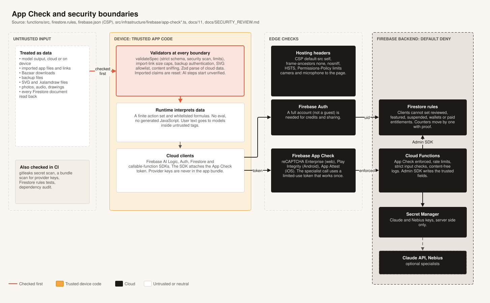](docs/diagrams/11-app-check-security-boundaries.svg)

| Platform | Provider in release builds | Development builds | File |
|---|---|---|---|
| Web | reCAPTCHA Enterprise, or reCAPTCHA v3 with `EXPO_PUBLIC_APPCHECK_PROVIDER=v3` | SDK debug token, registered in the console | `app-check.web.ts` |
| Android | Play Integrity, from the native Firebase App Check SDK inside `modules/kalam-nano` | Debug token | `app-check.native.ts`, `native-app-check.native.ts` |
| iOS | App Attest, with DeviceCheck as fallback, from `modules/kalam-apple`, handed to the JS SDK by a `CustomProvider` | Debug token | `app-check.ios.ts`, `native-app-check.native.ts` |

What guards a cloud call:

1. **App Check.** The provider calls `appCheckReady(8 s)` before a cloud request. A token that does not arrive in time fails the request as `app_check_failed` with a plain message instead of hanging. A 401 or 403 that mentions App Check maps to the same code (`src/infrastructure/firebase/errors.ts`). On the native apps the attestation provider is installed lazily, on the first cloud request, so on-device-only work never reaches Play Integrity or App Attest.
2. **Consent.** Settings has **Hybrid** and **Offline only**, **Use cloud AI when needed** and **Allow specialist models** (off by default). The first cloud-bound call asks for a one-time notice, and after "Not now" it does not ask again for 10 minutes. The Settings page says what is sent: the description, the words of a voice note, and any photo, video frame or drawing attached. Records are never sent, except the fields an AI step that the person added works on.
3. **Remote Config is not loaded when cloud is not allowed.** A request pinned to `only_on_device` does not start the Remote Config fetch.
4. **No provider keys in the bundle.** The client holds only `EXPO_PUBLIC_*` identifiers. The Claude and Nebius keys are Secret Manager secrets used by one Cloud Function, and CI scans the bundle for provider keys.
5. **Server side.** The Cloud Functions set `enforceAppCheck: true` (`functions/src/index.ts`, `functions/src/bazaar/index.ts`, `functions/src/collab/index.ts`), and the specialist function also uses `consumeAppCheckToken: true`, so each token works once.
6. **Cost and abuse limits.** Output tokens are capped per role, a token bucket limits cloud calls per task (6 per minute for compile, repair and safety, 30 for the rest), retries are bounded, and a run has a time budget. These protect cost and battery and are not a security boundary, because a modified client can skip them.

Where App Check stands, plainly. **Enforcement for AI Logic is off in the Firebase project used to develop Kalam**, so unregistered clients still work there. Turn it on in your own project after you register your apps. A debug token was sent on every recorded cloud call (scenario E below). The production reCAPTCHA Enterprise path in a real browser, Play Integrity and App Attest have no recorded run. One observation on 2026-11-26: a headless automated browser on the live site gets HTTP 403 from the reCAPTCHA Enterprise token exchange, because reCAPTCHA scores it as a bot, while sign-in and account sync still worked.

### 8. Offline, and when Gemini Nano is not there

Every row below is decided by `planRoute`, `cloudBlock` and the provider, and several were run (see the evidence).

| Situation | What Kalam does |
|---|---|
| Offline, building from a template | Builds. A template app needs no model, and Gemini Nano is not asked unless it is loaded |
| Offline, a task the device may take (voice command, small edit, "Ask") | `planRoute` clamps the request to `only_on_device`. If Nano is ready it answers, with no network |
| Offline, a cloud-only task (a medium or complex app, a sketch) | Refused as `offline` before anything is sent: "This needs an online model. Your saved apps and local data remain available." Scenario F recorded 0 requests sent while offline |
| Back online | The next cloud request works (scenario G) |
| Offline only, or cloud consent off | Same clamp: the device may answer, everything else is refused with the reason. A request pinned to the device never goes to the cloud |
| Gemini Nano not downloaded (`downloadable`) or downloading | A hybrid request goes to the cloud when allowed. A device-only request fails with `model_unavailable` and says why. The download starts only from a button in Settings, because Chrome needs a user gesture, and its progress is shown |
| Gemini Nano downloaded but not loaded | The first session after a page load took about 40 s on Chrome 157. Template parameters and the complexity tie-break only use Nano when it is already loaded, and a cold model is warmed in the background for next time |
| No Prompt API (another browser, an unsupported phone) | Status reads unavailable with the reason, and requests go to the cloud when allowed |
| A device attempt fails | One cloud fallback, as in [section 6](#6-the-single-cloud-fallback-rule) |
| Firebase not configured | Templates and saved apps still work. AI tasks fail with a plain "not set up" message |
| No App Check token within 8 s | `app_check_failed`, with a plain message |

Saved apps open, run and save offline whatever any of these rows say, because the runtime is data plus code and reaches AI only through the orchestrator.

### 9. Evidence: what was run and what passed

Only real runs are counted. The files are in [`docs/evidence`](docs/evidence), written by `scripts/record-evidence.mjs`. Mocked unit tests such as `firebase-provider.test.ts` and `orchestrator.test.ts` check Kalam's own logic around the SDK and are not counted as proof that a model ran.

| What | Result | File |
|---|---|---|
| First cloud call through Firebase AI Logic | `gemini-3.8-flash`, `inferenceSource: in_cloud`, 3.4 s, a debug App Check token exchanged | [`cloud-inference-2026-11-18.json`](docs/evidence/cloud-inference-2026-11-18.json) |
| First Gemini Nano call in Chrome through the SDK | A classify answer and a voice-command answer as schema-shaped JSON | [`on-device-inference-2026-11-18.json`](docs/evidence/on-device-inference-2026-11-18.json) |
| **Web hybrid matrix** in Chrome 158.0.8127.36 with real Gemini Nano, `firebase` 13.4.0 and `@firebase/ai` 3.1.0 | **Scenarios A to H all pass.** **A** Nano answers (12.8 s). **B** with no local model, the cloud answers (`gemini-3.5-flash-lite`, 4.6 s). **C** and **C2** a model that is not ready makes a device-only request refuse and a hybrid request go to the cloud, once with a simulated signal and once with the real `downloadable` state. **D** after a device failure there is exactly one cloud request. **E** every cloud request carries an App Check header. **F** offline, Nano answers in 1.0 s, and a cloud-only task is refused with 0 requests sent. **G** reconnecting restores the cloud (`gemini-3.8-flash`, 2.6 s). **H** an AI-step check ran 5 of 5 tests on Nano | [`web-matrix-2026-11-26.json`](docs/evidence/web-matrix-2026-11-26.json), from `node scripts/verify-firebase-ai.mjs --web-matrix` |
| The same paths inside the running app | A template build made no cloud request. A medium and a complex request were compiled by `gemini-3.8-flash`, with one repair call on the complex one. Nano filled template parameters and ran a voice command with no cloud request. A forced device failure was followed by one cloud fallback. Offline, a template app built and a cloud-only task was refused with no request sent. Screenshots show each source on the Activity page | [`web-hybrid-2026-11-26/`](docs/evidence/web-hybrid-2026-11-26) |
| Device benchmarks, Gemini Nano in Chrome | Voice commands **ready** (21 of 23). Classify, summarize and translate **failed** their gates, and the cloud model on the same cases scored higher, for example 18 of 20 on summarize | `local-ready-*-web-2026-11-26.json`, `provider-*-cloud-2026-11-26.json` |
| Cloud compiler quality | A 75-case golden set run live: of 42 cases routed to the cloud, 32 were valid on the first pass and 39 after the single repair pass. 25 synthetic photographs of the golden sketches were sent as image parts, and 18 of 25 apps built valid. Valid is not the same as correct | [`live-eval-2026-11-25.json`](docs/evidence/live-eval-2026-11-25.json) |
| Video as keyframes | Five video cases, with stills standing in for frames of a recorded video, were built through the real pipeline and the cloud model: 5 of 5 valid, 4 on the first pass | [`video-live-2026-11-26.json`](docs/evidence/video-live-2026-11-26.json) |
| Audio to text in the cloud | A WAV of one spoken sentence came back as text through the transcribe service in 3.9 s | [`audio-transcribe-2026-11-26.json`](docs/evidence/audio-transcribe-2026-11-26.json) |
| Templates, no model | 20 of 20 template cases valid | [`benchmark-categories-2026-11-26.json`](docs/evidence/benchmark-categories-2026-11-26.json) |

**Not verified.** The list is short and plain:

- Gemini Nano was only seen answering in desktop Chrome. The Android (`kalam-nano`) and iOS (`kalam-apple`) adapters are written and covered by unit tests and CI smoke flows, and this README does not claim a recorded on-device answer from a phone.
- Play Integrity, App Attest, and the production reCAPTCHA Enterprise path in a real browser have no recorded run, and enforcement for AI Logic is off in the development project.
- The `create_simple_app` local attempt and the extract, patch and template-parameter tasks have no device benchmark, so they are unproven.
- Transcribing a recording is not wired into the app screens.
- No Remote Config template is claimed to be published in the project, so the recorded runs used the in-code model defaults.
- Sketch results come from synthetic photographs, not hand-drawn ones, and the video run used stills, not a decoded video file.

To run the checks yourself, see [Check the hybrid path by hand](#check-the-hybrid-path-by-hand).

## Features

- **Five ways to start, and you can mix them.** Type, photo or sketch, voice, video and the Drawing Studio, all read as one request.
- **Templates.** 11 deterministic templates (calculator, counter, checklist, notes, expense tracker, habit tracker, inventory, contact book, measurement log, reminder list, simple form). A gallery at `/templates` adds 30 ready-made apps and five starter packs (Kirana and Retail, Tailoring, Tutors and Teachers, Clinics, Home). Each app can be looked at with made-up entries before you make it your own.
- **Cloud compiler** for medium and complex requests, with one repair pass, and **AI blocks** inside apps (extract from a photo, classify, summarize, translate). Each AI block is checked when the app is built, and an unchecked one stays marked unverified. At run time it uses the device when it can, and offline it shows a saved answer or refuses.
- **Drawing Studio.** Pen, marker, highlighter, shapes, text, component stamps, photos, eraser and select. Pressure and pinch zoom on the web, Skia on phones.
- **Formulas without `eval`.** A restricted formula language for totals, balances and filters.
- **Offline-first storage.** Dexie over IndexedDB on the web, `expo-sqlite` on Android and iOS. Saved apps open, render, take entries, calculate and navigate with no network.
- **Versions.** Every change is saved as a version you can restore. Apps can be cloned, reported on, and given reminders.
- **Voice commands and an assistant.** A heard command becomes an app action, and anything destructive asks first.
- **Kalam Bazaar.** Share an app, or add someone else's to your shelf. Listings are checked by code and by a cloud safety review, and moderators can act on reports. Free listings only: paid credits are off unless `EXPO_PUBLIC_BAZAAR_PAYMENTS=on`.
- **Collaboration.** Share an app with a team using an invite code, with admin, editor and viewer roles. Entries sync per field and a real clash is shown to you.
- **Backup and sync.** Encrypted backups (AES-256-GCM, key from your passphrase). Optional account sync that uploads app designs, and records only if you also set a passphrase, encrypted on the device first.
- **Offline queue.** Builds, translations and AI steps started offline wait in a visible queue, but only after you confirm what will be sent. Structural edits are never queued.
- **Access modes** that apply to Kalam and to every app it makes: Large, High contrast, Simple, Read aloud, Left-handed and Voice only.
- **Ten languages**, with script fonts for the eight Indic scripts and the Indian digit grouping.
- **Design.** A Charcoal and Saffron shell: charcoal `#1C1917`, warm paper `#FAF7F2`, saffron `#E2583E`, deep saffron `#B8432C` for anything that carries text, and marigold `#F2A541`. Light and dark themes. Web animation uses GSAP and three.js, phones use Reanimated and Skia.
- **An MCP server** that lets Claude Desktop, Claude Code or any MCP host build, check and package Kalam apps. See [MCP server](#mcp-server).

[](docs/diagrams/18-i18n-ten-languages.svg)

KalamSpec limits keep generated apps small: at most 8 screens, 10 collections, 15 AI blocks and 100 KB per spec. Features Kalam cannot do (logins, payments, servers) are mapped to the closest offline equivalent.

## Platforms

| Platform | What you get | Status |
|---|---|---|
| **Web (PWA)** | The live app at <https://kalam-hybrid.web.app>, installable, with an offline service worker. Gemini Nano in desktop Chrome | **Verified in Chrome**, including the in-app hybrid runs. See [Verification](#verification) |
| **Android** | An APK from the releases page. Gemini Nano through AICore on supported phones, Play Integrity App Check | **Builds and runs.** Uses Gemini Nano where the phone supports AICore, otherwise the cloud through Firebase AI Logic |
| **iOS** | A simulator build and an unsigned iPhone build on the releases page. Apple Foundation Models on iOS 26 with Apple Intelligence, App Attest | **Builds and runs in the simulator. Nothing has run on an iPhone.** The iPhone build must be signed by you (see [Download](#download)) |
| **MCP server** | `mcp/`, a Node process with 11 tools, built on the same pure code as the app | **Code complete.** 60 tests pass over in-memory, stdio and HTTP transports. No recorded session with a real MCP host yet |

## Download

| | |
|---|---|
| **Web app, no install** | <https://kalam-hybrid.web.app>. Sign in with Google or email. |
| **Android and iOS builds** | [**github.com/vishavmehra/kalam/releases/latest**](https://github.com/vishavmehra/kalam/releases/latest) |

| File on the release | For | Notes |
|---|---|---|
| `Kalam-android.apk` | Android phones and emulators | A test build, not from the Play Store, signed with a debug key. Open the file on the phone and allow installs from that source |
| `Kalam-ios-device-unsigned.ipa` | iPhones | **Unsigned, so it will not install as it is.** Sign it with AltStore or Sideloadly (a free Apple ID works) or with your own Apple Developer certificate, then install it. Apple allows nothing else without an Apple account, and this project does not hold one |
| `Kalam-ios-simulator.zip` | The iOS Simulator on a Mac | Unzip it and drag the app onto an open Simulator window |

Each release also has a `SHA256SUMS.txt` to check a download against. Pushing a version tag such as `v0.1.0`, or running the **Release** workflow by hand (`.github/workflows/release.yml`), builds the three files and attaches them to a GitHub Release. The Android and Simulator builds are the ones CI already builds. The unsigned iPhone build is the same app built for a device without code signing, and its first run on a hosted runner has not happened yet.

## Screenshots

<table>
  <tr>
    <td align="center" width="20%"></td>
    <td align="center" width="20%"></td>
    <td align="center" width="20%"></td>
    <td align="center" width="20%"></td>
    <td align="center" width="20%"></td>
  </tr>
  <tr>
    <td align="center"><sub>Landing</sub></td>
    <td align="center"><sub>Make an app</sub></td>
    <td align="center"><sub>Templates</sub></td>
    <td align="center"><sub>Shelf, dark</sub></td>
    <td align="center"><sub>Sign in, dark</sub></td>
  </tr>
</table>

<table>
  <tr>
    <td width="50%">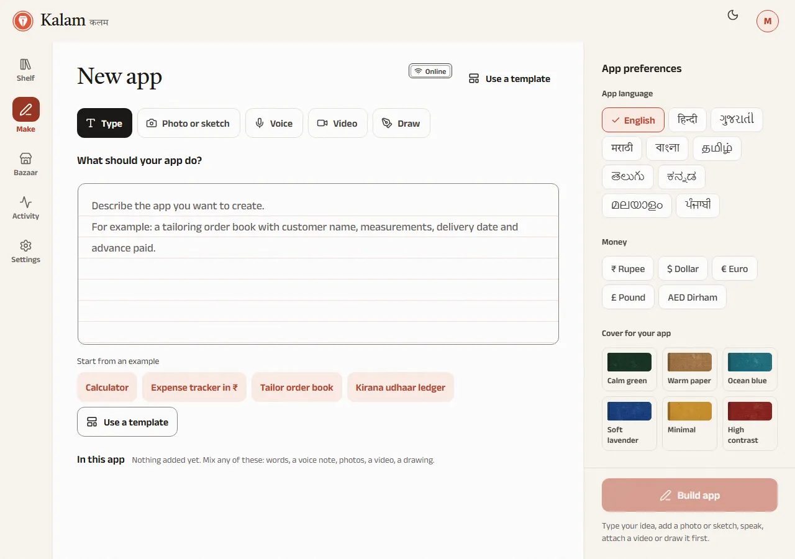</td>
    <td width="50%">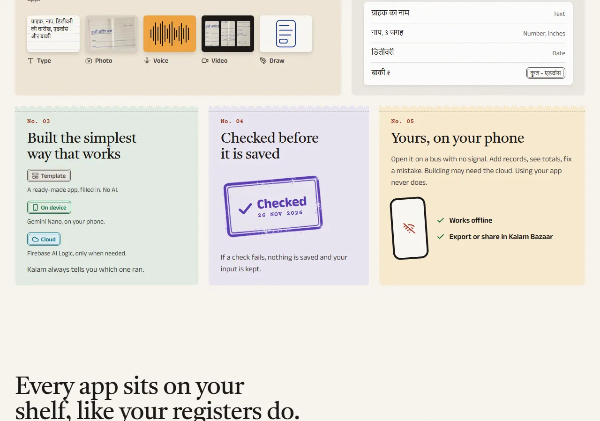</td>
  </tr>
  <tr>
    <td align="center"><sub>Make an app on the desktop web</sub></td>
    <td align="center"><sub>How it works, from the landing page</sub></td>
  </tr>
</table>

<p align="center"></p>

## Architecture

Click a diagram to open it at full size.

[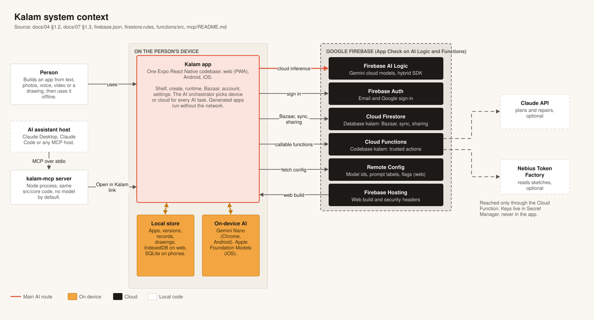](docs/diagrams/01-system-context.svg)

**One codebase, four targets.** The Expo app serves Web, Android and iOS. The pure TypeScript in `src/core` has no React, Expo or Firebase imports, so the MCP server bundles the very same code the app uses. Only `src/services/index.ts`, the composition root, wires infrastructure to core.

[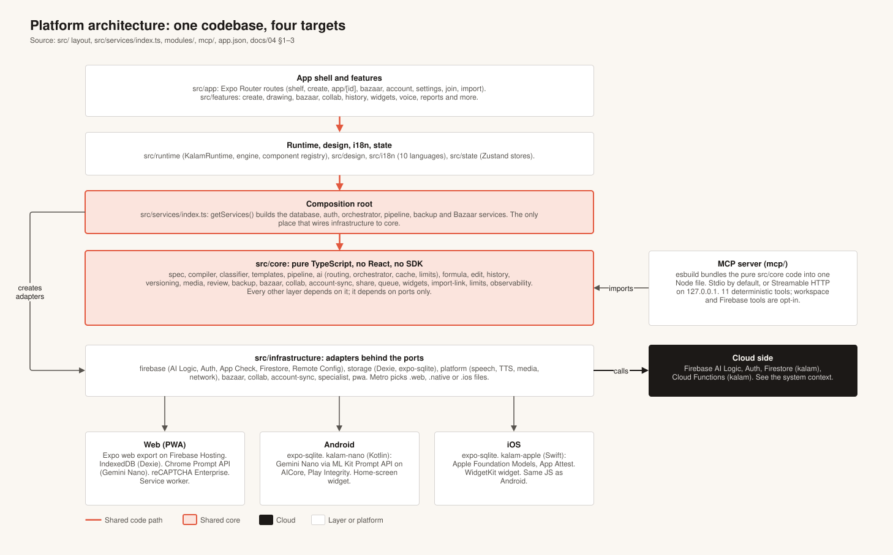](docs/diagrams/02-platform-architecture.svg)

### Drawing Studio

[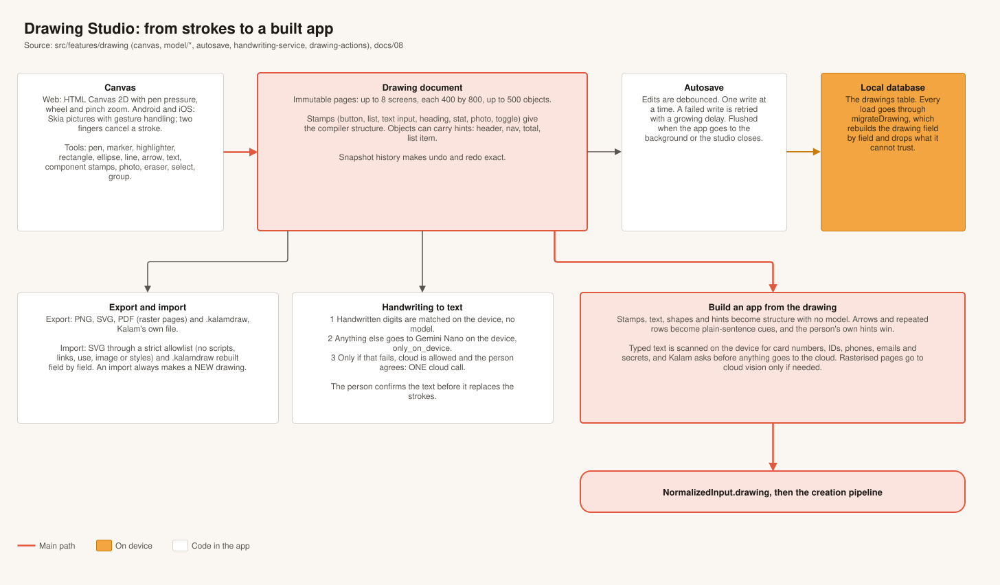](docs/diagrams/14-drawing-studio-flow.svg)

Drawings are immutable pages (up to 8, each 400 by 800, up to 500 objects) that autosave to the local database. Component stamps give the compiler structure without a model, handwriting is read on the device first, and a drawing enters the same creation pipeline as every other input.

### KalamSpec: an app is data, never code

[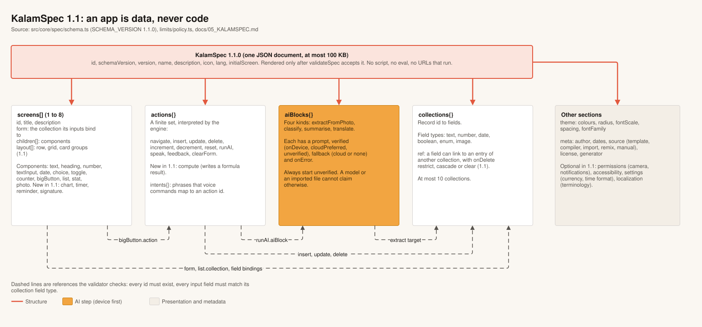](docs/diagrams/06-kalamspec-structure.svg)

A spec is one JSON document with screens, actions, collections, AI blocks, a theme and metadata. The action set is finite and interpreted by the engine. There is no script, no `eval`, no `new Function`, and no URL that runs.

[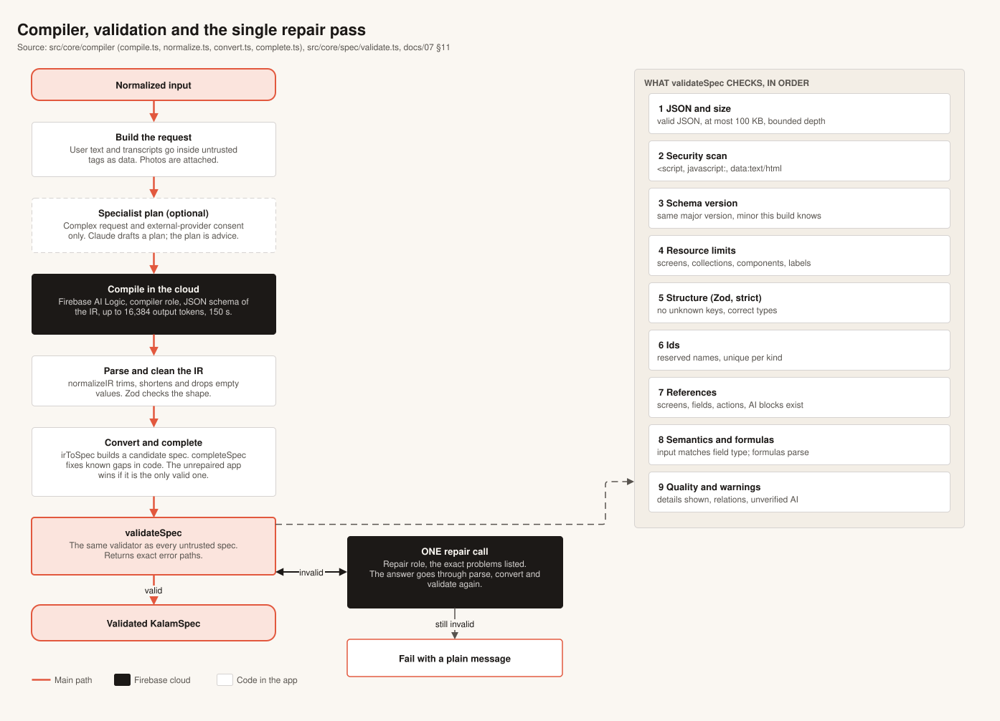](docs/diagrams/07-compiler-validation-repair.svg)

### Runtime

[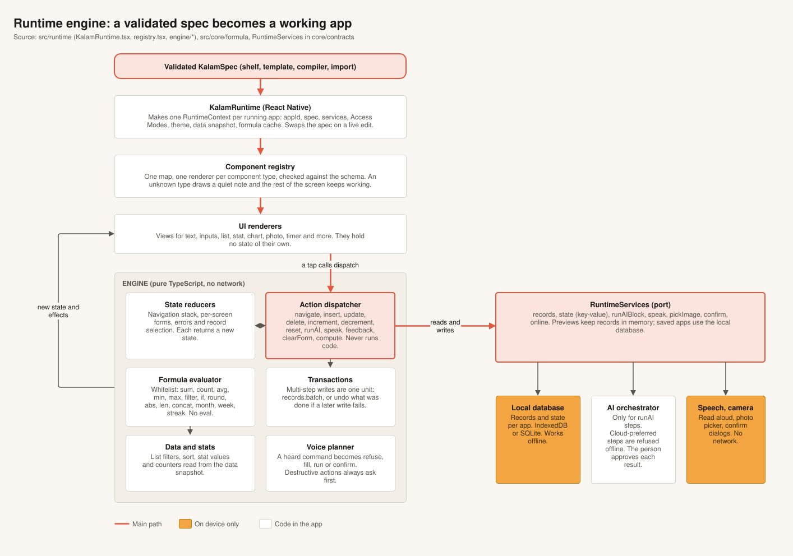](docs/diagrams/08-runtime-engine.svg)

The runtime renders the spec through a component registry, dispatches actions through a reducer, and reaches the outside world only through a `RuntimeServices` port (local database, AI orchestrator, speech and camera). That is why a saved app works with no network.

[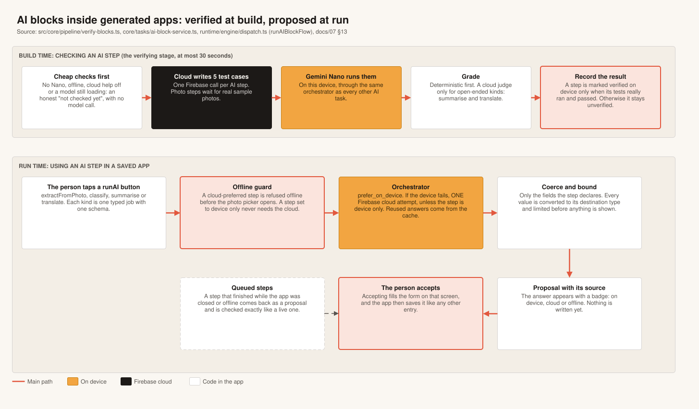](docs/diagrams/20-ai-blocks-and-verification.svg)

### Offline storage, backup and sync

[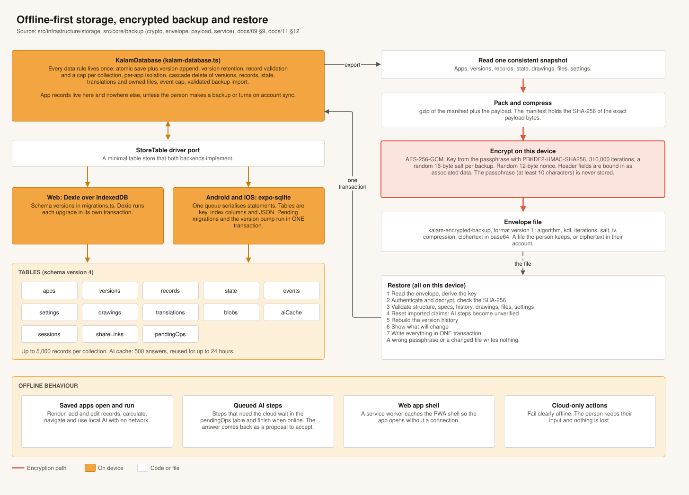](docs/diagrams/09-offline-storage-backup.svg)

[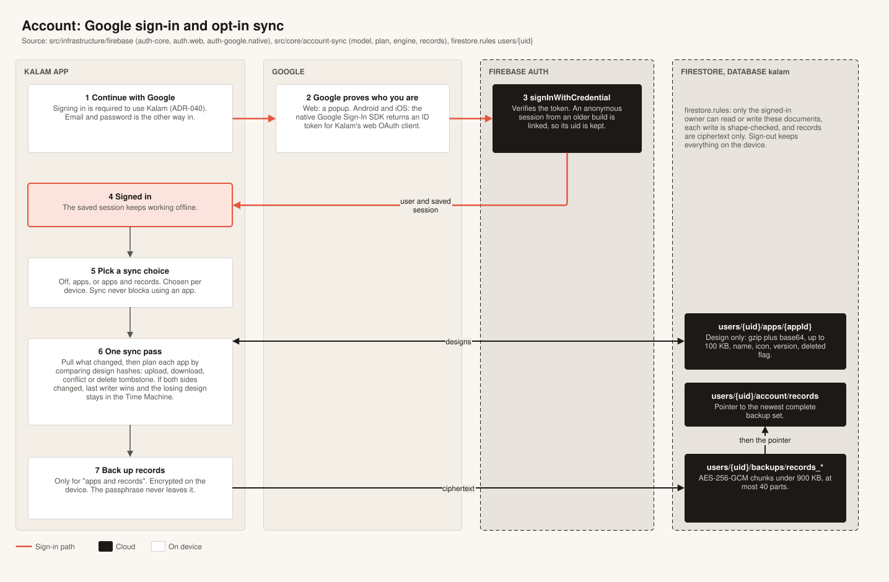](docs/diagrams/10-account-sync-google-signin.svg)

### Kalam Bazaar and collaboration

[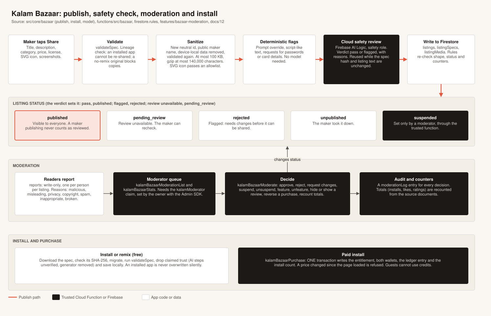](docs/diagrams/12-bazaar-publish-moderation.svg)

[](docs/diagrams/13-collab-join.svg)

[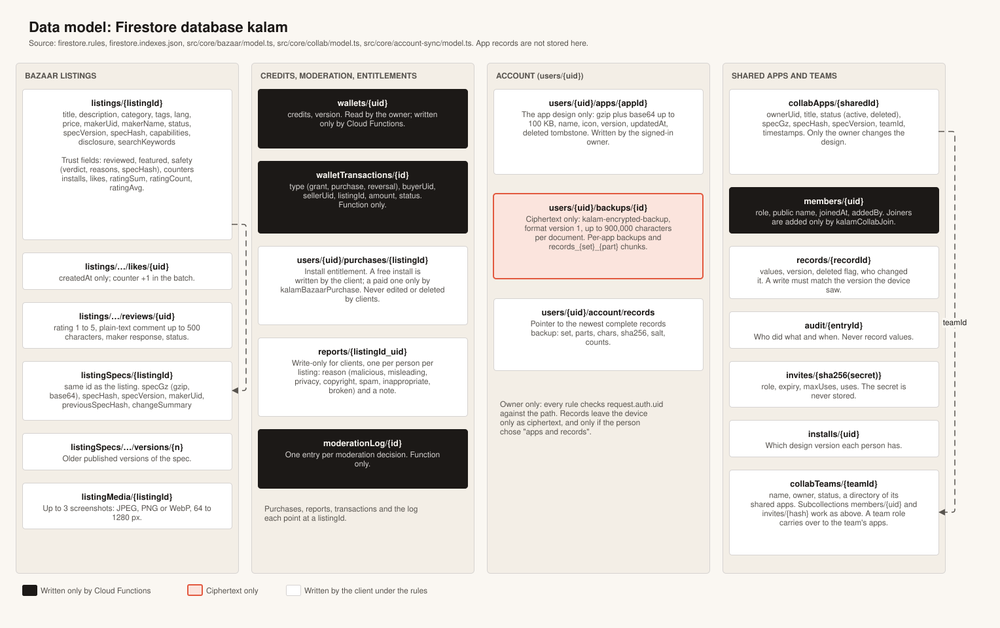](docs/diagrams/17-data-model-firestore.svg)

### MCP tools and resources

[](docs/diagrams/15-mcp-server-tools.svg)

### CI and release

[](docs/diagrams/16-ci-release.svg)

### Repository layout

```text
src/
  app/                 Expo Router routes: shelf, onboarding, create (draw, review), app run and edit, activity, settings
  core/                Pure TypeScript. Runs in Node under Vitest. No React, Expo or Firebase imports
                       spec (KalamSpec schema, validation), ai (orchestrator, routing), classifier, templates,
                       compiler, pipeline, tasks (AI blocks, edit, voice), edit, versioning, formula, backup, bazaar,
                       queue, collab, account-sync, clone, import-link, reports
  runtime/             KalamRuntime and engine: renders and runs a KalamSpec
  infrastructure/
    firebase/          Firebase init, App Check, hybrid provider, on-device adapters
    specialist/        Client for the specialist callable
    storage/           Dexie (web) and expo-sqlite (Android, iOS) behind one driver
    platform/          Network, media, speech: .web and .native splits
    bazaar/, pwa/      Bazaar client, service worker registration
  features/            create, media, drawing (Studio), editing, history, shelf, templates, queue, collab, share,
                       reports, reminders, assistant, recovery, storage, account, auth, bazaar, cloud-consent,
                       settings, activity, landing
  design/, components/ Design tokens, UI kit, shell
  services/index.ts    Composition root: the only place providers meet core
functions/             Cloud Functions codebase "kalam": specialists (Claude, Nebius) and Bazaar callables
modules/
  kalam-nano/          Android native module (Kotlin): Gemini Nano, Play Integrity
  kalam-apple/         iOS native module (Swift): Apple Foundation Models, App Attest
  kalam-widget/        Android widget and iOS WidgetKit extension (written, never built or registered)
mcp/                   MCP server (Node) reusing src/core
scripts/               build-pwa, verify-firebase-ai, verify-cloud-compile, record-evidence, eval, bench, check-bundle-size
tests/                 fixtures, e2e (Playwright), evaluation (golden set, perf budgets), rules (Firestore), emulator
docs/diagrams/         The diagrams above, as SVG and editable .drawio
docs/evidence/         Recorded real runs (JSON, logs, screenshots)
```

Stack: Expo SDK 58, React Native 0.88, React 19.3, Expo Router, TypeScript (strict), Zod 4, Zustand 5, Firebase JS SDK 13 (`@firebase/ai` 3.1), Vitest 5, Playwright, Cloud Functions 2nd gen on Node 22. Platform splits use Metro extensions (`foo.web.ts`, `foo.native.ts`, `foo.ios.ts`) with a plain `foo.ts` shim so `tsc` resolves.

## Verification

Only real runs count as verified. Mocked unit tests check Kalam's own logic around the SDK and are never counted as proof that a model ran. Evidence files are in [`docs/evidence`](docs/evidence).

| Claim | State | Evidence |
|---|---|---|
| Firebase AI Logic is imported and used at runtime | **Verified** | `firebase` 13.4.0 and `@firebase/ai` 3.1.0. Real requests go through `getGenerativeModel` |
| Cloud inference through Firebase AI Logic | **Verified** | `gemini-3.8-flash` and `gemini-3.5-flash-lite` with `inferenceSource: in_cloud`: [`cloud-inference-2026-11-18.json`](docs/evidence/cloud-inference-2026-11-18.json) and the web runs below |
| Web hybrid matrix in Chrome 158 with real Gemini Nano | **Verified, scenarios A to H all pass** | [`web-matrix-2026-11-26.json`](docs/evidence/web-matrix-2026-11-26.json), run by `node scripts/verify-firebase-ai.mjs --web-matrix`. **A** Gemini Nano answers through the SDK. **B** with no local model, the cloud answers. **C** a model that is not ready makes a device-only request refuse, and the hybrid request goes to the cloud. **D** after a device failure there is exactly one cloud attempt. **E** every cloud request carries an App Check token. **F** offline, the device answers and the cloud request is refused with a plain message. **G** reconnecting restores the cloud. **H** an AI-step check runs 5 of 5 tests on Gemini Nano. Scenario C was run twice, once with a simulated "not ready" signal and once with the real `downloadable` state |
| The same paths inside the running Kalam app | **Verified on web** | [`web-hybrid-2026-11-26/`](docs/evidence/web-hybrid-2026-11-26) (`matrix-results.json` and screenshots, against a locally served build in Chrome). A template build made no cloud request. A medium and a complex request were compiled by `gemini-3.8-flash`, with one repair call on the complex one. Gemini Nano filled in template parameters, and a voice command ran on Gemini Nano with no cloud request. When the device was made to fail, one cloud fallback followed. Offline, a template app still built and a cloud-only task was refused with no request sent. Each run shows its source on the Activity page |
| Device-first benchmarks (Gemini Nano in Chrome, 2026-11-26) | **Measured for four tasks. Only voice commands pass today** | Run by `node scripts/local-ready.mjs --task <task> --cdp-port 9333`, and read by the router. Voice commands: 21 of 23 correct, p95 3.8 s, gate **ready**. Classify 83.3% against 85% needed, summarize 60% against 80%, translate 75% against 90%: all **failed**, so on the web those three go to the cloud. Files: `docs/evidence/local-ready-*-web-2026-11-26.json`, `provider-*-cloud-2026-11-26.json` |
| Cloud compiler quality | **Verified through the evaluation runner, not the screens** | A 75-case golden set, run live on 2026-11-25: of 42 cases routed to the cloud, 32 were valid on the first pass and 39 after the single repair pass. Valid is not the same as correct. Median about 13 s, 95th percentile about 114 s. [`live-eval-2026-11-25.json`](docs/evidence/live-eval-2026-11-25.json) |
| Deterministic templates | **Verified** | 20 of 20 template cases valid with no model ([`benchmark-categories-2026-11-26.json`](docs/evidence/benchmark-categories-2026-11-26.json)) |
| App Check | **Partly verified** | Debug token sent on every recorded cloud call. The reCAPTCHA Enterprise path in a browser, Play Integrity and App Attest are not recorded. Enforcement is off on the development project |
| Android | **Builds and runs** | CI built a 46 MB release APK and passed six Maestro flows on an emulator (run 45615319769, branch `ci/mobile-smoke`, before the redesign). |
| iOS | **Simulator only** | The same CI run built the iOS app on a macOS runner and passed six Maestro flows on the simulator (before the redesign). The `kalam-apple` Swift module compiled there. Apple Foundation Models and App Attest are not verified on a device |
| MCP server | **Tested through the MCP SDK client** | 60 tests in 6 files, over in-memory, stdio and HTTP transports |
| Specialists (Claude, Nebius) | **Verified locally** | Real calls through `functions/scripts/verify-providers.mjs` and the Functions emulator. Off by default and not part of the judging build |

### Known limits

- On the web the device model runs English text, and image input accepts JPEG and PNG only. Android handles English and Korean. On Android and iOS the device takes text only and image requests go to the cloud.
- Gemini Nano in Chrome needs capable desktop hardware and a multi-gigabyte download that Chrome starts only from a user gesture. The first session after each page load is slow.
- Capture on real devices (camera, microphone, video) is built but not verified on hardware. Speech recognition may be done by a platform service, and Kalam labels where it ran. A recorded audio file cannot be transcribed in the app yet: the web asks you to type the words.
- Kalam Bazaar, accounts and collaboration are built and covered by Firestore rules tests, but not verified end to end, and collaboration was never run with two real accounts.
- The web bundle is large (about 13 MB of JavaScript, about 8 MB on the first screen, measured 2026-11-26) and over the size budgets set on 2026-11-18. The CI Android release APK was 46 MB against a 25 MB target. Cold start, shelf open time and drawing latency have not been measured.
- An internal security review found no critical issues. It was not an external audit. `npm audit` reports 4 high and 3 moderate advisories in the app's dependencies (`firebase` through `@grpc/grpc-js`, and Expo's build tooling through `minimatch`) with no safe upgrade yet, and none in the Cloud Functions. No real Play Integrity or App Attest token has been exchanged.
- Native home-screen widgets (`modules/kalam-widget`) have never been built or registered.

## Set it up

### Prerequisites

| Need | For |
|---|---|
| Node.js 22 or newer (developed on Node 24) and npm | everything |
| Desktop Chrome with Gemini Nano | the on-device leg on the web (optional) |
| A Firebase project | sign-in (required), cloud AI and the Bazaar. Without one, Kalam cannot sign anyone in and stops at the sign-in screen |
| Firebase CLI (`npm i -g firebase-tools`, developed with 15.36) | Functions, Firestore, Hosting, emulators |
| JDK 17, Android SDK, an emulator or phone | Android |
| A Mac with Xcode 26 or later, or EAS Build with an Expo account. EAS alone, without a Mac, gives only device builds, which need a paid Apple Developer account and a device | iOS |
| Java 21 | Firestore emulator (rules tests only) |

### Clone and install

```bash
git clone https://github.com/vishavmehra/kalam.git
cd kalam
npm ci
npm --prefix functions ci     # the root type check also reads functions/src, so install its packages first
```

### Environment

```bash
cp .env.example .env.local        # PowerShell: Copy-Item .env.example .env.local
```

`.env.local` is gitignored. Only `EXPO_PUBLIC_*` values reach the client, and none is a secret. Restart the dev server after editing, because values are inlined at bundle time.

| Variable | Purpose |
|---|---|
| `EXPO_PUBLIC_FIREBASE_API_KEY`, `_AUTH_DOMAIN`, `_PROJECT_ID`, `_STORAGE_BUCKET`, `_MESSAGING_SENDER_ID`, `_APP_ID` | Firebase web app config. Protect the project with App Check and API key restrictions |
| `EXPO_PUBLIC_FIREBASE_ANDROID_APP_ID`, `EXPO_PUBLIC_FIREBASE_IOS_APP_ID` | App ids of the Android and iOS apps registered in Firebase. Needed for Play Integrity and App Attest |
| `EXPO_PUBLIC_GOOGLE_WEB_CLIENT_ID`, `EXPO_PUBLIC_GOOGLE_IOS_CLIENT_ID` | Public OAuth client ids for Google sign-in on Android and iOS. Email sign-in works without them |
| `EXPO_PUBLIC_AI_BACKEND` | `agent_platform` (needs the Blaze plan) or `google` (Gemini Developer API). Anything else means `google` |
| `EXPO_PUBLIC_AI_LOCATION` | Region for `agent_platform`. Kalam uses `global` |
| `EXPO_PUBLIC_APPCHECK_PROVIDER` | `enterprise` (default) or `v3` |
| `EXPO_PUBLIC_RECAPTCHA_SITE_KEY` | reCAPTCHA key. Without it, web App Check is skipped and reported as not configured |
| `EXPO_PUBLIC_APPCHECK_DEBUG_TOKEN` | Development only. Register it in App Check, Manage debug tokens |
| `EXPO_PUBLIC_AI_MODEL_<ROLE>` | Optional model override. Roles include `COMPILER`, `REPAIR` and `JUDGE`; the full list is in `src/core/ai/model-config.ts` |
| `EXPO_PUBLIC_SPECIALIST_ENABLED` | `true` turns the specialist adapter on. Default `false` |
| `EXPO_PUBLIC_FUNCTIONS_EMULATOR` | `host:port` of the Functions emulator, for example `127.0.0.1:5001` |
| `EXPO_PUBLIC_BAZAAR_PAYMENTS` | `on` shows paid Bazaar listings. Leave empty |
| `EXPO_PUBLIC_DIAGNOSTICS` | `true` shows the `/lab` and `/nano-check` screens in a production build. Leave `false` for a store build |

Server-side names (Cloud Functions only, never in the client): `KALAM_ANTHROPIC_API_KEY` and `KALAM_NEBIUS_API_KEY` (secrets), and the optional `KALAM_CLAUDE_PLAN_MODEL`, `KALAM_CLAUDE_REPAIR_MODEL` and `KALAM_NEBIUS_VISION_MODEL`.

### Firebase project

1. **Project.** Create or pick a Firebase project. Copy `.firebaserc.example` to `.firebaserc` and fill in your project id and Hosting site id. The Blaze plan is needed for the `agent_platform` backend and for deploying Functions.
2. **Web app.** Project settings, Your apps, add a **Web** app. Copy its config into the six `EXPO_PUBLIC_FIREBASE_*` values.
3. **Authentication.** Enable the **Google** and **Email/Password** providers. Signing in is required to use Kalam. The Anonymous provider is not needed.
4. **AI Logic.** Firebase console, AI Logic, Get started. Choose a backend and set `EXPO_PUBLIC_AI_BACKEND` to match. Both support hybrid on-device inference. Cloud calls cost money, so keep experiments small.
5. **App Check on the web.** In Google Cloud console, create a reCAPTCHA Enterprise **website** key that allows `localhost` and your deployed domain. In Firebase console, App Check, Apps, register your web app with the reCAPTCHA Enterprise provider and that key. Put the key in `EXPO_PUBLIC_RECAPTCHA_SITE_KEY`.
6. **App Check debug token for local development.** Leave `EXPO_PUBLIC_APPCHECK_DEBUG_TOKEN` empty on the first run. The dev build turns on the SDK's debug provider, which prints a token in the browser console. Register it under App Check, Manage debug tokens, then paste it into `.env.local`. Do not enforce App Check on a shared project while experimenting. Production builds never use the debug token.
7. **Check the cloud leg.** This makes one tiny real request and prints only outcome, model, latency and token counts:

   ```bash
   node scripts/verify-firebase-ai.mjs
   ```

### Gemini Nano in Chrome

Kalam does not call Gemini Nano directly. Firebase AI Logic's hybrid `GenerativeModel` decides between it and the cloud.

1. Use desktop Chrome. The recorded runs used Chrome 157 and 158 on Windows 11. Chrome documents the hardware requirements and the flags that expose the Prompt API at <https://developer.chrome.com/docs/ai/built-in>. Flag names change between versions.
2. Open Kalam, then DevTools, Console, and run:

   ```js
   typeof LanguageModel                 // 'undefined' means the API is not exposed here
   await LanguageModel.availability({
     expectedInputs:  [{ type: 'text', languages: ['en'] }],
     expectedOutputs: [{ type: 'text', languages: ['en'] }],
   })                                    // 'available' | 'downloadable' | 'downloading' | 'unavailable'
   ```

3. If it says `downloadable`, open **Settings, On-device AI, Prepare on-device AI**. The status row then reads "On-device AI ready".
4. Without the UI: start Chrome with a dedicated profile and `--remote-debugging-port=9333`, then run `node scripts/verify-firebase-ai.mjs --on-device`, or `--web-matrix` for the full scenario matrix. The script opens its own tab and closes it afterwards.

### Run on the web

```bash
npm run web                      # Expo dev server, http://localhost:8081
```

For a production build with the offline service worker (`sw.js` exists only in the build):

```bash
npm run build:web                # expo export, then scripts/build-pwa.mjs, output in dist/
node tests/e2e/serve.mjs         # serves dist/ with SPA fallback on http://127.0.0.1:4173
```

To host it: `firebase deploy --only hosting:kalam`. The Content Security Policy in `firebase.json` names a Firebase auth domain in `frame-src`. Replace it with yours first.

### Run on Android

Android builds natively. `expo run:android` creates the gitignored `android/` project. The first build compiles native modules and takes a long time. Versions used: JDK 17, Android SDK platform 37, build-tools 37.0.0, NDK 27.1.12297006, CMake 3.22.1. Start an emulator or connect a phone first.

```powershell
$env:JAVA_HOME    = "<path-to-jdk-17>"
$env:ANDROID_HOME = "$env:LOCALAPPDATA\Android\Sdk"
$env:Path        += ";$env:ANDROID_HOME\platform-tools;$env:ANDROID_HOME\emulator"
npm run android                  # on macOS or Linux, set the same variables with export
```

In Firebase, register an Android app with package `com.kalam.app`, add the SHA-256 fingerprint of your signing key, register Play Integrity under App Check, and set `EXPO_PUBLIC_FIREBASE_ANDROID_APP_ID`. The API key must not be restricted to HTTP referrers, because app requests carry none.

Emulators have no AICore, so on-device AI correctly reads unavailable and requests go to the cloud. Gemini Nano needs a supported phone with a locked bootloader and an up-to-date AICore. With EAS, `eas build --profile preview --platform android` makes an internal APK.

### Run on iOS

iOS needs a Mac with Xcode 26 or later. The iOS Simulator is part of Xcode. The `ios` block in `app.json` uses bundle id `com.kalam.app` and the App Attest entitlement, and `ios` must stay in `expo.platforms`. `kalam-apple` adds Firebase through Swift Package Manager.

```bash
npx expo prebuild --platform ios && npx expo run:ios        # on a Mac
npx expo install expo-dev-client                            # the EAS development and simulator profiles need it
eas build --profile simulator --platform ios                # EAS simulator build, to run on a Mac
```

In Firebase, register an iOS app with bundle id `com.kalam.app`, enter your Apple Team ID, register App Attest under App Check, and set `EXPO_PUBLIC_FIREBASE_IOS_APP_ID`. Apple Foundation Models need a device with Apple Intelligence on. Simulators and unsupported devices read unavailable, and requests go to the cloud. This path is not verified on a device.

### Cloud Functions (specialists and Bazaar)

The codebase is `kalam` in `functions/` (Node 22). It holds the `kalamSpecialistReason` callable and three Bazaar callables (`kalamBazaarWallet`, `kalamBazaarPurchase`, `kalamBazaarModerate`). All enforce App Check. Provider keys live only in Secret Manager when deployed, and in the gitignored `functions/.secret.local` on your machine.

```bash
cd functions && npm ci && npm run build && cd ..
# functions/.secret.local (never commit it):
#   KALAM_ANTHROPIC_API_KEY=<your key>
#   KALAM_NEBIUS_API_KEY=<your key>
npm run functions:serve          # emulator on port 5001
```

Point the client at the emulator with `EXPO_PUBLIC_SPECIALIST_ENABLED=true` and `EXPO_PUBLIC_FUNCTIONS_EMULATOR=127.0.0.1:5001` in `.env.local` (from an Android emulator use `10.0.2.2:5001`). Restart Expo and turn on **Settings, Allow specialist models**. Check both adapters with one tiny real request each: `cd functions && npm run verify:providers`. To deploy (Blaze plan):

```bash
firebase functions:secrets:set KALAM_ANTHROPIC_API_KEY
firebase functions:secrets:set KALAM_NEBIUS_API_KEY
firebase deploy --only functions:kalam
```

### Firestore rules and indexes

Firestore holds Kalam Bazaar listings, shared (collaborative) apps with their entries, and account sync data. The records of an app you have not shared never go there, and with account sync they leave the device only if you set a passphrase, and then only encrypted. Kalam uses a named database `kalam` and never touches `(default)`.

```bash
firebase firestore:databases:create kalam --location <region>
firebase deploy --only firestore:kalam
```

This deploys `firestore.rules` and `firestore.indexes.json` as listed in `firebase.json`. Test the rules on the local emulator (needs Java):

```bash
npx firebase-tools emulators:exec --only firestore --project demo-kalam "npx vitest run --config tests/rules/vitest.config.ts"
```

### MCP server

`mcp/` is a separate Node process that lets an AI assistant build, check and package Kalam apps. It reuses the pure code in `src/core`, so its validation matches the app. It uses no AI model by default, makes no network calls and reads no files unless you allow it.

```bash
cd mcp && npm ci && npm run build        # writes mcp/dist/server.js
node dist/server.js --help
```

**Known gap.** The build bundles a KalamSpec reference file, `docs/05_KALAMSPEC.md`, which is kept locally and is not published. In a fresh clone `npm run build` stops with a missing-file error. As a workaround, create any markdown file at that path first (for example `# KalamSpec`). The `kalam://schema` resource is unaffected, because it is built from the code. The fix is to make the build skip the file.

| Option | Effect |
|---|---|
| none | stdio transport. Core tools only. No files, no network |
| `--workspace <dir>` | Adds tools to list, read and write `*.kalam.json` files directly inside that one folder. No subfolders, no symbolic links, size caps |
| `--firebase`, `--cloud-calls <n>` | Adds `kalam_compile_with_firebase`. Needs the Firebase web config and an App Check debug token in the environment (the same `EXPO_PUBLIC_*` names as the app). Sends request text to Firebase AI Logic and nothing else. Model calls are capped at `n` (default 5, maximum 50) |
| `--http`, `--port <n>` | Streamable HTTP on `127.0.0.1` only (default port 3917) instead of stdio. There is no login, so it cannot be combined with `--workspace` or `--firebase` |
| `--app-url <url>` | Your hosted Kalam web app, for web "Open in Kalam" links |

The 11 core tools are read-only and deterministic: `kalam_spec_schema`, `kalam_validate_spec`, `kalam_list_templates`, `kalam_build_from_template`, `kalam_classify_request`, `kalam_explain_spec`, `kalam_diff_specs`, `kalam_check_formula`, `kalam_explain_formula`, `kalam_compute_report` and `kalam_package_app`. The server also offers the `kalam://schema` and `kalam://templates/{id}` resources and a `create_kalam_app` prompt.

Add it to Claude Code:

```bash
claude mcp add kalam -- node /absolute/path/to/kalam/mcp/dist/server.js --workspace /absolute/path/to/my-apps
```

Add it to Claude Desktop in `claude_desktop_config.json`, then restart Claude Desktop:

```json
{ "mcpServers": { "kalam": { "command": "node", "args": ["/absolute/path/to/kalam/mcp/dist/server.js", "--workspace", "/absolute/path/to/my-apps"] } } }
```

`kalam_package_app` writes an app file and an "Open in Kalam" link. The link is the way into the app today: open it in Kalam to see a preview and decide whether to save. The app does not yet have a button that imports a plain app file.

### Check the hybrid path by hand

Use the production build in desktop Chrome with Gemini Nano available and an App Check debug token registered.

1. Open **Settings, AI and privacy** to see the mode, on-device status, Firebase AI Logic configuration and App Check state.
2. Create an app from *"A counter to count how many glasses of water I drink"*. It gets a Template badge and makes no cloud call.
3. Create an app from a complex request, such as *"A tailor order book with customer name, chest, waist, delivery date and advance paid, and a way to classify notes as urgent or normal"*. It gets a Cloud badge and a plain-language summary.
4. In the app's editor, open AI blocks and run **Verify on this device**. Cloud writes sample cases and Gemini Nano runs them locally.
5. Go offline. Saved apps still open. Creating a complex app explains that building needs an online model and leaves saved apps untouched.
6. Open **Activity** for counts by source, median latency, fallbacks and recent decisions. The log is local and clearable.

## Testing

```bash
npm test                  # Vitest unit tests, fake providers
npm run typecheck         # tsc --noEmit
npm run lint              # ESLint (expo lint)
npm run build:web && npm run e2e     # Playwright against the production build
cd functions && npm test             # builds, then node --test
cd mcp && npm test                   # MCP server tests
npm run audit                        # npm audit for the app and the functions
```

The unit suite holds more than 7,500 tests in about 275 files across `src/core`, `src/infrastructure`, `src/features`, `src/runtime` and `src/i18n`. Unit tests use fake providers on purpose. Real-model behaviour is checked by the scripts below and by the walk-through above, never by mocks.

| Command | What it does | Cost |
|---|---|---|
| `npm run eval` | Runs the golden set (`tests/evaluation/golden`) through the classifier, templates, validation and describe. Writes a dated report | none |
| `npm run eval:check` | Same, and exits 1 when a quality floor is missed (used in CI) | none |
| `node scripts/eval.mjs --live --budget 6` | Also compiles cloud-route cases with real Firebase AI Logic. The budget is a hard cap on requests | billed |
| `npm run bench` | Timing and size benchmarks of the pure core | none |
| `npm run check:bundle` | Web bundle budgets, after `build:web` | none |
| `node scripts/verify-firebase-ai.mjs` | One real cloud request. `--on-device` for Chrome Gemini Nano, `--web-matrix` for the scenario matrix A to H | one billed call, or a few |
| `node scripts/verify-cloud-compile.mjs` | The real creation pipeline against the real cloud model, with a call cap | billed |

**Recording evidence.** `scripts/record-evidence.mjs` runs a verify script, removes anything secret-shaped (API key, App Check token, UUIDs, long tokens) and writes a dated JSON file to `docs/evidence/`. The only prompt sent is the fixed sample "Buy milk tomorrow."

```bash
node scripts/record-evidence.mjs cloud        # one billed cloud call. Do not run it in a loop
node scripts/record-evidence.mjs on-device    # Chrome must be running with --remote-debugging-port=9333
```

Continuous integration (`.github/workflows`) runs types, lint, unit and evaluation tests, the production web build with a bundle scan for provider secrets, Playwright, the Functions tests, Firestore rules tests, and dependency and secret scans. It calls no real model and needs no secret. The live evaluation is a separate manual workflow with a hard request cap.

## Privacy and security

[](docs/diagrams/11-app-check-security-boundaries.svg)

- **Data stays on the device.** Apps and their records are stored in IndexedDB (web) or SQLite (Android, iOS). Cloud Firestore holds Bazaar and collaboration data, and account sync data if you turn it on. The Activity log is local and clearable.
- **Sign-in.** Signing in with Google or email is required. Firebase Authentication keeps the session on the device, so after you sign in, saved apps open and run with no network. Account sync is off until you choose it, and records sync only if you also set a passphrase, which encrypts them on the device first.
- **What is sent to the cloud, and when.** Only for cloud-routed jobs, and only if cloud AI is allowed: your request text, photos you chose, video keyframes and a summary of a drawing. A one-time notice appears before the first cloud build. Raw audio and raw video are not sent to any AI provider. Video is reduced to keyframes and speech to a transcript first. Speech recognition itself may run on a platform service, and Kalam labels where it ran. Recordings are deleted right after transcription unless you turn on "Keep recordings".
- **You control it.** **Offline only** mode blocks every cloud call. "Use cloud AI when needed" and "Allow specialist models" are separate switches. Specialist models are off by default.
- **Encrypted backups.** AES-256-GCM, with a key derived by PBKDF2-HMAC-SHA256 (310,000 iterations minimum) from your passphrase. The passphrase and key are never stored.
- **No keys in the client.** Only `EXPO_PUBLIC_*` identifiers reach the bundle. Claude and Nebius keys exist only in Cloud Functions (Secret Manager, or `functions/.secret.local` locally). CI scans the production bundle for provider secrets.
- **App Check.** Web uses reCAPTCHA Enterprise, with a debug token in development only. Native builds use Play Integrity and App Attest. The Cloud Functions enforce it.
- **Specialist function.** Strict request validation and size limits, a per-task allowlist (`plan_app`, `repair_spec`, `interpret_sketch`), timeouts, server-side output validation, a rate limit, and a usage log that holds task, provider, model, latency and token counts but no user content.
- **KalamSpec is data.** No `eval`, no `new Function`, no executing model output. Every spec is validated before it renders. Invalid output is rejected or repaired once. The previous valid version is preserved. Injection fixtures live in `tests/fixtures/specs/invalid`.
- **Untrusted by default.** User text and images are wrapped as untrusted data in prompts. Model output, imported app files, Bazaar downloads and backups are all treated as untrusted and re-validated. Imported AI steps start unverified.
- **Hosting headers** (`firebase.json`): a Content Security Policy, `nosniff`, `X-Frame-Options: DENY`, a strict referrer policy, and camera and microphone limited to the page itself.
- **Firestore rules** are covered by emulator tests in `tests/rules`. Clients cannot set reviewed, featured, suspended, wallet or entitlement fields.

## Existing work and tooling

### Existing-work disclosure

On 2026-11-17 this repository held only product planning documents and an instruction file for the coding agent. It had no source code, no configuration and no build. Those planning documents are kept locally and are not published here.

All of the code in this repository was written during the hackathon period with AI assistance from Claude Code (Anthropic). That covers the app, the runtime, the AI pipeline, the Cloud Functions, the native modules, the MCP server, the tests, the scripts and the build setup. The planning documents were revised while building so that they match the decisions made along the way.

### Tooling and Firebase Agent Skills record

- **Coding agent:** Claude Code (Anthropic).
- **Firebase Agent Skills:** none confirmed. No official Firebase Agent Skill was confirmed as installed or used. The Firebase AI Logic integration followed the Firebase documentation and the installed SDK's own type definitions (`@firebase/ai` 3.1.0).
- **Other skills assigned to the build agents:** `frontend-design`, `emil-design-eng`, `gsap-react`, `gsap-performance`, `threejs-fundamentals`, `claude-api`, `security-review`, `impeccable`, `readme`, and `avoid-ai-writing` or `unslop` for plain-English copy. This list records which skills the agents were told to use. It is not a log of every call.
- **Other tools:** Vitest, Playwright, the Firebase emulators, `tsc`, ESLint, draw.io for the diagrams, and the scripts in `scripts/`.

## Licence

Kalam is released under the [MIT License](LICENSE). Copyright (c) 2026 Vishav Mehra.
