<div align="center">


# Kalam

### Draw the app you need. Own it forever.

Kalam is an app that makes apps. Type a few lines, photograph a paper sketch, say it out loud, film it or draw it. Kalam turns the request into a checked app that lives on your phone and keeps working with no signal. Built for **#BuildHybridAI 2026** on **Firebase AI Logic** hybrid inference: templates and Gemini Nano on the device first, Gemini in the cloud only when the job needs it.

[](#hybrid-ai) [](#where-the-firebase-ai-logic-code-lives) [](#where-the-on-device-model-runs) [](#set-it-up) [](#platforms) [](#mcp-server) [](LICENSE)

[**Live demo**](https://kalam-hybrid.web.app) · [**Download**](#download) · [How it works](#how-kalam-works) · [Hybrid AI](#hybrid-ai) · [Screenshots](#screenshots) · [Architecture](#architecture) · [Set it up](#set-it-up) · [Privacy and security](#privacy-and-security)

<picture>
  <source media="(prefers-color-scheme: dark)" srcset="docs/media/hero-dark.webp">
  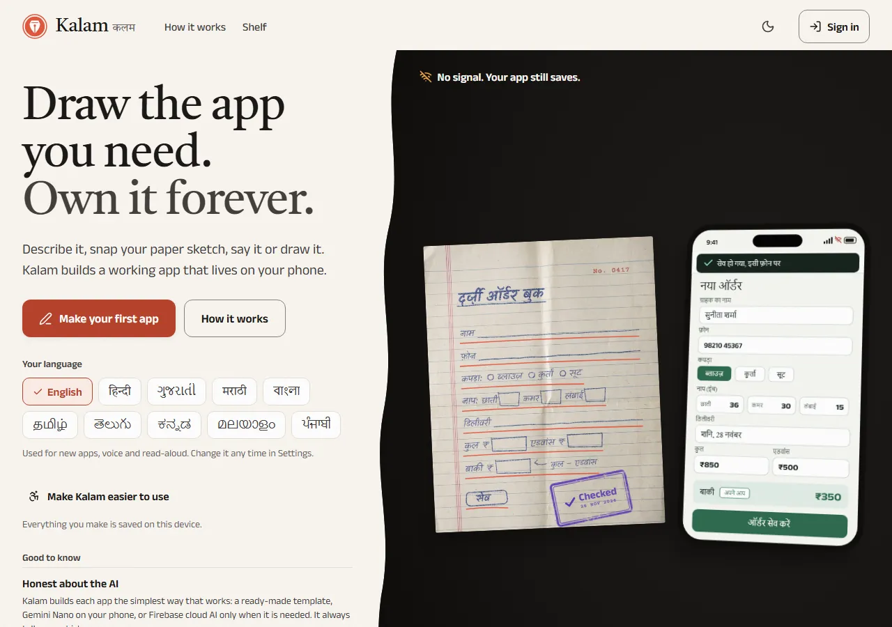
</picture>

</div>

> **Sign in once, then it is yours offline.** Kalam needs a Google or email sign-in to use. After the first sign-in, your apps open, run and save with no network. Building a new app may need the cloud. Using an app never does.

> **State of the build (2026-11-26).** Hybrid inference is recorded end to end on the web: Gemini Nano in Chrome, Gemini in the cloud through Firebase AI Logic, one fallback between them, App Check on every cloud call, and offline use. The Android and iOS apps build and pass smoke flows in CI. [Verification](#verification) lists every claim with its evidence and its gaps.

---

## What Kalam is

You describe the app you need. Kalam reads it, shows you in plain words what it understood, builds it, checks it, and puts it on your shelf. The result is not generated code. It is a **KalamSpec**: a small JSON description of screens, saved lists, buttons and formulas. One shared runtime renders and runs every KalamSpec, so a generated app can never run a script.

| Way in | What you give Kalam |
|---|---|
| **Type** | A few lines in your own words, up to 4,000 characters |
| **Photo or sketch** | A picture of a paper register or a drawing, up to 4 photos |
| **Voice** | A spoken description, turned into text you can correct |
| **Video** | A clip of up to 60 seconds, reduced to a few keyframes on the device |
| **Draw** | The built-in Drawing Studio: pen, shapes, text and component stamps such as button, list and total |

You can mix them in one request. Anything that will go to the cloud is marked before you build.

Kalam is for people who already keep their business in a paper register: a tailor's order book, a kirana credit ledger, a tuition fee list, an attendance sheet. It works in ten languages (English, Hindi, Gujarati, Marathi, Bengali, Tamil, Telugu, Kannada, Malayalam and Punjabi).

**Why hybrid.** Most requests do not need a big model. A counter, an expense tracker or a checklist is a template with a few parameters. Small jobs such as reading a voice command, classifying a note or filling in a template fit a small model that runs on the device. Whole-app generation from a vague request, reading a sketch and hard repairs need a large cloud model. Kalam sends each job to the cheapest place that can do it well, and it tells you where it ran.

## How Kalam works

[](docs/diagrams/04-creation-pipeline.svg)

*Click any diagram to open it at full size. Editable sources are the `.drawio` files next to each SVG in [`docs/diagrams`](docs/diagrams).*

1. **Normalize.** Every input becomes one `NormalizedInput`. Raw audio and raw video never enter the pipeline: speech becomes a transcript and video becomes keyframes first.
2. **Classify.** A rule-based classifier (no model) calls the request simple, medium or complex.
3. **Build.** A simple request that fits one of the 11 templates is built by code, with Gemini Nano filling any missing parameters on the device. Everything else goes to the cloud compiler.
4. **Validate.** Every result, from any route, goes through the same `validateSpec`: JSON size, a security scan, schema, limits, references and formulas. If it fails, there is **one** repair call. If it still fails, you get a plain message and your input is kept.
5. **Review, then save.** Kalam reads back what it understood: the screens, the fields, the sums. You fix anything it got wrong, then save to the shelf. The previous valid version of an app is always kept.

[](docs/diagrams/05-multimodal-inputs.svg)

## Hybrid AI

**Deterministic first. Device next. Cloud when justified.**

[](docs/diagrams/03-hybrid-ai-routing.svg)

| Tier | What runs there | Examples |
|---|---|---|
| **Template** (no model) | Ordinary code | Calculations, saving, sorting, formulas, navigation, theme, and every app built from a template |
| **On device** | Gemini Nano in Chrome and on Android, Apple Foundation Models on iOS, through the Firebase AI Logic hybrid SDK | Filling template parameters, voice commands, small edits, classify, summarize, translate, checking an AI step |
| **Cloud** | Gemini through Firebase AI Logic | Building a medium or complex app, reading a sketch, hard repair, checking the safety of a shared app |

**Rules the code enforces**

1. **Deterministic first.** Calculations, saving, navigation, formulas, theming and templates never call a model.
2. **Device first for small typed jobs.** Extract, classify, summarize, translate, voice commands and small edits prefer the device model.
3. **Measured, not assumed.** A job runs on the device only if that platform's benchmark for the job has not failed. The result of each benchmark is in [Verification](#verification). A simple request with no template tries the device only after its benchmark has passed.
4. **At most one cloud fallback.** If a small job fails on the device, the orchestrator makes one Firebase attempt, and only when cloud is allowed and the request was not marked device-only. There is no cascade of providers and no retry loop across providers.
5. **Consent clamps every decision.** Settings has **Hybrid** and **Offline only**, plus "Use cloud AI when needed" and "Allow specialist models". A request that must stay on the device is never widened to the cloud.
6. **Honest labels.** Every AI result is labelled **Template**, **On device** or **Cloud**. The label comes from the SDK's own `inferenceSource`, not from the mode that was requested. The **Activity** page shows counts by source, median latency, fallbacks and recent decisions, all stored locally.
7. **Validate everything.** Every model output is checked with Zod and semantic rules before it renders.

**Which task runs where** (`src/core/ai/routing.ts`)

[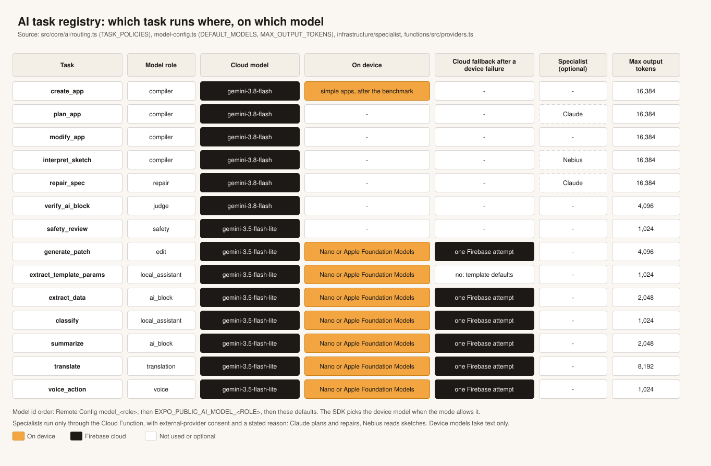](docs/diagrams/19-task-registry-and-models.svg)

**Models.** Model ids live in one file, `src/core/ai/model-config.ts`. `gemini-3.8-flash` handles compile, repair and AI-step judging. `gemini-3.5-flash-lite` handles the small roles. A role can be overridden with Remote Config or with `EXPO_PUBLIC_AI_MODEL_<ROLE>`. The cloud backend is Firebase AI Logic on the Agent Platform backend, location `global`. The Gemini Developer API backend also works.

### Where the on-device model runs

| Platform | On-device model | How it reaches Firebase AI Logic |
|---|---|---|
| Web | Gemini Nano in desktop Chrome, through the Prompt API (`LanguageModel`) | The SDK's hybrid mode drives it directly. `on-device.web.ts` checks availability, starts the download and warms the model |
| Android | Gemini Nano through the ML Kit Prompt API on AICore, on supported phones | The Expo module `modules/kalam-nano` (Kotlin), exposed to the SDK as a Prompt API shaped `LanguageModel` |
| iOS | Apple Foundation Models (`SystemLanguageModel`), iOS 26 or later with Apple Intelligence on | The Expo module `modules/kalam-apple` (Swift), through the same adapter |
| MCP server (Node) | None | Optional cloud compile only, off by default |

On Android and iOS the device model takes text only, about 4,000 input tokens, and runs only while Kalam is on screen. Image requests go to the cloud. Without the native module, or on an unsupported phone, on-device status reads unavailable with the reason, and requests go to the cloud when allowed.

### App Check

| Platform | Release builds | Development builds |
|---|---|---|
| Web | reCAPTCHA Enterprise (v3 optional) | SDK debug token, registered in the Firebase console |
| Android | Play Integrity, from `modules/kalam-nano` | Debug token |
| iOS | App Attest with DeviceCheck fallback, from `modules/kalam-apple` | Debug token |

The Cloud Functions enforce App Check, and the specialist function accepts each token once. In the project used to develop Kalam, App Check enforcement for AI Logic is off, so unregistered clients still work. Turn enforcement on in your own project after you register your apps.

### Specialist providers

Claude (planning and repair) and Nebius (sketch reading) exist as server-side adapters inside one Cloud Function, `kalamSpecialistReason`. They are off by default, need their own consent switch, never run from the client, and are not part of the judging build. Firebase AI Logic is the primary path, and no benchmark yet shows a measurable benefit from the specialists over Firebase alone.

### Where the Firebase AI Logic code lives

| What | File |
|---|---|
| `getAI`, `getGenerativeModel`, hybrid `mode` (`only_on_device`, `prefer_on_device`, `only_in_cloud`, `prefer_in_cloud`), result `inferenceSource` | `src/infrastructure/firebase/firebase-provider.ts` |
| One lazy Firebase init, App Check before the first request | `src/infrastructure/firebase/app.ts` |
| App Check per platform | `app-check.web.ts`, `app-check.native.ts`, `app-check.ios.ts` in the same folder |
| Chrome Prompt API availability, download, warm-up | `src/infrastructure/firebase/on-device.web.ts` |
| Native on-device adapters | `on-device.native.ts`, `on-device.ios.ts`, `prompt-api.native.ts` |
| Routing policy and consent rules | `src/core/ai/routing.ts` |
| The single orchestrator, retries, event log | `src/core/ai/orchestrator.ts` |
| Cloud compiler with one repair pass | `src/core/compiler/compile.ts` |
| Specialist callable | `functions/src/index.ts`, `functions/src/providers.ts` |
| Real-call check scripts | `scripts/verify-firebase-ai.mjs`, `scripts/verify-cloud-compile.mjs`, `functions/scripts/verify-providers.mjs` |
| Recorded real runs | `docs/evidence/`, written by `scripts/record-evidence.mjs` |

## Features

- **Five ways to start, and you can mix them.** Type, photo or sketch, voice, video and the Drawing Studio, all read as one request.
- **Templates.** 11 deterministic templates (calculator, counter, checklist, notes, expense tracker, habit tracker, inventory, contact book, measurement log, reminder list, simple form). A gallery at `/templates` adds 30 ready-made apps and five starter packs (Kirana and Retail, Tailoring, Tutors and Teachers, Clinics, Home). Each app can be looked at with made-up entries before you make it your own.
- **Cloud compiler** for medium and complex requests, with one repair pass, and **AI blocks** inside apps (extract from a photo, classify, summarize, translate). Each AI block is checked when the app is built, and an unchecked one stays marked unverified. At run time it uses the device when it can, and offline it shows a saved answer or refuses.
- **Drawing Studio.** Pen, marker, highlighter, shapes, text, component stamps, photos, eraser and select. Pressure and pinch zoom on the web, Skia on phones.
- **Formulas without `eval`.** A restricted formula language for totals, balances and filters.
- **Offline-first storage.** Dexie over IndexedDB on the web, `expo-sqlite` on Android and iOS. Saved apps open, render, take entries, calculate and navigate with no network.
- **Versions.** Every change is saved as a version you can restore. Apps can be cloned, reported on, and given reminders.
- **Voice commands and an assistant.** A heard command becomes an app action, and anything destructive asks first.
- **Kalam Bazaar.** Share an app, or add someone else's to your shelf. Listings are checked by code and by a cloud safety review, and moderators can act on reports. Free listings only: paid credits are off unless `EXPO_PUBLIC_BAZAAR_PAYMENTS=on`.
- **Collaboration.** Share an app with a team using an invite code, with admin, editor and viewer roles. Entries sync per field and a real clash is shown to you.
- **Backup and sync.** Encrypted backups (AES-256-GCM, key from your passphrase). Optional account sync that uploads app designs, and records only if you also set a passphrase, encrypted on the device first.
- **Offline queue.** Builds, translations and AI steps started offline wait in a visible queue, but only after you confirm what will be sent. Structural edits are never queued.
- **Access modes** that apply to Kalam and to every app it makes: Large, High contrast, Simple, Read aloud, Left-handed and Voice only.
- **Ten languages**, with script fonts for the eight Indic scripts and the Indian digit grouping.
- **Design.** A Charcoal and Saffron shell: charcoal `#1C1917`, warm paper `#FAF7F2`, saffron `#E2583E`, deep saffron `#B8432C` for anything that carries text, and marigold `#F2A541`. Light and dark themes. Web animation uses GSAP and three.js, phones use Reanimated and Skia.
- **An MCP server** that lets Claude Desktop, Claude Code or any MCP host build, check and package Kalam apps. See [MCP server](#mcp-server).

[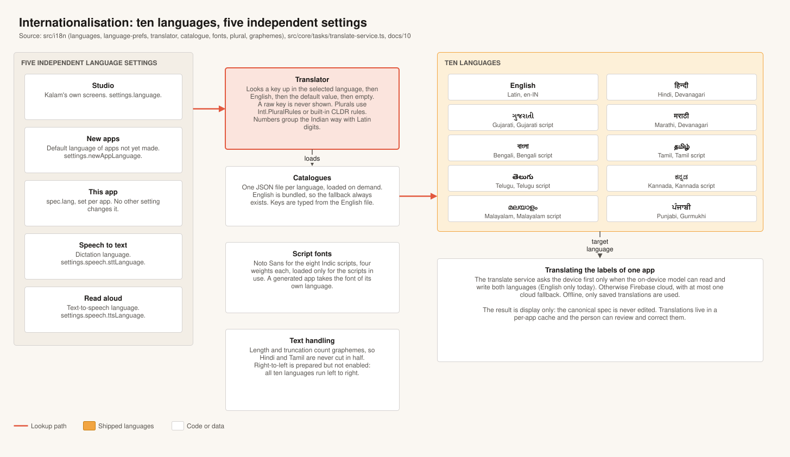](docs/diagrams/18-i18n-ten-languages.svg)

KalamSpec limits keep generated apps small: at most 8 screens, 10 collections, 15 AI blocks and 100 KB per spec. Features Kalam cannot do (logins, payments, servers) are mapped to the closest offline equivalent.

## Platforms

| Platform | What you get | Status |
|---|---|---|
| **Web (PWA)** | The live app at <https://kalam-hybrid.web.app>, installable, with an offline service worker. Gemini Nano in desktop Chrome | **Verified in Chrome**, including the in-app hybrid runs. See [Verification](#verification) |
| **Android** | An APK from the releases page. Gemini Nano through AICore on supported phones, Play Integrity App Check | **Builds and runs.** Uses Gemini Nano where the phone supports AICore, otherwise the cloud through Firebase AI Logic |
| **iOS** | A simulator build and an unsigned iPhone build on the releases page. Apple Foundation Models on iOS 26 with Apple Intelligence, App Attest | **Builds and runs in the simulator. Nothing has run on an iPhone.** The iPhone build must be signed by you (see [Download](#download)) |
| **MCP server** | `mcp/`, a Node process with 11 tools, built on the same pure code as the app | **Code complete.** 60 tests pass over in-memory, stdio and HTTP transports. No recorded session with a real MCP host yet |

## Download

| | |
|---|---|
| **Web app, no install** | <https://kalam-hybrid.web.app>. Sign in with Google or email. |
| **Android and iOS builds** | [**github.com/vishavmehra/kalam/releases/latest**](https://github.com/vishavmehra/kalam/releases/latest) |

| File on the release | For | Notes |
|---|---|---|
| `Kalam-android.apk` | Android phones and emulators | A test build, not from the Play Store, signed with a debug key. Open the file on the phone and allow installs from that source |
| `Kalam-ios-device-unsigned.ipa` | iPhones | **Unsigned, so it will not install as it is.** Sign it with AltStore or Sideloadly (a free Apple ID works) or with your own Apple Developer certificate, then install it. Apple allows nothing else without an Apple account, and this project does not hold one |
| `Kalam-ios-simulator.zip` | The iOS Simulator on a Mac | Unzip it and drag the app onto an open Simulator window |

Each release also has a `SHA256SUMS.txt` to check a download against. Pushing a version tag such as `v0.1.0`, or running the **Release** workflow by hand (`.github/workflows/release.yml`), builds the three files and attaches them to a GitHub Release. The Android and Simulator builds are the ones CI already builds. The unsigned iPhone build is the same app built for a device without code signing, and its first run on a hosted runner has not happened yet.

## Screenshots

<table>
  <tr>
    <td align="center" width="20%">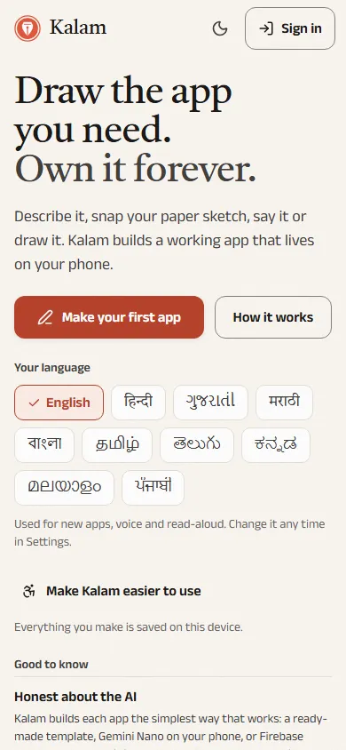</td>
    <td align="center" width="20%">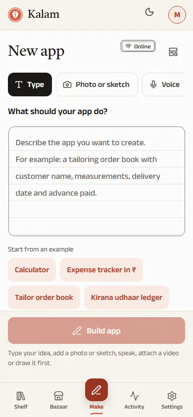</td>
    <td align="center" width="20%">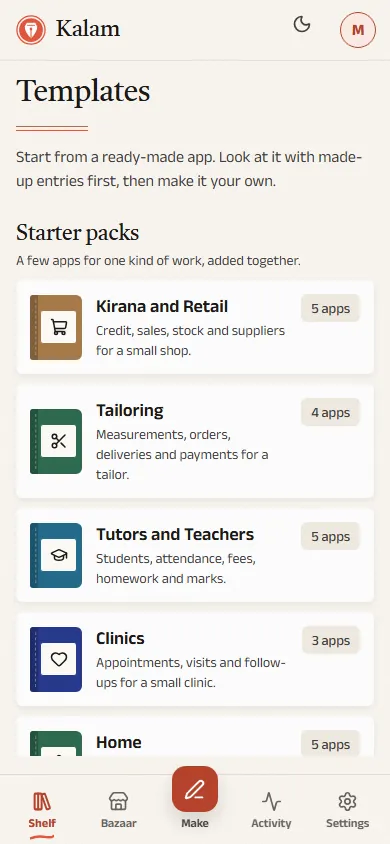</td>
    <td align="center" width="20%">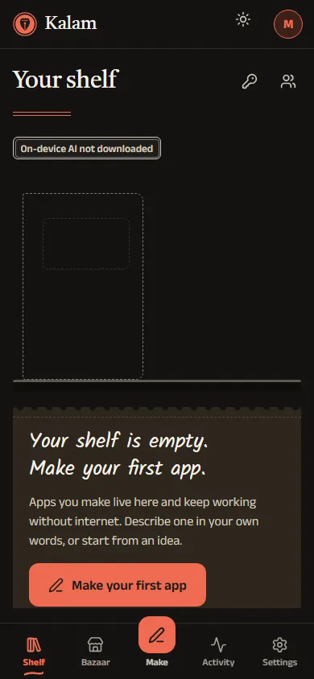</td>
    <td align="center" width="20%">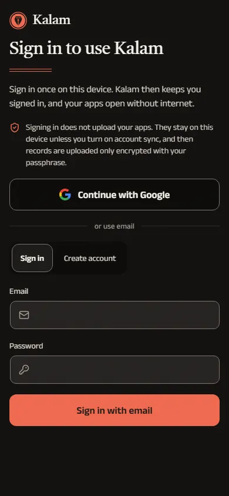</td>
  </tr>
  <tr>
    <td align="center"><sub>Landing</sub></td>
    <td align="center"><sub>Make an app</sub></td>
    <td align="center"><sub>Templates</sub></td>
    <td align="center"><sub>Shelf, dark</sub></td>
    <td align="center"><sub>Sign in, dark</sub></td>
  </tr>
</table>

<table>
  <tr>
    <td width="50%"></td>
    <td width="50%"></td>
  </tr>
  <tr>
    <td align="center"><sub>Make an app on the desktop web</sub></td>
    <td align="center"><sub>How it works, from the landing page</sub></td>
  </tr>
</table>

<p align="center">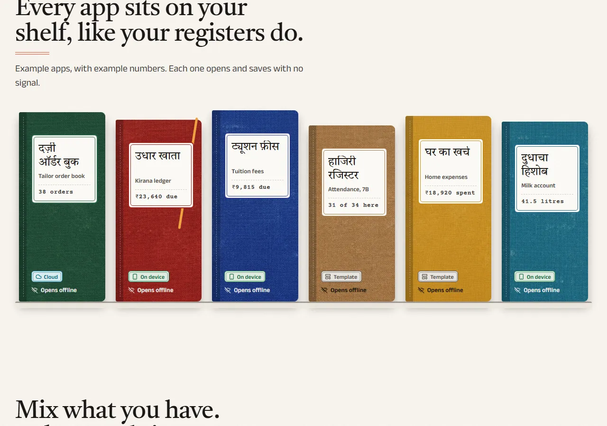</p>

## Architecture

Click a diagram to open it at full size.

[](docs/diagrams/01-system-context.svg)

**One codebase, four targets.** The Expo app serves Web, Android and iOS. The pure TypeScript in `src/core` has no React, Expo or Firebase imports, so the MCP server bundles the very same code the app uses. Only `src/services/index.ts`, the composition root, wires infrastructure to core.

[](docs/diagrams/02-platform-architecture.svg)

### Drawing Studio

[](docs/diagrams/14-drawing-studio-flow.svg)

Drawings are immutable pages (up to 8, each 400 by 800, up to 500 objects) that autosave to the local database. Component stamps give the compiler structure without a model, handwriting is read on the device first, and a drawing enters the same creation pipeline as every other input.

### KalamSpec: an app is data, never code

[](docs/diagrams/06-kalamspec-structure.svg)

A spec is one JSON document with screens, actions, collections, AI blocks, a theme and metadata. The action set is finite and interpreted by the engine. There is no script, no `eval`, no `new Function`, and no URL that runs.

[](docs/diagrams/07-compiler-validation-repair.svg)

### Runtime

[](docs/diagrams/08-runtime-engine.svg)

The runtime renders the spec through a component registry, dispatches actions through a reducer, and reaches the outside world only through a `RuntimeServices` port (local database, AI orchestrator, speech and camera). That is why a saved app works with no network.

[](docs/diagrams/20-ai-blocks-and-verification.svg)

### Offline storage, backup and sync

[](docs/diagrams/09-offline-storage-backup.svg)

[](docs/diagrams/10-account-sync-google-signin.svg)

### Kalam Bazaar and collaboration

[](docs/diagrams/12-bazaar-publish-moderation.svg)

[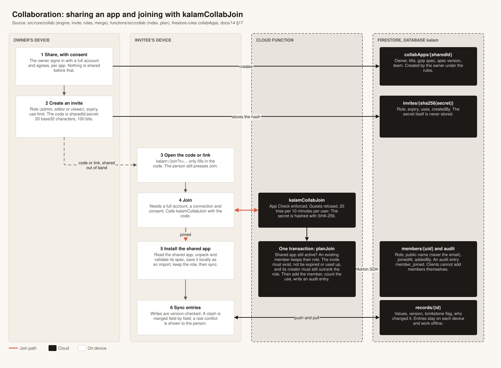](docs/diagrams/13-collab-join.svg)

[](docs/diagrams/17-data-model-firestore.svg)

### MCP tools and resources

[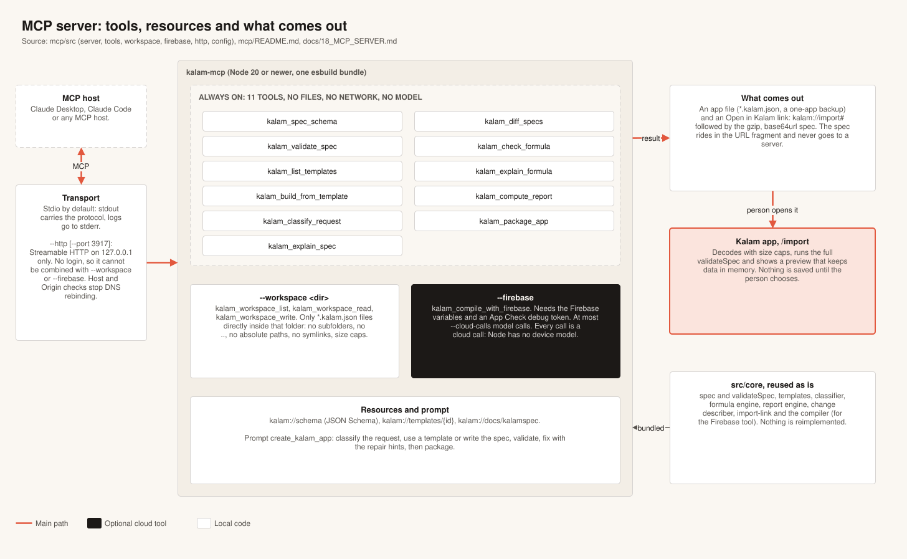](docs/diagrams/15-mcp-server-tools.svg)

### CI and release

[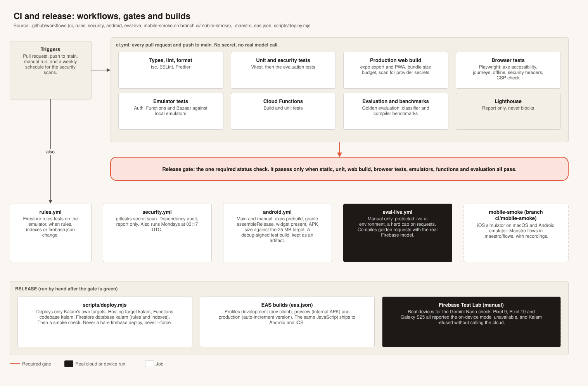](docs/diagrams/16-ci-release.svg)

### Repository layout

```text
src/
  app/                 Expo Router routes: shelf, onboarding, create (draw, review), app run and edit, activity, settings
  core/                Pure TypeScript. Runs in Node under Vitest. No React, Expo or Firebase imports
                       spec (KalamSpec schema, validation), ai (orchestrator, routing), classifier, templates,
                       compiler, pipeline, tasks (AI blocks, edit, voice), edit, versioning, formula, backup, bazaar,
                       queue, collab, account-sync, clone, import-link, reports
  runtime/             KalamRuntime and engine: renders and runs a KalamSpec
  infrastructure/
    firebase/          Firebase init, App Check, hybrid provider, on-device adapters
    specialist/        Client for the specialist callable
    storage/           Dexie (web) and expo-sqlite (Android, iOS) behind one driver
    platform/          Network, media, speech: .web and .native splits
    bazaar/, pwa/      Bazaar client, service worker registration
  features/            create, media, drawing (Studio), editing, history, shelf, templates, queue, collab, share,
                       reports, reminders, assistant, recovery, storage, account, auth, bazaar, cloud-consent,
                       settings, activity, landing
  design/, components/ Design tokens, UI kit, shell
  services/index.ts    Composition root: the only place providers meet core
functions/             Cloud Functions codebase "kalam": specialists (Claude, Nebius) and Bazaar callables
modules/
  kalam-nano/          Android native module (Kotlin): Gemini Nano, Play Integrity
  kalam-apple/         iOS native module (Swift): Apple Foundation Models, App Attest
  kalam-widget/        Android widget and iOS WidgetKit extension (written, never built or registered)
mcp/                   MCP server (Node) reusing src/core
scripts/               build-pwa, verify-firebase-ai, verify-cloud-compile, record-evidence, eval, bench, check-bundle-size
tests/                 fixtures, e2e (Playwright), evaluation (golden set, perf budgets), rules (Firestore), emulator
docs/diagrams/         The diagrams above, as SVG and editable .drawio
docs/evidence/         Recorded real runs (JSON, logs, screenshots)
```

Stack: Expo SDK 58, React Native 0.88, React 19.3, Expo Router, TypeScript (strict), Zod 4, Zustand 5, Firebase JS SDK 13 (`@firebase/ai` 3.1), Vitest 5, Playwright, Cloud Functions 2nd gen on Node 22. Platform splits use Metro extensions (`foo.web.ts`, `foo.native.ts`, `foo.ios.ts`) with a plain `foo.ts` shim so `tsc` resolves.

## Verification

Only real runs count as verified. Mocked unit tests check Kalam's own logic around the SDK and are never counted as proof that a model ran. Evidence files are in [`docs/evidence`](docs/evidence).

| Claim | State | Evidence |
|---|---|---|
| Firebase AI Logic is imported and used at runtime | **Verified** | `firebase` 13.4.0 and `@firebase/ai` 3.1.0. Real requests go through `getGenerativeModel` |
| Cloud inference through Firebase AI Logic | **Verified** | `gemini-3.8-flash` and `gemini-3.5-flash-lite` with `inferenceSource: in_cloud`: [`cloud-inference-2026-11-18.json`](docs/evidence/cloud-inference-2026-11-18.json) and the web runs below |
| Web hybrid matrix in Chrome 158 with real Gemini Nano | **Verified, scenarios A to H all pass** | [`web-matrix-2026-11-26.json`](docs/evidence/web-matrix-2026-11-26.json), run by `node scripts/verify-firebase-ai.mjs --web-matrix`. **A** Gemini Nano answers through the SDK. **B** with no local model, the cloud answers. **C** a model that is not ready makes a device-only request refuse, and the hybrid request goes to the cloud. **D** after a device failure there is exactly one cloud attempt. **E** every cloud request carries an App Check token. **F** offline, the device answers and the cloud request is refused with a plain message. **G** reconnecting restores the cloud. **H** an AI-step check runs 5 of 5 tests on Gemini Nano. Scenario C was run twice, once with a simulated "not ready" signal and once with the real `downloadable` state |
| The same paths inside the running Kalam app | **Verified on web** | [`web-hybrid-2026-11-26/`](docs/evidence/web-hybrid-2026-11-26) (`matrix-results.json` and screenshots, against a locally served build in Chrome). A template build made no cloud request. A medium and a complex request were compiled by `gemini-3.8-flash`, with one repair call on the complex one. Gemini Nano filled in template parameters, and a voice command ran on Gemini Nano with no cloud request. When the device was made to fail, one cloud fallback followed. Offline, a template app still built and a cloud-only task was refused with no request sent. Each run shows its source on the Activity page |
| Device-first benchmarks (Gemini Nano in Chrome, 2026-11-26) | **Measured for four tasks. Only voice commands pass today** | Run by `node scripts/local-ready.mjs --task <task> --cdp-port 9333`, and read by the router. Voice commands: 21 of 23 correct, p95 3.8 s, gate **ready**. Classify 83.3% against 85% needed, summarize 60% against 80%, translate 75% against 90%: all **failed**, so on the web those three go to the cloud. Files: `docs/evidence/local-ready-*-web-2026-11-26.json`, `provider-*-cloud-2026-11-26.json` |
| Cloud compiler quality | **Verified through the evaluation runner, not the screens** | A 75-case golden set, run live on 2026-11-25: of 42 cases routed to the cloud, 32 were valid on the first pass and 39 after the single repair pass. Valid is not the same as correct. Median about 13 s, 95th percentile about 114 s. [`live-eval-2026-11-25.json`](docs/evidence/live-eval-2026-11-25.json) |
| Deterministic templates | **Verified** | 20 of 20 template cases valid with no model ([`benchmark-categories-2026-11-26.json`](docs/evidence/benchmark-categories-2026-11-26.json)) |
| App Check | **Partly verified** | Debug token sent on every recorded cloud call. The reCAPTCHA Enterprise path in a browser, Play Integrity and App Attest are not recorded. Enforcement is off on the development project |
| Android | **Builds and runs** | CI built a 46 MB release APK and passed six Maestro flows on an emulator (run 45615319769, branch `ci/mobile-smoke`, before the redesign). |
| iOS | **Simulator only** | The same CI run built the iOS app on a macOS runner and passed six Maestro flows on the simulator (before the redesign). The `kalam-apple` Swift module compiled there. Apple Foundation Models and App Attest are not verified on a device |
| MCP server | **Tested through the MCP SDK client** | 60 tests in 6 files, over in-memory, stdio and HTTP transports |
| Specialists (Claude, Nebius) | **Verified locally** | Real calls through `functions/scripts/verify-providers.mjs` and the Functions emulator. Off by default and not part of the judging build |

### Known limits

- On the web the device model runs English text, and image input accepts JPEG and PNG only. Android handles English and Korean. On Android and iOS the device takes text only and image requests go to the cloud.
- Gemini Nano in Chrome needs capable desktop hardware and a multi-gigabyte download that Chrome starts only from a user gesture. The first session after each page load is slow.
- Capture on real devices (camera, microphone, video) is built but not verified on hardware. Speech recognition may be done by a platform service, and Kalam labels where it ran. A recorded audio file cannot be transcribed in the app yet: the web asks you to type the words.
- Kalam Bazaar, accounts and collaboration are built and covered by Firestore rules tests, but not verified end to end, and collaboration was never run with two real accounts.
- The web bundle is large (about 13 MB of JavaScript, about 8 MB on the first screen, measured 2026-11-26) and over the size budgets set on 2026-11-18. The CI Android release APK was 46 MB against a 25 MB target. Cold start, shelf open time and drawing latency have not been measured.
- An internal security review found no critical issues. It was not an external audit. `npm audit` reports 4 high and 3 moderate advisories in the app's dependencies (`firebase` through `@grpc/grpc-js`, and Expo's build tooling through `minimatch`) with no safe upgrade yet, and none in the Cloud Functions. No real Play Integrity or App Attest token has been exchanged.
- Native home-screen widgets (`modules/kalam-widget`) have never been built or registered.

## Set it up

### Prerequisites

| Need | For |
|---|---|
| Node.js 22 or newer (developed on Node 24) and npm | everything |
| Desktop Chrome with Gemini Nano | the on-device leg on the web (optional) |
| A Firebase project | sign-in (required), cloud AI and the Bazaar. Without one, Kalam cannot sign anyone in and stops at the sign-in screen |
| Firebase CLI (`npm i -g firebase-tools`, developed with 15.36) | Functions, Firestore, Hosting, emulators |
| JDK 17, Android SDK, an emulator or phone | Android |
| A Mac with Xcode 26 or later, or EAS Build with an Expo account. EAS alone, without a Mac, gives only device builds, which need a paid Apple Developer account and a device | iOS |
| Java 21 | Firestore emulator (rules tests only) |

### Clone and install

```bash
git clone https://github.com/vishavmehra/kalam.git
cd kalam
npm ci
npm --prefix functions ci     # the root type check also reads functions/src, so install its packages first
```

### Environment

```bash
cp .env.example .env.local        # PowerShell: Copy-Item .env.example .env.local
```

`.env.local` is gitignored. Only `EXPO_PUBLIC_*` values reach the client, and none is a secret. Restart the dev server after editing, because values are inlined at bundle time.

| Variable | Purpose |
|---|---|
| `EXPO_PUBLIC_FIREBASE_API_KEY`, `_AUTH_DOMAIN`, `_PROJECT_ID`, `_STORAGE_BUCKET`, `_MESSAGING_SENDER_ID`, `_APP_ID` | Firebase web app config. Protect the project with App Check and API key restrictions |
| `EXPO_PUBLIC_FIREBASE_ANDROID_APP_ID`, `EXPO_PUBLIC_FIREBASE_IOS_APP_ID` | App ids of the Android and iOS apps registered in Firebase. Needed for Play Integrity and App Attest |
| `EXPO_PUBLIC_GOOGLE_WEB_CLIENT_ID`, `EXPO_PUBLIC_GOOGLE_IOS_CLIENT_ID` | Public OAuth client ids for Google sign-in on Android and iOS. Email sign-in works without them |
| `EXPO_PUBLIC_AI_BACKEND` | `agent_platform` (needs the Blaze plan) or `google` (Gemini Developer API). Anything else means `google` |
| `EXPO_PUBLIC_AI_LOCATION` | Region for `agent_platform`. Kalam uses `global` |
| `EXPO_PUBLIC_APPCHECK_PROVIDER` | `enterprise` (default) or `v3` |
| `EXPO_PUBLIC_RECAPTCHA_SITE_KEY` | reCAPTCHA key. Without it, web App Check is skipped and reported as not configured |
| `EXPO_PUBLIC_APPCHECK_DEBUG_TOKEN` | Development only. Register it in App Check, Manage debug tokens |
| `EXPO_PUBLIC_AI_MODEL_<ROLE>` | Optional model override. Roles include `COMPILER`, `REPAIR` and `JUDGE`; the full list is in `src/core/ai/model-config.ts` |
| `EXPO_PUBLIC_SPECIALIST_ENABLED` | `true` turns the specialist adapter on. Default `false` |
| `EXPO_PUBLIC_FUNCTIONS_EMULATOR` | `host:port` of the Functions emulator, for example `127.0.0.1:5001` |
| `EXPO_PUBLIC_BAZAAR_PAYMENTS` | `on` shows paid Bazaar listings. Leave empty |
| `EXPO_PUBLIC_DIAGNOSTICS` | `true` shows the `/lab` and `/nano-check` screens in a production build. Leave `false` for a store build |

Server-side names (Cloud Functions only, never in the client): `KALAM_ANTHROPIC_API_KEY` and `KALAM_NEBIUS_API_KEY` (secrets), and the optional `KALAM_CLAUDE_PLAN_MODEL`, `KALAM_CLAUDE_REPAIR_MODEL` and `KALAM_NEBIUS_VISION_MODEL`.

### Firebase project

1. **Project.** Create or pick a Firebase project. Copy `.firebaserc.example` to `.firebaserc` and fill in your project id and Hosting site id. The Blaze plan is needed for the `agent_platform` backend and for deploying Functions.
2. **Web app.** Project settings, Your apps, add a **Web** app. Copy its config into the six `EXPO_PUBLIC_FIREBASE_*` values.
3. **Authentication.** Enable the **Google** and **Email/Password** providers. Signing in is required to use Kalam. The Anonymous provider is not needed.
4. **AI Logic.** Firebase console, AI Logic, Get started. Choose a backend and set `EXPO_PUBLIC_AI_BACKEND` to match. Both support hybrid on-device inference. Cloud calls cost money, so keep experiments small.
5. **App Check on the web.** In Google Cloud console, create a reCAPTCHA Enterprise **website** key that allows `localhost` and your deployed domain. In Firebase console, App Check, Apps, register your web app with the reCAPTCHA Enterprise provider and that key. Put the key in `EXPO_PUBLIC_RECAPTCHA_SITE_KEY`.
6. **App Check debug token for local development.** Leave `EXPO_PUBLIC_APPCHECK_DEBUG_TOKEN` empty on the first run. The dev build turns on the SDK's debug provider, which prints a token in the browser console. Register it under App Check, Manage debug tokens, then paste it into `.env.local`. Do not enforce App Check on a shared project while experimenting. Production builds never use the debug token.
7. **Check the cloud leg.** This makes one tiny real request and prints only outcome, model, latency and token counts:

   ```bash
   node scripts/verify-firebase-ai.mjs
   ```

### Gemini Nano in Chrome

Kalam does not call Gemini Nano directly. Firebase AI Logic's hybrid `GenerativeModel` decides between it and the cloud.

1. Use desktop Chrome. The recorded runs used Chrome 157 and 158 on Windows 11. Chrome documents the hardware requirements and the flags that expose the Prompt API at <https://developer.chrome.com/docs/ai/built-in>. Flag names change between versions.
2. Open Kalam, then DevTools, Console, and run:

   ```js
   typeof LanguageModel                 // 'undefined' means the API is not exposed here
   await LanguageModel.availability({
     expectedInputs:  [{ type: 'text', languages: ['en'] }],
     expectedOutputs: [{ type: 'text', languages: ['en'] }],
   })                                    // 'available' | 'downloadable' | 'downloading' | 'unavailable'
   ```

3. If it says `downloadable`, open **Settings, On-device AI, Prepare on-device AI**. The status row then reads "On-device AI ready".
4. Without the UI: start Chrome with a dedicated profile and `--remote-debugging-port=9333`, then run `node scripts/verify-firebase-ai.mjs --on-device`, or `--web-matrix` for the full scenario matrix. The script opens its own tab and closes it afterwards.

### Run on the web

```bash
npm run web                      # Expo dev server, http://localhost:8081
```

For a production build with the offline service worker (`sw.js` exists only in the build):

```bash
npm run build:web                # expo export, then scripts/build-pwa.mjs, output in dist/
node tests/e2e/serve.mjs         # serves dist/ with SPA fallback on http://127.0.0.1:4173
```

To host it: `firebase deploy --only hosting:kalam`. The Content Security Policy in `firebase.json` names a Firebase auth domain in `frame-src`. Replace it with yours first.

### Run on Android

Android builds natively. `expo run:android` creates the gitignored `android/` project. The first build compiles native modules and takes a long time. Versions used: JDK 17, Android SDK platform 37, build-tools 37.0.0, NDK 27.1.12297006, CMake 3.22.1. Start an emulator or connect a phone first.

```powershell
$env:JAVA_HOME    = "<path-to-jdk-17>"
$env:ANDROID_HOME = "$env:LOCALAPPDATA\Android\Sdk"
$env:Path        += ";$env:ANDROID_HOME\platform-tools;$env:ANDROID_HOME\emulator"
npm run android                  # on macOS or Linux, set the same variables with export
```

In Firebase, register an Android app with package `com.kalam.app`, add the SHA-256 fingerprint of your signing key, register Play Integrity under App Check, and set `EXPO_PUBLIC_FIREBASE_ANDROID_APP_ID`. The API key must not be restricted to HTTP referrers, because app requests carry none.

Emulators have no AICore, so on-device AI correctly reads unavailable and requests go to the cloud. Gemini Nano needs a supported phone with a locked bootloader and an up-to-date AICore. With EAS, `eas build --profile preview --platform android` makes an internal APK.

### Run on iOS

iOS needs a Mac with Xcode 26 or later. The iOS Simulator is part of Xcode. The `ios` block in `app.json` uses bundle id `com.kalam.app` and the App Attest entitlement, and `ios` must stay in `expo.platforms`. `kalam-apple` adds Firebase through Swift Package Manager.

```bash
npx expo prebuild --platform ios && npx expo run:ios        # on a Mac
npx expo install expo-dev-client                            # the EAS development and simulator profiles need it
eas build --profile simulator --platform ios                # EAS simulator build, to run on a Mac
```

In Firebase, register an iOS app with bundle id `com.kalam.app`, enter your Apple Team ID, register App Attest under App Check, and set `EXPO_PUBLIC_FIREBASE_IOS_APP_ID`. Apple Foundation Models need a device with Apple Intelligence on. Simulators and unsupported devices read unavailable, and requests go to the cloud. This path is not verified on a device.

### Cloud Functions (specialists and Bazaar)

The codebase is `kalam` in `functions/` (Node 22). It holds the `kalamSpecialistReason` callable and three Bazaar callables (`kalamBazaarWallet`, `kalamBazaarPurchase`, `kalamBazaarModerate`). All enforce App Check. Provider keys live only in Secret Manager when deployed, and in the gitignored `functions/.secret.local` on your machine.

```bash
cd functions && npm ci && npm run build && cd ..
# functions/.secret.local (never commit it):
#   KALAM_ANTHROPIC_API_KEY=<your key>
#   KALAM_NEBIUS_API_KEY=<your key>
npm run functions:serve          # emulator on port 5001
```

Point the client at the emulator with `EXPO_PUBLIC_SPECIALIST_ENABLED=true` and `EXPO_PUBLIC_FUNCTIONS_EMULATOR=127.0.0.1:5001` in `.env.local` (from an Android emulator use `10.0.2.2:5001`). Restart Expo and turn on **Settings, Allow specialist models**. Check both adapters with one tiny real request each: `cd functions && npm run verify:providers`. To deploy (Blaze plan):

```bash
firebase functions:secrets:set KALAM_ANTHROPIC_API_KEY
firebase functions:secrets:set KALAM_NEBIUS_API_KEY
firebase deploy --only functions:kalam
```

### Firestore rules and indexes

Firestore holds Kalam Bazaar listings, shared (collaborative) apps with their entries, and account sync data. The records of an app you have not shared never go there, and with account sync they leave the device only if you set a passphrase, and then only encrypted. Kalam uses a named database `kalam` and never touches `(default)`.

```bash
firebase firestore:databases:create kalam --location <region>
firebase deploy --only firestore:kalam
```

This deploys `firestore.rules` and `firestore.indexes.json` as listed in `firebase.json`. Test the rules on the local emulator (needs Java):

```bash
npx firebase-tools emulators:exec --only firestore --project demo-kalam "npx vitest run --config tests/rules/vitest.config.ts"
```

### MCP server

`mcp/` is a separate Node process that lets an AI assistant build, check and package Kalam apps. It reuses the pure code in `src/core`, so its validation matches the app. It uses no AI model by default, makes no network calls and reads no files unless you allow it.

```bash
cd mcp && npm ci && npm run build        # writes mcp/dist/server.js
node dist/server.js --help
```

**Known gap.** The build bundles a KalamSpec reference file, `docs/05_KALAMSPEC.md`, which is kept locally and is not published. In a fresh clone `npm run build` stops with a missing-file error. As a workaround, create any markdown file at that path first (for example `# KalamSpec`). The `kalam://schema` resource is unaffected, because it is built from the code. The fix is to make the build skip the file.

| Option | Effect |
|---|---|
| none | stdio transport. Core tools only. No files, no network |
| `--workspace <dir>` | Adds tools to list, read and write `*.kalam.json` files directly inside that one folder. No subfolders, no symbolic links, size caps |
| `--firebase`, `--cloud-calls <n>` | Adds `kalam_compile_with_firebase`. Needs the Firebase web config and an App Check debug token in the environment (the same `EXPO_PUBLIC_*` names as the app). Sends request text to Firebase AI Logic and nothing else. Model calls are capped at `n` (default 5, maximum 50) |
| `--http`, `--port <n>` | Streamable HTTP on `127.0.0.1` only (default port 3917) instead of stdio. There is no login, so it cannot be combined with `--workspace` or `--firebase` |
| `--app-url <url>` | Your hosted Kalam web app, for web "Open in Kalam" links |

The 11 core tools are read-only and deterministic: `kalam_spec_schema`, `kalam_validate_spec`, `kalam_list_templates`, `kalam_build_from_template`, `kalam_classify_request`, `kalam_explain_spec`, `kalam_diff_specs`, `kalam_check_formula`, `kalam_explain_formula`, `kalam_compute_report` and `kalam_package_app`. The server also offers the `kalam://schema` and `kalam://templates/{id}` resources and a `create_kalam_app` prompt.

Add it to Claude Code:

```bash
claude mcp add kalam -- node /absolute/path/to/kalam/mcp/dist/server.js --workspace /absolute/path/to/my-apps
```

Add it to Claude Desktop in `claude_desktop_config.json`, then restart Claude Desktop:

```json
{ "mcpServers": { "kalam": { "command": "node", "args": ["/absolute/path/to/kalam/mcp/dist/server.js", "--workspace", "/absolute/path/to/my-apps"] } } }
```

`kalam_package_app` writes an app file and an "Open in Kalam" link. The link is the way into the app today: open it in Kalam to see a preview and decide whether to save. The app does not yet have a button that imports a plain app file.

### Check the hybrid path by hand

Use the production build in desktop Chrome with Gemini Nano available and an App Check debug token registered.

1. Open **Settings, AI and privacy** to see the mode, on-device status, Firebase AI Logic configuration and App Check state.
2. Create an app from *"A counter to count how many glasses of water I drink"*. It gets a Template badge and makes no cloud call.
3. Create an app from a complex request, such as *"A tailor order book with customer name, chest, waist, delivery date and advance paid, and a way to classify notes as urgent or normal"*. It gets a Cloud badge and a plain-language summary.
4. In the app's editor, open AI blocks and run **Verify on this device**. Cloud writes sample cases and Gemini Nano runs them locally.
5. Go offline. Saved apps still open. Creating a complex app explains that building needs an online model and leaves saved apps untouched.
6. Open **Activity** for counts by source, median latency, fallbacks and recent decisions. The log is local and clearable.

## Testing

```bash
npm test                  # Vitest unit tests, fake providers
npm run typecheck         # tsc --noEmit
npm run lint              # ESLint (expo lint)
npm run build:web && npm run e2e     # Playwright against the production build
cd functions && npm test             # builds, then node --test
cd mcp && npm test                   # MCP server tests
npm run audit                        # npm audit for the app and the functions
```

The unit suite holds more than 7,500 tests in about 275 files across `src/core`, `src/infrastructure`, `src/features`, `src/runtime` and `src/i18n`. Unit tests use fake providers on purpose. Real-model behaviour is checked by the scripts below and by the walk-through above, never by mocks.

| Command | What it does | Cost |
|---|---|---|
| `npm run eval` | Runs the golden set (`tests/evaluation/golden`) through the classifier, templates, validation and describe. Writes a dated report | none |
| `npm run eval:check` | Same, and exits 1 when a quality floor is missed (used in CI) | none |
| `node scripts/eval.mjs --live --budget 6` | Also compiles cloud-route cases with real Firebase AI Logic. The budget is a hard cap on requests | billed |
| `npm run bench` | Timing and size benchmarks of the pure core | none |
| `npm run check:bundle` | Web bundle budgets, after `build:web` | none |
| `node scripts/verify-firebase-ai.mjs` | One real cloud request. `--on-device` for Chrome Gemini Nano, `--web-matrix` for the scenario matrix A to H | one billed call, or a few |
| `node scripts/verify-cloud-compile.mjs` | The real creation pipeline against the real cloud model, with a call cap | billed |

**Recording evidence.** `scripts/record-evidence.mjs` runs a verify script, removes anything secret-shaped (API key, App Check token, UUIDs, long tokens) and writes a dated JSON file to `docs/evidence/`. The only prompt sent is the fixed sample "Buy milk tomorrow."

```bash
node scripts/record-evidence.mjs cloud        # one billed cloud call. Do not run it in a loop
node scripts/record-evidence.mjs on-device    # Chrome must be running with --remote-debugging-port=9333
```

Continuous integration (`.github/workflows`) runs types, lint, unit and evaluation tests, the production web build with a bundle scan for provider secrets, Playwright, the Functions tests, Firestore rules tests, and dependency and secret scans. It calls no real model and needs no secret. The live evaluation is a separate manual workflow with a hard request cap.

## Privacy and security

[](docs/diagrams/11-app-check-security-boundaries.svg)

- **Data stays on the device.** Apps and their records are stored in IndexedDB (web) or SQLite (Android, iOS). Cloud Firestore holds Bazaar and collaboration data, and account sync data if you turn it on. The Activity log is local and clearable.
- **Sign-in.** Signing in with Google or email is required. Firebase Authentication keeps the session on the device, so after you sign in, saved apps open and run with no network. Account sync is off until you choose it, and records sync only if you also set a passphrase, which encrypts them on the device first.
- **What is sent to the cloud, and when.** Only for cloud-routed jobs, and only if cloud AI is allowed: your request text, photos you chose, video keyframes and a summary of a drawing. A one-time notice appears before the first cloud build. Raw audio and raw video are not sent to any AI provider. Video is reduced to keyframes and speech to a transcript first. Speech recognition itself may run on a platform service, and Kalam labels where it ran. Recordings are deleted right after transcription unless you turn on "Keep recordings".
- **You control it.** **Offline only** mode blocks every cloud call. "Use cloud AI when needed" and "Allow specialist models" are separate switches. Specialist models are off by default.
- **Encrypted backups.** AES-256-GCM, with a key derived by PBKDF2-HMAC-SHA256 (310,000 iterations minimum) from your passphrase. The passphrase and key are never stored.
- **No keys in the client.** Only `EXPO_PUBLIC_*` identifiers reach the bundle. Claude and Nebius keys exist only in Cloud Functions (Secret Manager, or `functions/.secret.local` locally). CI scans the production bundle for provider secrets.
- **App Check.** Web uses reCAPTCHA Enterprise, with a debug token in development only. Native builds use Play Integrity and App Attest. The Cloud Functions enforce it.
- **Specialist function.** Strict request validation and size limits, a per-task allowlist (`plan_app`, `repair_spec`, `interpret_sketch`), timeouts, server-side output validation, a rate limit, and a usage log that holds task, provider, model, latency and token counts but no user content.
- **KalamSpec is data.** No `eval`, no `new Function`, no executing model output. Every spec is validated before it renders. Invalid output is rejected or repaired once. The previous valid version is preserved. Injection fixtures live in `tests/fixtures/specs/invalid`.
- **Untrusted by default.** User text and images are wrapped as untrusted data in prompts. Model output, imported app files, Bazaar downloads and backups are all treated as untrusted and re-validated. Imported AI steps start unverified.
- **Hosting headers** (`firebase.json`): a Content Security Policy, `nosniff`, `X-Frame-Options: DENY`, a strict referrer policy, and camera and microphone limited to the page itself.
- **Firestore rules** are covered by emulator tests in `tests/rules`. Clients cannot set reviewed, featured, suspended, wallet or entitlement fields.

## Existing work and tooling

### Existing-work disclosure

On 2026-11-17 this repository held only product planning documents and an instruction file for the coding agent. It had no source code, no configuration and no build. Those planning documents are kept locally and are not published here.

All of the code in this repository was written during the hackathon period with AI assistance from Claude Code (Anthropic). That covers the app, the runtime, the AI pipeline, the Cloud Functions, the native modules, the MCP server, the tests, the scripts and the build setup. The planning documents were revised while building so that they match the decisions made along the way.

### Tooling and Firebase Agent Skills record

- **Coding agent:** Claude Code (Anthropic).
- **Firebase Agent Skills:** none confirmed. No official Firebase Agent Skill was confirmed as installed or used. The Firebase AI Logic integration followed the Firebase documentation and the installed SDK's own type definitions (`@firebase/ai` 3.1.0).
- **Other skills assigned to the build agents:** `frontend-design`, `emil-design-eng`, `gsap-react`, `gsap-performance`, `threejs-fundamentals`, `claude-api`, `security-review`, `impeccable`, `readme`, and `avoid-ai-writing` or `unslop` for plain-English copy. This list records which skills the agents were told to use. It is not a log of every call.
- **Other tools:** Vitest, Playwright, the Firebase emulators, `tsc`, ESLint, draw.io for the diagrams, and the scripts in `scripts/`.

## Licence

Kalam is released under the [MIT License](LICENSE). Copyright (c) 2026 Vishav Mehra.
