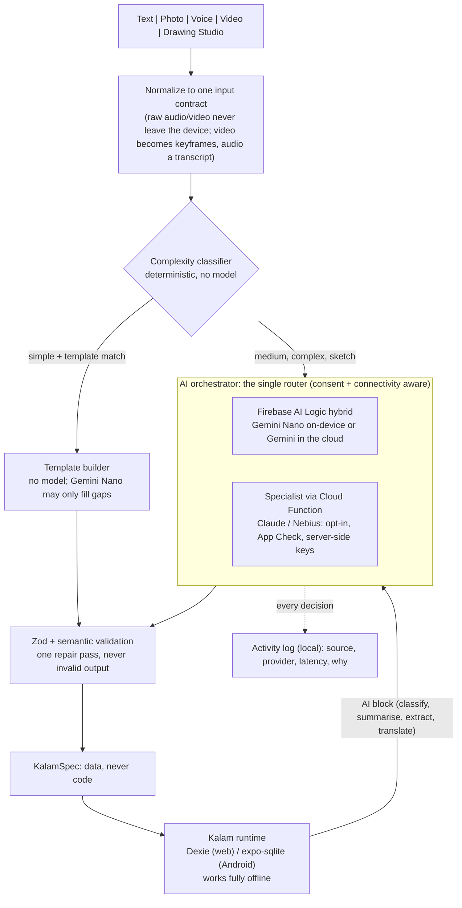

# Kalam

**Draw the app you need. Own it forever.**

Kalam is an app that creates other apps. Describe what you need (text, a photo of a sketch, your voice, a video, or the built-in Drawing Studio) and Kalam turns it into a validated, declarative **KalamSpec** (JSON data, never code). One shared runtime renders and runs it, with the data stored on your device.

> Building may need the cloud. **Using your app should not.**

Built for **#BuildHybridAI 2026** on **Firebase AI Logic hybrid inference**: Gemini Nano on the device when it can do the job, Gemini in the cloud when it cannot, ordinary deterministic code for everything that never needed a model. Targets: **Web (PWA), Android and iOS**, plus an MCP server. The judging build demonstrates hybrid inference on Web and Android. iOS is code and configuration only so far. See [Platforms](#platforms) for the status of each.

- [Status at a glance](#status-at-a-glance)
- [Platforms](#platforms)
- [How it works](#how-it-works)
- [Where the Firebase AI Logic code lives](#where-the-firebase-ai-logic-code-lives)
- [Tech stack](#tech-stack)
- [Quickstart](#quickstart)
- [Environment variables](#environment-variables)
- [Specialist providers (Claude, Nebius) and the Functions emulator](#specialist-providers-claude-nebius-and-the-functions-emulator)
- [Running tests](#running-tests)
- [Three-minute hybrid demo](#three-minute-hybrid-demo)
- [Project structure](#project-structure)
- [Security and privacy](#security-and-privacy)
- [Known limitations](#known-limitations)
- [Documentation map](#documentation-map)
- [License](#license)
- [Existing work and how Kalam was built](#existing-work-and-how-kalam-was-built)

---

## Status at a glance

Honest, evidence-based. Per-checkpoint detail lives in `docs/07_HYBRID_AI.md` section 22 and `docs/17_FIREBASE_HYBRID_AI_REQUIREMENTS_TRACEABILITY.md` section 15.1.

| Area | Status | Evidence |
|---|---|---|
| Gemini Nano (on-device) structured output | **Verified** | Chrome 157.0.8103.79, Prompt API with the session options Firebase's on-device adapter sends. Recorded 2026-11-18 in `docs/evidence/on-device-inference-2026-11-18.json`. Not yet recorded: the same call through `getGenerativeModel` inside the running app |
| Firebase AI Logic cloud inference | **Verified** | One real structured-output request through the SDK (`gemini-3.8-flash`, `inferenceSource: in_cloud`, App Check debug token exchanged, 3383 ms). Recorded 2026-11-18 in `docs/evidence/cloud-inference-2026-11-18.json`. A complex app compiled through the app UI is not yet verified |
| Six-scenario hybrid check in a real browser (docs/17 section 12.1) | **Pending** | Runs next session in the Kalam Chrome profile. See `docs/FIREBASE_HYBRID_AI_VERIFICATION.md` section 9 |
| Claude and Nebius specialists | **Verified locally, not deployed** | Real calls through `functions/scripts/verify-providers.mjs` and the Functions emulator with an App Check token |
| Template app: create, save, run (web) | **Verified** | Exercised in a real browser |
| Offline web app (PWA service worker) | **Verified** | Chromium: precache, offline reload, offline deep link |
| Unit tests | **3668 of 3675 passing** | `npm test`, 57 files, measured 2026-11-18 19:52 (see [Running tests](#running-tests)) |
| `tsc --noEmit` | **Not re-measured here** | Other work was still in progress when these numbers were taken |
| Android build, end-to-end, security review | **Not verified** | In progress |
| Gemini Nano on Android | **Blocked** | No native bridge or device yet (see [Known limitations](#known-limitations)) |

---

## Platforms

Kalam is one Expo codebase for Web, Android and iOS, plus an MCP server for AI assistants. The owner added iOS and the MCP server to the scope on 2026-11-18 (ADR-039 in `docs/16`). Web and Android stay the platforms the judging build demonstrates.

| Platform | Status | What is true today |
|---|---|---|
| Web (PWA) | **Partly verified** | Template create, save and run, and the offline PWA, were checked in a real browser. On-device Gemini Nano through Chrome's Prompt API is recorded in `docs/evidence/`. The full six-scenario check is pending |
| Android | **Built, not verified end to end** | Native Expo build. No on-device Gemini Nano and no Play Integrity App Check yet, so on-device-only requests fail with a clear message |
| iOS | **Code and configuration only. Not verified** | Same codebase as Android. No iOS build has been made and nothing has run on a simulator or a device. The `ios` block in `app.json` and an `eas.json` are still to be added. Checking it needs a Mac with Xcode, or EAS Build. On-device AI on iOS would use Apple Foundation Models through Firebase AI Logic and needs a Swift native module that does not exist. Until then iOS shows the on-device model as unavailable and labels cloud work as cloud |
| MCP server | **See `docs/18`** | A separate Node process that reuses the pure code in `src/core`, so assistants can validate, explain and edit KalamSpec files. It adds no AI provider and reads no user data unless the person passes a workspace folder. Its tools and status are in `docs/18` |

---

## How it works



**Rules the code enforces**

1. **Deterministic first.** Calculations, CRUD, navigation, formulas and theming never call a model.
2. **Local AI first where it can do the job.** Small, typed tasks (extract, classify, summarise, translate, voice command, small edits) prefer Gemini Nano.
3. **Cloud when justified.** Whole-app generation, sketch understanding and difficult repair go to Gemini through Firebase AI Logic.
4. **Specialists only with consent and a reason.** Claude and Nebius run in a Cloud Function, behind a separate "Allow specialist models" switch that is off by default.
5. **No silent fallbacks.** If a provider fails, the orchestrator does not quietly try another. A request that must stay on-device is never widened to the cloud.
6. **Honest source badges.** Every AI result is labelled **On-device**, **Cloud**, **Deterministic** or **Offline**, taken from the SDK's own `inferenceSource`, never assumed.

Routing policy per task (from `src/core/ai/routing.ts`):

| Task | Where it can run |
|---|---|
| `create_app`, `plan_app`, `modify_app`, `interpret_sketch`, `repair_spec` | Firebase cloud only; specialist when escalated with consent |
| `verify_ai_block`, `safety_review` | Firebase cloud only |
| `generate_patch`, `extract_template_params`, `extract_data`, `classify`, `summarize`, `translate`, `voice_action` | Gemini Nano first; cloud only if the user allows it |

Settings (**Hybrid** or **Offline only**, "Use cloud AI when needed", "Allow specialist models") clamp every decision.

---

## Where the Firebase AI Logic code lives

For judges and reviewers: the SDK is isolated to a few files so it is easy to audit.

| What | File |
|---|---|
| `getAI` + `getGenerativeModel` with hybrid `mode` (`only_on_device`, `prefer_on_device`, `only_in_cloud`, `prefer_in_cloud`), result `inferenceSource` | `src/infrastructure/firebase/firebase-provider.ts` |
| Chrome Prompt API availability, download and warm-up | `src/infrastructure/firebase/on-device.web.ts` (`on-device.native.ts` is an honest "unavailable" stub) |
| One Firebase init, lazy, App Check before the first request | `src/infrastructure/firebase/app.ts` |
| App Check (reCAPTCHA Enterprise or v3, debug token in dev) | `src/infrastructure/firebase/app-check.web.ts` |
| Routing policy and consent rules | `src/core/ai/routing.ts` |
| The single orchestrator, retries, event log | `src/core/ai/orchestrator.ts` |
| Model ids per logical role (the only place they live) | `src/core/ai/model-config.ts` |
| Cloud compiler with one repair pass | `src/core/compiler/compile.ts` |
| Composition root | `src/services/index.ts` |
| Specialist callable (Claude, Nebius) | `functions/src/index.ts`, `functions/src/providers.ts` |
| Real-call check scripts | `scripts/verify-firebase-ai.mjs`, `functions/scripts/verify-providers.mjs` |
| Recorded real runs, how to repeat them, and the scenario matrix | `docs/FIREBASE_HYBRID_AI_VERIFICATION.md`, `docs/evidence/`, `scripts/record-evidence.mjs` |

---

## Tech stack

| Layer | Technology |
|---|---|
| App | Expo SDK 58, React Native 0.88, React 19.3, Expo Router, TypeScript (strict). One codebase for Web, Android and iOS (iOS not yet built) |
| Web motion | GSAP and three.js (`*.web.tsx` files) |
| Android motion and drawing | Reanimated 4 and Skia (`*.native.tsx` files) |
| Local storage | Dexie over IndexedDB (web), expo-sqlite (Android and iOS) |
| Validation and state | Zod 4, Zustand 5 |
| Formulas | jsep, evaluated by a restricted interpreter (no `eval`) |
| AI | Firebase JS SDK 13.4, `firebase/ai` hybrid inference (`InferenceMode`), Gemini Nano via Chrome's Prompt API |
| Abuse protection | Firebase App Check, reCAPTCHA Enterprise |
| Server | Cloud Functions 2nd gen, Node 22, codebase `kalam`, function `kalamSpecialistReason` |
| Tests | Vitest 5 (unit), Playwright (end-to-end against the production web build) |
| Offline web | Generated service worker (`scripts/build-pwa.mjs`) over the Expo web export |

Platform splits use Metro extensions (`foo.web.ts`, `foo.native.ts`, plus a plain `foo.ts` shim so `tsc` resolves). iOS uses the same codebase and is not built yet (ADR-039 in `docs/16`).

---

## Quickstart

### 1. Prerequisites

| Need | For |
|---|---|
| Node.js 22 or newer (developed on Node 24) and npm | everything |
| Desktop Chrome with Gemini Nano | the on-device leg on web (optional; without it Kalam uses templates and the cloud) |
| A Firebase project | cloud AI (optional for the template-only experience) |
| Firebase CLI (`npm i -g firebase-tools`, developed with 15.36) | Functions emulator and Hosting |
| JDK 17, Android SDK, an emulator or device | Android only |
| A Mac with Xcode, or EAS Build (needs an Expo account) | iOS only. Not yet verified |

### 2. Install

```bash
git clone <your-fork-or-this-repo-url> kalam
cd kalam
npm ci
```

### 3. Configure environment

```bash
cp .env.example .env.local        # PowerShell: Copy-Item .env.example .env.local
```

`.env.local` is gitignored. Only `EXPO_PUBLIC_*` values reach the client bundle and none of them is a secret. Fill them in using step 4. See [Environment variables](#environment-variables). Restart the dev server after editing (values are inlined at bundle time).

Kalam runs without Firebase configured: you get templates, the runtime, storage and the Drawing Studio, and AI features report "not configured" instead of faking results.

### 4. Firebase setup (one time)

1. **Project.** Create or pick a Firebase project. Blaze (pay as you go) is needed only for the `agent_platform` backend and for deploying Functions. Put your project id in `.firebaserc` (`default`).
2. **Web app.** Project settings, Your apps, add a **Web** app. Copy its config into the six `EXPO_PUBLIC_FIREBASE_*` values in `.env.local`.
3. **AI Logic backend.** Firebase console, AI Logic, Get started. Choose one and set `EXPO_PUBLIC_AI_BACKEND` to match:
   - `google`: Gemini Developer API (`GoogleAIBackend`). Works on the free Spark plan.
   - `agent_platform`: Agent Platform / Vertex Gemini API (`AgentPlatformBackend`), billed through Cloud Billing, so Blaze. Also set `EXPO_PUBLIC_AI_LOCATION` (we use `global`). Cloud calls cost money; keep experiments small.
   Both backends support hybrid on-device inference.
4. **App Check, reCAPTCHA Enterprise.** In Google Cloud console create a reCAPTCHA Enterprise **website** key that allows `localhost` (and your deployed domain). In Firebase console, App Check, Apps, your web app, register it with the **reCAPTCHA Enterprise** provider and that key. Put the site key in `EXPO_PUBLIC_RECAPTCHA_SITE_KEY` and keep `EXPO_PUBLIC_APPCHECK_PROVIDER=enterprise` (`v3` selects reCAPTCHA v3).
5. **App Check, debug token (local development).** Leave `EXPO_PUBLIC_APPCHECK_DEBUG_TOKEN` empty on first run. The dev build enables the SDK's debug provider, which prints a token in the browser console. Register it in App Check, Manage debug tokens, then paste it into `.env.local`. Do not enforce App Check on a shared project while experimenting. Production builds never use the debug token.
6. **Check the cloud leg** (makes one tiny real request, prints only outcome, model, latency and tokens):

   ```bash
   node scripts/verify-firebase-ai.mjs
   ```

To keep a dated, redacted record of a run (API key, App Check token and UUIDs are removed), use `node scripts/record-evidence.mjs cloud` (one billed call) or `node scripts/record-evidence.mjs on-device`. Files go to `docs/evidence/`.

### 5. Gemini Nano in Chrome (on-device leg)

Gemini Nano is Chrome's built-in model, reached through the Prompt API (`LanguageModel`). Kalam does not call it directly: Firebase AI Logic's hybrid `GenerativeModel` decides between it and the cloud.

1. Use desktop Chrome (developed and verified on Chrome 157, Windows 11). Chrome documents the OS, storage and GPU/RAM requirements and the flags that expose the API: <https://developer.chrome.com/docs/ai/built-in>. Flag names change between versions.
2. Open Kalam, open DevTools, Console, and run:

   ```js
   typeof LanguageModel                 // 'undefined' => the API is not exposed in this browser
   await LanguageModel.availability({
     expectedInputs:  [{ type: 'text', languages: ['en'] }],
     expectedOutputs: [{ type: 'text', languages: ['en'] }],
   })                                    // 'available' | 'downloadable' | 'downloading' | 'unavailable'
   ```

   These are the same options Kalam passes, so the answers match.
3. If it says `downloadable`, open **Settings, On-device AI, Prepare on-device AI**. Chrome only starts the one-time, multi-gigabyte download from a user gesture. The status row then reads "On-device AI ready".
4. The first on-device session after each page load takes roughly 40 s (model load); later ones are fast. Kalam warms the model early for this reason.
5. Verify end to end without the UI. Start Chrome with a dedicated profile and remote debugging, then run the script. It opens its own tab and closes it afterwards:

   ```bash
   chrome --remote-debugging-port=9333 --user-data-dir=<a-dedicated-profile-dir>
   node scripts/verify-firebase-ai.mjs --on-device            # add --cdp-port <n> if not 9333
   ```

Playwright's bundled Chromium has no Gemini Nano; on-device behaviour can only be checked in real Chrome.

### 6. Run on web

```bash
npm run web                      # Expo dev server (default http://localhost:8081)
```

Production build with the offline service worker (needed to test real offline reloads, because `sw.js` only exists in the build):

```bash
npm run build:web                # expo export + scripts/build-pwa.mjs, output in dist/
node tests/e2e/serve.mjs         # serves dist/ with SPA fallback on http://127.0.0.1:4173
```

Chrome treats `localhost` and `127.0.0.1` as secure contexts, which the Prompt API and service workers need.

### 7. Run on Android

Android is built natively (`expo run:android` creates the gitignored `android/` project and builds with Gradle). The first build compiles native modules (Skia and others) and takes a long time.

Requirements used by this project: **JDK 17**, Android SDK **platform 37.0**, **build-tools 37.0.0**, **NDK 27.1.12297006**, **CMake 3.22.1** (install through Android Studio's SDK Manager). A virtual device or phone must be running first.

PowerShell:

```powershell
$env:JAVA_HOME    = "<path-to-jdk-17>"
$env:ANDROID_HOME = "$env:LOCALAPPDATA\Android\Sdk"
$env:Path        += ";$env:ANDROID_HOME\platform-tools;$env:ANDROID_HOME\emulator"
emulator -list-avds              # we use an API 36 AVD named Kalam_API36
emulator -avd Kalam_API36        # hardware acceleration (WHPX on Windows); first boot can take minutes
npm run android
```

macOS / Linux: same variables with `export`. Android caveats: no on-device Gemini Nano and no Play Integrity App Check yet, so cloud AI works only while App Check is not enforced. See [Known limitations](#known-limitations). The Android target is **not yet verified** end to end.

---

## Environment variables

### Client (`.env.local`, all `EXPO_PUBLIC_*`, none secret)

| Variable | Purpose |
|---|---|
| `EXPO_PUBLIC_FIREBASE_API_KEY`, `_AUTH_DOMAIN`, `_PROJECT_ID`, `_STORAGE_BUCKET`, `_MESSAGING_SENDER_ID`, `_APP_ID` | Firebase web app config. Protect the project with App Check and API key restrictions |
| `EXPO_PUBLIC_AI_BACKEND` | `google` (Gemini Developer API) or `agent_platform` (Vertex; needs Blaze). Anything else means `google` |
| `EXPO_PUBLIC_AI_LOCATION` | Region for `agent_platform` (we use `global`) |
| `EXPO_PUBLIC_APPCHECK_PROVIDER` | `enterprise` (default) or `v3` |
| `EXPO_PUBLIC_RECAPTCHA_SITE_KEY` | reCAPTCHA site key. Without it App Check is skipped and reported as not configured |
| `EXPO_PUBLIC_APPCHECK_DEBUG_TOKEN` | Dev only. Register it in App Check, Manage debug tokens |
| `EXPO_PUBLIC_AI_MODEL_<ROLE>` | Optional model override. Roles: `COMPILER`, `REPAIR`, `JUDGE`, `SAFETY`, `LOCAL_ASSISTANT`, `EDIT`, `VOICE`, `AI_BLOCK`, `TRANSLATION`. Defaults in `src/core/ai/model-config.ts` |
| `EXPO_PUBLIC_SPECIALIST_ENABLED` | `true` turns the specialist adapter on (default `false`) |
| `EXPO_PUBLIC_FUNCTIONS_EMULATOR` | `host:port` of the Functions emulator, e.g. `127.0.0.1:5001` |

### Server (Cloud Functions only, never in the client)

| Name | Purpose |
|---|---|
| `KALAM_ANTHROPIC_API_KEY`, `KALAM_NEBIUS_API_KEY` | Secrets. Emulator: `functions/.secret.local`. Deployed: `firebase functions:secrets:set` (Blaze) |
| `KALAM_CLAUDE_PLAN_MODEL`, `KALAM_CLAUDE_REPAIR_MODEL`, `KALAM_NEBIUS_VISION_MODEL` | Optional model overrides; defaults in `functions/src/providers.ts` |

---

## Specialist providers (Claude, Nebius) and the Functions emulator

Claude (planning and repair) and Nebius (sketch reading) are optional and **never called from the client**. The client calls one App Check-protected callable, `kalamSpecialistReason`, which holds the keys, validates the request, calls the provider, validates the reply and logs only task, provider, model, latency and token counts (never user content).

1. Create `functions/.secret.local` (gitignored, **never commit it, never paste its contents anywhere**):

   ```bash
   KALAM_ANTHROPIC_API_KEY=<your key>
   KALAM_NEBIUS_API_KEY=<your key>
   ```

2. Install, build and run the emulator:

   ```bash
   cd functions && npm ci && cd ..
   npm run functions:serve          # firebase emulators:start --only functions (port 5001)
   ```

3. Point the client at it in `.env.local`, then restart Expo:

   ```bash
   EXPO_PUBLIC_SPECIALIST_ENABLED=true
   EXPO_PUBLIC_FUNCTIONS_EMULATOR=127.0.0.1:5001
   ```

   From an Android emulator the host's localhost is `10.0.2.2`. In the app, also turn on **Settings, Allow specialist models**.

4. Optional real-call check of both adapters (one tiny request each; prints status, latency, model, tokens, never secrets):

   ```bash
   cd functions && npm run build && npm run verify:providers
   ```

`kalamSpecialistReason` is **not deployed** from this repository's workflow, and Hosting/Functions deploys are left to the project owner. Be aware `.firebaserc` and `firebase.json` hold the project binding, the Hosting target (`kalam`) and the Functions codebase (`kalam`).

---

## Running tests

```bash
npm test                  # Vitest: 57 files, 3675 tests
npm run typecheck         # tsc --noEmit
cd functions && npm test  # builds, then node --test (request and output schemas)
npm run build:web && npm run e2e   # Playwright against the production build
```

Vitest, run once on 2026-11-18 19:52 with two workers: **3668 passed, 7 failed** in 57 files. The failing tests belong to work that was still being changed when the run was taken (the Bazaar install checks and the Android on-device shim). They are listed below so the number is not hidden.

| Area | Tests |
|---|---|
| `src/core/ai` | 2731 |
| `src/infrastructure` | 247 (2 failing) |
| `src/features` | 152 |
| `src/runtime` | 113 |
| `src/core/tasks` | 78 |
| `src/core/templates` | 77 |
| `src/core/edit` | 48 |
| `src/core/spec` | 44 |
| `src/core/formula` | 43 |
| `src/core/i18n-labels` | 36 |
| `src/core/bazaar` | 27 (5 failing) |
| `src/core/compiler` | 26 |
| `src/core/assistant` | 22 |
| `src/core/pipeline` | 16 |
| `src/core/classifier` | 9 |
| `src/core/versioning` | 6 |

- Failing: `src/core/bazaar/bazaar.test.ts: preparePublication / listing schema builds a listing that passes the listing schema with derived disclosures`
- Failing: `src/core/bazaar/bazaar.test.ts: install validation (docs/05 §17) installs a verified copy with a new id, version 1, attribution and no records`
- Failing: `src/core/bazaar/bazaar.test.ts: install validation (docs/05 §17) refuses a spec whose hash does not match the listing`
- Failing: `src/core/bazaar/bazaar.test.ts: install validation (docs/05 §17) respects the license: remix only when allowed, and marks remixes`
- Failing: `src/core/bazaar/bazaar.test.ts: install validation (docs/05 §17) never trusts claimed AI verification or generator provenance (R-09)`
- Failing: `src/infrastructure/firebase/on-device.test.ts: on-device (Android shim) reports Gemini Nano as unavailable because there is no native bridge yet`
- Failing: `src/infrastructure/firebase/on-device.test.ts: on-device (Android shim) never exposes a LanguageModel, even if a global one exists, so only_on_device cannot silently use it`

Classifier benchmark (`tests/fixtures/requests/classifier-cases.json`): **56 of 57** complexity levels correct (98.2%), 33 of 33 secondary labels. The single miss is `calc-with-history` (expected medium, got complex).

Notes:

- One test (`classifier ... is cheap: well under 2 ms per request`) is a timing assertion. It failed once in a full parallel run (about 2.5 ms under heavy load) and passes when run alone or on a quiet machine.
- Unit tests use fake providers on purpose. Real-model behaviour is checked by the scripts above and by the demo, never by mocks.
- Playwright uses its bundled Chromium (no Gemini Nano), so `npm run e2e` covers the deterministic and offline paths only. The specs (`tests/e2e`) are newly added; their pass/fail status is not recorded in this README.
- No ESLint configuration is committed yet.

---

## Three-minute hybrid demo

Goal: show deterministic, on-device and cloud paths, the offline guarantee, and honest source labels.

**Before recording**

- `.env.local` filled in, App Check debug token registered, Gemini Nano `available` (Settings shows "On-device AI ready").
- Use the production build (`npm run build:web`, `node tests/e2e/serve.mjs`) in desktop Chrome so a reload also works offline.
- Have a complex prompt ready, for example: *"A tailor order book with customer name, phone, chest, waist and length, delivery date and advance paid. Let me classify each note as urgent or normal."* (The cloud model decides the structure; check the saved app under Edit, AI blocks. If it did not add an AI block, ask for one with **Ask for a change** before recording.)

**Script**

| Time | Step | What the viewer should see |
|---|---|---|
| 0:00 | Open **Settings**, AI and privacy | Hybrid mode, on-device AI ready, Firebase AI Logic configured, App Check state |
| 0:20 | **Create**: type *"A counter to count how many glasses of water I drink"*, create | Progress, then review with a **Deterministic** / template badge. No cloud call. Save to Shelf, open it, tap the counter |
| 0:50 | **Create**: paste the complex prompt | Progress through classify and cloud compile. Review shows a **Cloud** badge and a plain-language summary of screens and data. Save, open, add a record or two |
| 1:35 | **Edit** the app, AI blocks, **Verify on this device** (online) | Cloud writes five sample cases, Gemini Nano runs them locally. At least four passing marks the block "Runs on this device" |
| 2:00 | **Go offline** (airplane mode, or DevTools Network, Offline) | Shelf shows **Offline: apps still work**. Reload the page: the app still opens |
| 2:10 | In the app, add a record, then trigger its AI action (classify / summarise) | Works with no network. The badge reads **On-device** |
| 2:30 | Try **Create** with a complex request while offline | A plain-language message that building needs an online model; saved apps and data untouched |
| 2:40 | Back online, open **Activity** | Counts by source (On-device, Cloud, Deterministic), median latency, fallbacks, escalations and recent decisions. Recorded locally |

---

## Project structure

```text
src/
  app/                 Expo Router routes: shelf, onboarding, create (+ draw, review),
                       app/[id] (run, edit), activity, settings
  core/                Pure TypeScript, runs in Node under Vitest. No react / expo imports
    spec/              KalamSpec v1 Zod schema, validation, migration, plain-language describe
    contracts/         Every cross-module interface (frozen)
    ai/                Orchestrator, routing policy, model config, Zod -> JSON Schema
    classifier/        Deterministic complexity + template matching
    templates/         11 templates: calculator, counter, checklist, notes, expense tracker, ...
    compiler/          Cloud compiler: prompt, IR, conversion, one repair pass
    pipeline/          createApplication: classify -> template or cloud -> validate
    tasks/             AI-block, edit and voice services (Nano-first)
    edit/              Patch operations on specs; versioning/ keeps every valid version
    formula/           Restricted expression parser and evaluator
  runtime/             KalamRuntime and engine: renders and runs a KalamSpec, in-memory or stored
  infrastructure/
    firebase/          Firebase init, App Check, hybrid provider, on-device status
    specialist/        Client for the kalamSpecialistReason callable
    storage/           Dexie (web) / expo-sqlite (Android) behind one driver
    platform/          Network, media, speech: .web / .native splits
    pwa/               Service worker registration
  features/            create, drawing (Studio), editing, activity, settings, shelf, landing, input
  design/              Design tokens, theme and UI kit
  components/, state/  Shell, shared UI helpers, Zustand stores
  services/index.ts    Composition root: the only place providers meet core
functions/             Cloud Functions codebase "kalam": specialist adapters (Claude, Nebius)
scripts/               build-pwa.mjs, verify-firebase-ai.mjs, record-evidence.mjs, verify-cloud-compile.mjs, eval.mjs
tests/                 fixtures/ (specs, classifier cases, compiler IR) and e2e/ (Playwright)
docs/                  Product, architecture and AI documents (00 to 17), verification report, evidence/
```

---

## Security and privacy

- **Secrets.** Only `EXPO_PUBLIC_*` identifiers reach the client. Claude and Nebius keys live only in Cloud Functions (Secret Manager when deployed, `functions/.secret.local` locally, gitignored). Never commit secrets.
- **App Check.** Web uses reCAPTCHA Enterprise (v3 optional), with a debug token in development only. `kalamSpecialistReason` sets `enforceAppCheck: true`.
- **Specialist function.** Strict request validation and size limits, a per-task allowlist (`plan_app`, `repair_spec`, `interpret_sketch`), timeouts, server-side output validation, a per-instance rate limit, and a usage log without user content.
- **Consent.** Cloud AI can be switched off (**Offline only**); external specialists are off by default and need their own switch.
- **KalamSpec is data.** No `eval`, no `new Function`, no executing model output. Every spec is validated (Zod plus semantic checks) before it renders; invalid output is rejected or repaired once; the previous valid version is preserved. Injection fixtures live in `tests/fixtures/specs/invalid`.
- **Prompt injection.** User content and images are wrapped as untrusted data in prompts; model output is never trusted.
- **What leaves the device.** Only for cloud-routed tasks: your text, chosen photos, video keyframes and a drawing summary. Raw audio and raw video are not sent. Apps and their records stay in IndexedDB or SQLite. The Activity log is local and clearable.
- **Hosting headers** (`firebase.json`): `nosniff`, strict referrer policy, `X-Frame-Options: DENY`, camera and microphone limited to self.
- A dedicated security review has **not** been completed yet.

---

## Known limitations

- **Android on-device AI is not available.** Firebase's JS hybrid path drives Chrome's Prompt API only. Gemini Nano on Android needs a native bridge that does not exist yet, so on-device-only requests fail with a clear message instead of silently using the cloud.
- **Android App Check is not implemented.** The JS SDK offers only reCAPTCHA providers (browser DOM). Play Integrity needs a native bridge. With App Check enforced, Android cloud calls, and the specialist function, would be rejected.
- **Android build, end-to-end and security review are unverified** at the time of writing.
- **A complex app compiled by the real cloud model through the app UI is not yet verified end to end.** One tiny structured request through the SDK is recorded in `docs/evidence/`, and the compile path is covered by unit tests with fake providers. The six-scenario browser check (Nano available, not capable, not ready, fallback, App Check, offline) has not been run yet.
- **Specialists are not deployed**, are off by default, and no benchmark yet shows a measurable benefit over Firebase-only generation (a docs/07 CP8/CP9 acceptance criterion).
- **AI-block verification** and the on-device AI actions are implemented and unit tested, but not yet run end to end against real models in the app.
- **Capture on real devices** (camera, microphone, video, speech recognition) is built but not verified on hardware. Speech recognition may be performed by a platform cloud service; Kalam labels where it ran.
- **On-device scope.** Prompt API sessions are configured for English text, and on-device image input accepts JPEG or PNG only. Gemini Nano needs capable desktop hardware and a multi-gigabyte download.
- **Complex apps are bounded** by the KalamSpec limits (for example 8 screens and 10 collections). Features Kalam cannot do (logins, payments, servers) are mapped to the closest offline equivalent.
- **iOS is code and configuration only.** It shares the codebase, but no iOS build has been made and no iOS test has run. The `ios` block in `app.json` and `eas.json` are still to be added. On-device AI on iOS needs a Swift native module that does not exist, and App Attest for App Check needs native code too. Verifying iOS needs a Mac or EAS Build, and a real device for on-device AI and App Attest (ADR-039 in `docs/16`).
- **Not verified:** accounts and the Bazaar marketplace are in progress and have not been verified end to end (see `docs/12_KALAM_BAZAAR.md`). Paid listings exist behind the `kalamBazaarPurchase` function and stay hidden unless `EXPO_PUBLIC_BAZAAR_PAYMENTS=on`, which is off by default.
- **Playwright e2e** specs are new and their results are not recorded here. One timing-based unit test can flake under load (see [Running tests](#running-tests)).

---

## Documentation map

| Document | Topic |
|---|---|
| `docs/07_HYBRID_AI.md` | **AI architecture authority**, implementation checkpoints CP0 to CP12 with status |
| `docs/17_FIREBASE_HYBRID_AI_REQUIREMENTS_TRACEABILITY.md` | Hackathon requirements and compliance matrix |
| `docs/FIREBASE_HYBRID_AI_VERIFICATION.md` | Real recorded runs, versions, scenario matrix, limits (raw runs in `docs/evidence/`) |
| `docs/16_ARCHITECTURE_DECISIONS_AND_RISKS.md` | Decisions (ADR-001 to ADR-039), the register of conflicts between documents, risks |
| `docs/05_KALAMSPEC.md` | The KalamSpec format |
| `docs/18` | The MCP server: tools, limits and status |
| `docs/04_TECHNICAL_ARCHITECTURE.md` | Stack and system architecture |
| `docs/09_RUNTIME_AND_OFFLINE.md` | Runtime and offline behaviour |
| `docs/11_DATA_AND_SECURITY.md` | Data and security |
| `docs/02_DESIGN_SYSTEM.md`, `docs/03_UX_AND_INTERACTION.md` | Design system and UX |
| `docs/06_MULTIMODAL_ENGINE.md`, `docs/08_DRAWING_STUDIO.md` | Multimodal input and the Drawing Studio |
| `docs/00_PROJECT_BIBLE.md`, `docs/01_PRODUCT_REQUIREMENTS.md`, `docs/15_PRODUCT_ROADMAP.md` | Vision, requirements, roadmap |

---

## License

Kalam is released under the [MIT License](LICENSE). Copyright (c) 2026 Vishav Mehra.

---

## Existing work and how Kalam was built

### Existing-work disclosure (`docs/17` section 3.9)

On 2026-11-17 this repository contained only the product documents (`docs/00` to `docs/17`) and `CLAUDE.md`. It had no source code, no configuration and no build.

All of the code in this repository was written during the hackathon period with AI assistance from Claude Code: the app, the runtime, the AI pipeline, the Cloud Functions, the tests, the scripts and the build setup. The product documents were revised while building so that they match the decisions recorded in `docs/16`.

### Tooling and Firebase Agent Skills record (`docs/17` section 4.2)

- **Coding agent:** Claude Code (Anthropic), following `CLAUDE.md`.
- **Firebase Agent Skills:** none confirmed. No official Firebase Agent Skill was confirmed as installed or used. The Firebase AI Logic integration followed the Firebase documentation and the installed SDK's own type definitions (`@firebase/ai` 3.1.0). If a Firebase skill is used later, it will be listed here.
- **Other skills assigned to the build agents:** `frontend-design`, `emil-design-eng`, `gsap-react`, `gsap-performance`, `threejs-fundamentals`, `claude-api`, `security-review`, `impeccable`, `readme`, and `avoid-ai-writing` or `unslop` for plain-English copy. Each one is marked "assigned to build agents": this list records which skills the agents were told to use, not a log of every call.
- **Other tools:** Vitest, Playwright, the Firebase Functions emulator, `tsc`, and the scripts in `scripts/`.
