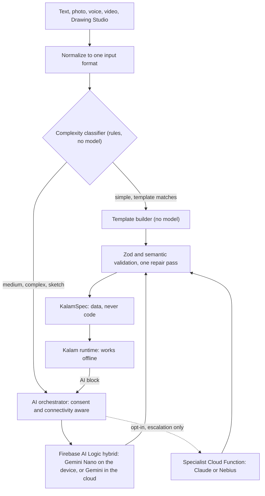

# Kalam

**Draw the app you need. Own it forever.**

Kalam is an app that creates other apps. You describe what you need by typing, speaking, photographing a sketch, recording a video or drawing in the built-in Drawing Studio. Kalam turns the request into a **KalamSpec**: a validated JSON description of the app. It is data, never code. One shared runtime renders and runs it. The app and its records stay on your device and keep working with no network.

> Building may need the cloud. **Using your app should not.**

Built for **#BuildHybridAI 2026** on **Firebase AI Logic** hybrid inference. Targets: Web (PWA), Android, iOS and an MCP server. Source: <https://github.com/vishavmehra/kalam>. Licence: MIT.

**Honest summary of the state today (2026-11-26).** Cloud inference through Firebase AI Logic and on-device Gemini Nano in Chrome are verified with real runs, and a 75-case live evaluation of the cloud compiler was run on 2026-11-25. The Android and iOS apps build and pass six smoke flows in CI, but no phone has produced an on-device answer yet, and the in-app hybrid scenarios are not recorded in a browser. [Status](#3-status) lists each claim with its evidence, `docs/PERFORMANCE_REPORT.md` has the measured numbers, and `docs/SECURITY_REVIEW.md` the security status.

---

## 1. What Kalam is

You can start an app from text, a photo of a sketch, your voice, a video or the Drawing Studio. Kalam normalizes the input, decides how hard the request is, builds the app, validates it and shows a plain-language summary before you save it. Saved apps live in a local shelf. You can edit them, back them up with encryption and export them. Signing in with Google or with an email and password is required to use Kalam. The session is kept on the device, so after you sign in everything works offline.

**Why hybrid.** Most requests do not need a large model. A counter, an expense tracker or a checklist is a template with a few parameters. Small tasks such as classifying a note, extracting fields or reading a voice command fit a small model that runs on the device. Only whole-app generation from a vague request, sketch understanding and hard repairs need a large cloud model. Kalam sends each task to the cheapest place that can do it well, and it tells you where it ran.

What is in the repository:

- 11 deterministic templates (calculator, counter, checklist, notes, expense tracker, habit tracker, inventory, contact book, measurement log, reminder list, simple form) and a rule-based complexity classifier. No model is called to classify. A gallery at `/templates` offers 31 ready-made apps, among them the five showcase apps, a kirana credit book and an attendance register.
- A cloud compiler for complex requests, with one repair pass, and AI blocks inside apps (classify, summarize, extract, translate) that run on the device when they can.
- A restricted formula language. No `eval`, no `new Function`.
- Offline-first storage: Dexie over IndexedDB on the web, `expo-sqlite` on Android and iOS.
- Kalam Bazaar, a share and install space for apps (Firebase Auth and Firestore). Free listings only. Paid credits are off unless `EXPO_PUBLIC_BAZAAR_PAYMENTS=on`.
- A visible, opt-in queue for builds, translations and AI steps started while offline. Nothing is queued unless you confirm what will be sent, and structural edits are never queued.
- Collaborative apps and teams (Firestore rules and the `kalamCollabJoin` function), app cloning, version history with restore, reports, reminders, an assistant, backup and account sync. Native home-screen widgets are not built yet; web shortcuts work.

KalamSpec limits keep generated apps small: at most 8 screens, 10 collections and 15 AI blocks. Features Kalam cannot do (logins, payments, servers) are mapped to the closest offline equivalent.

---

## 2. How the hybrid AI works



**Rules the code enforces**

1. **Deterministic first.** Calculations, CRUD, navigation, formulas, theming and templates never call a model.
2. **On-device first for small typed tasks.** Extract, classify, summarize, translate, voice commands and small edits prefer Gemini Nano.
3. **Cloud when the task needs it.** Whole-app generation, sketch understanding and difficult repair go to Gemini through Firebase AI Logic.
4. **At most one cloud fallback.** If a small task fails on the device, the orchestrator may make one Firebase cloud attempt. It does so only when cloud is allowed and the request was not marked on-device-only. There is no cascade of providers and no retry loop across providers.
5. **Consent clamps every decision.** Settings has **Hybrid** and **Offline only**, plus "Use cloud AI when needed" and "Allow specialist models". A request that must stay on the device is never widened to the cloud.
6. **Honest source labels.** Every AI result is labelled **On-device**, **Cloud**, **Deterministic** or **Offline**. The label comes from the SDK's own `inferenceSource`, not from the mode that was requested.
7. **Validate everything.** Every model output is checked with Zod and semantic rules before it renders. Invalid output is repaired once or rejected. The previous valid version of an app is kept.

**Routing per task** (`src/core/ai/routing.ts`)

| Task | Where it can run |
|---|---|
| `create_app`, `plan_app`, `modify_app`, `interpret_sketch`, `repair_spec` | Firebase cloud only. A specialist only when escalated with consent |
| `verify_ai_block`, `safety_review` | Firebase cloud only |
| `generate_patch`, `extract_data`, `classify`, `summarize`, `translate`, `voice_action` | Gemini Nano first, then at most one cloud attempt if cloud is allowed |
| `extract_template_params` | Gemini Nano only. The deterministic template is the fallback |

**Models.** The cloud models are set in `src/core/ai/model-config.ts`, the only place model ids live. `gemini-3.8-flash` handles compile, repair and AI-block verification. `gemini-3.5-flash-lite` handles the small roles. Each role can be overridden with `EXPO_PUBLIC_AI_MODEL_<ROLE>`. The cloud backend is Firebase AI Logic on the **Agent Platform** backend, location `global`. The Gemini Developer API backend also works.

**Where the on-device model runs**

| Platform | On-device model | How it reaches Firebase AI Logic |
|---|---|---|
| Web | Gemini Nano in desktop Chrome, through the Prompt API (`LanguageModel`) | The SDK's hybrid mode drives it directly. `on-device.web.ts` checks availability, starts the download and warms the model |
| Android | Gemini Nano through Firebase AI Logic's Android on-device SDK (ML Kit Prompt API on AICore), on supported phones | The Expo module `modules/kalam-nano` (Kotlin). `on-device.native.ts` exposes it to the SDK as a Prompt API shaped `LanguageModel` |
| iOS | Apple Foundation Models (`SystemLanguageModel`), iOS 26 or later with Apple Intelligence on | The Expo module `modules/kalam-apple` (Swift), through the same adapter |
| MCP server (Node) | None | Optional cloud compile only, off by default |

On Android and iOS the device model takes text only, about 4000 input tokens, and runs only while Kalam is on screen. Image requests go to the cloud. Without the native module (for example in Expo Go) or on an unsupported phone, on-device status reads unavailable with the reason, and requests go to the cloud when allowed. They are labelled Cloud.

**App Check**

| Platform | Release builds | Development builds |
|---|---|---|
| Web | reCAPTCHA Enterprise (v3 optional) | SDK debug token, registered in the Firebase console |
| Android | Play Integrity, from `modules/kalam-nano` | Debug token |
| iOS | App Attest with DeviceCheck fallback, from `modules/kalam-apple` | Debug token |

In the project used to develop Kalam, App Check enforcement is off, so unregistered clients still work. Turn enforcement on in your own project after you register your apps. The Cloud Functions enforce App Check, and the specialist function accepts each token once.

**Specialist providers.** Claude (planning and repair) and Nebius (sketch reading) exist as server-side adapters inside one Cloud Function, `kalamSpecialistReason`. They are off by default, need their own consent switch, never run from the client and are not part of the judging build. Firebase AI Logic remains the primary path. No benchmark yet shows a measurable benefit over Firebase-only generation.

**Where the Firebase AI Logic code lives**

| What | File |
|---|---|
| `getAI`, `getGenerativeModel`, hybrid `mode` (`only_on_device`, `prefer_on_device`, `only_in_cloud`, `prefer_in_cloud`), result `inferenceSource` | `src/infrastructure/firebase/firebase-provider.ts` |
| One lazy Firebase init, App Check before the first request | `src/infrastructure/firebase/app.ts` |
| App Check per platform | `app-check.web.ts`, `app-check.native.ts`, `app-check.ios.ts` in the same folder |
| Chrome Prompt API availability, download, warm-up | `src/infrastructure/firebase/on-device.web.ts` |
| Native on-device adapters | `on-device.native.ts`, `on-device.ios.ts`, `prompt-api.native.ts` |
| Routing policy and consent rules | `src/core/ai/routing.ts` |
| The single orchestrator, retries, event log | `src/core/ai/orchestrator.ts` |
| Cloud compiler with one repair pass | `src/core/compiler/compile.ts` |
| Specialist callable | `functions/src/index.ts`, `functions/src/providers.ts` |
| Real-call check scripts | `scripts/verify-firebase-ai.mjs`, `scripts/verify-cloud-compile.mjs`, `functions/scripts/verify-providers.mjs` |
| Recorded real runs | `docs/evidence/*.json`, written by `scripts/record-evidence.mjs` |

---

## 3. Status

Only real runs count as verified. Mocked unit tests check Kalam's own logic around the SDK and are never counted as proof that a model ran.

### Platforms

| Platform | Status | What is true today |
|---|---|---|
| Web (PWA) | **Partly verified** | Template create, save and run, and offline reload of the production build, were observed in a real browser. On-device Gemini Nano in Chrome and one cloud request are recorded, and the cloud compiler was evaluated live on 2026-11-25 from Node. The in-app hybrid scenarios are not recorded. The production bundle is over its size budgets (see `docs/PERFORMANCE_REPORT.md`) |
| Android | **Builds and runs, on-device AI not yet seen working** | CI built a 46 MB release APK and passed six Maestro flows on an emulator (run 45615319769, branch `ci/mobile-smoke`, before the redesign). On 2026-11-25 the app was opened on three real phones in Firebase Test Lab (Pixel 9, Pixel 10, Galaxy S25): the `kalam-nano` module linked on all three and AICore was unavailable on all three, so the app correctly refused the on-device-only task. Evidence in `docs/evidence/android-nano-*`. Gemini Nano still needs a supported phone with a working model |
| iOS | **Builds and runs in the simulator, no device run** | The same CI run built the iOS app on a macOS runner and passed six Maestro flows on the simulator (before the redesign). The `kalam-apple` Swift module compiled there. Nothing has run on an iPhone, so Apple Foundation Models and App Attest are not verified. A device build needs a paid Apple Developer account, and the on-device model needs a device with Apple Intelligence |
| MCP server | **Code complete, tested through the MCP SDK client** | `mcp/` has 60 tests in 6 files over in-memory, stdio and HTTP transports (run 2026-11-26). No recorded session with Claude Desktop or Claude Code |

### Hybrid AI requirements

| Requirement | Status | Evidence |
|---|---|---|
| Firebase AI Logic SDK imported and used at runtime | **Verified** | `firebase` 13.4.0 and `@firebase/ai` 3.1.0. A real request through `getGenerativeModel`, sent by `scripts/verify-firebase-ai.mjs`, reached the cloud model |
| Cloud inference through Firebase AI Logic | **Verified** | One real structured-output request on 2026-11-17 and 18: `gemini-3.8-flash`, `inferenceSource: in_cloud`, App Check debug token exchanged, 3383 ms, 132 tokens (`docs/evidence/cloud-inference-2026-11-18.json`). A live evaluation on 2026-11-25 sent 56 requests over 75 golden cases: 39 of 42 cloud-routed cases gave a valid app after one repair pass (`docs/evidence/live-eval-2026-11-25.json`) |
| Gemini Nano on the web | **Verified** | Chrome 157.0.8103.79, `availability: available`. Two schema-valid structured outputs through the Prompt API, using the session options Firebase's on-device adapter sends. The first session after a cold start took about two minutes. File: `docs/evidence/on-device-inference-2026-11-18.json` |
| The same on-device request through `getGenerativeModel` inside the running app | **Pending** | The recorded run called the Prompt API directly |
| Local to cloud fallback in a real browser | **Code complete, pending** | Policy in `routing.ts` and `orchestrator.ts`, unit tested with fake providers. No real "on-device unavailable, cloud used" run is recorded |
| Source labels in the UI | **Code complete, partly seen** | The Deterministic badge was seen in a browser. Real On-device and Cloud badges are not recorded in-app |
| App Check | **Partly verified** | Debug token exchanged on a real cloud call. The reCAPTCHA Enterprise path in a browser, Play Integrity and App Attest are not recorded |
| A complex app compiled by the real cloud model through the app UI | **Pending** | The compile path is covered by unit tests with fake providers. `scripts/verify-cloud-compile.mjs` and `scripts/eval.mjs --live` run it against the real model from Node, not through the screens |
| On-device model on Android (Gemini Nano) and iOS (Apple Foundation Models) | **Not verified** | AICore was unavailable on the three Test Lab phones, and nothing has run on an iPhone. Needs a supported phone, or a device with Apple Intelligence. The dated per-provider table is in `docs/07` section 14.6 |
| Offline use of saved apps | **Observed on web** | Offline reload and deep link in Chromium. Playwright spec `tests/e2e/04-offline.spec.ts` exists. No result is committed |
| Specialists (Claude, Nebius) | **Verified locally** | Real calls through `functions/scripts/verify-providers.mjs` and the Functions emulator. Off by default and not part of the judging build |
| Public repository and open-source licence | **Done** | Public on GitHub, MIT |

### Known limits

- On the web the on-device model is configured for English text, and image input accepts JPEG and PNG only. Android handles English and Korean. On Android and iOS the device takes text only and image requests go to the cloud.
- Gemini Nano in Chrome needs capable desktop hardware and a multi-gigabyte download that Chrome starts only from a user gesture. The first session after each page load is slow.
- Capture on real devices (camera, microphone, video) is built but not verified on hardware. Speech recognition may be done by a platform cloud service. Kalam labels where it ran.
- Kalam Bazaar, accounts and collaboration are built and covered by Firestore rules tests, but not verified end to end, and collaboration was never run with two real accounts.
- The web bundle is 13.1 MB of JavaScript (8.1 MB on the first screen) and exceeds the size budgets set on 2026-11-18, and the Android release APK is 46 MB against a 25 MB target. Cold start, shelf open time and drawing latency have not been measured. The cloud compiler took a median of about 13 seconds and a 95th percentile of about 114 seconds in the live evaluation. See `docs/PERFORMANCE_REPORT.md`.
- An internal security review on 2026-11-18, updated on 2026-11-26, covered the web build, hosting headers, the specialist function, the KalamSpec trust boundary and AI routing. It found no critical issues, and the dependency audit reports four high advisories in `firebase` and `@grpc/grpc-js` that no safe upgrade clears; they are not in the web or phone bundles. It was not an external audit and no real Play Integrity or App Attest token has been exchanged. See `docs/SECURITY_REVIEW.md`.
- Native home-screen widgets (`modules/kalam-widget`) have never been built or registered. Cloud transcription of an audio file is not available, and the sound track of a video is read on iOS only.

---

## 4. Setup

### 4.1 Prerequisites

| Need | For |
|---|---|
| Node.js 22 or newer (developed on Node 24) and npm | everything |
| Desktop Chrome with Gemini Nano | the on-device leg on the web (optional) |
| A Firebase project | sign-in (required), cloud AI and the Bazaar. Without one, Kalam cannot sign anyone in, so the app stops at the sign-in screen. Use your own project and follow 4.4 |
| Firebase CLI (`npm i -g firebase-tools`, developed with 15.36) | Functions, Firestore, Hosting, emulators |
| JDK 17, Android SDK, an emulator or phone | Android |
| A Mac with Xcode (simulator or local builds), or EAS Build with an Expo account. EAS alone, without a Mac, gives only device builds, which need a paid Apple Developer account and a device | iOS |
| Java 21 | Firestore emulator (rules tests only) |

### 4.2 Clone and install

```bash
git clone https://github.com/vishavmehra/kalam.git
cd kalam
npm ci
npm --prefix functions ci     # the root type check also reads functions/src, so install its packages first
```

The `mcp/` folder has its own `package.json`; install it only when you need the MCP server (section 4.11).

### 4.3 Environment

```bash
cp .env.example .env.local        # PowerShell: Copy-Item .env.example .env.local
```

`.env.local` is gitignored. Only `EXPO_PUBLIC_*` values reach the client, and none is a secret. Restart the dev server after editing, because values are inlined at bundle time.

| Variable | Purpose |
|---|---|
| `EXPO_PUBLIC_FIREBASE_API_KEY`, `_AUTH_DOMAIN`, `_PROJECT_ID`, `_STORAGE_BUCKET`, `_MESSAGING_SENDER_ID`, `_APP_ID` | Firebase web app config. Protect the project with App Check and API key restrictions |
| `EXPO_PUBLIC_FIREBASE_ANDROID_APP_ID`, `EXPO_PUBLIC_FIREBASE_IOS_APP_ID` | App ids of the Android and iOS apps registered in Firebase. Needed for Play Integrity and App Attest |
| `EXPO_PUBLIC_AI_BACKEND` | `agent_platform` (needs the Blaze plan) or `google` (Gemini Developer API). Anything else means `google` |
| `EXPO_PUBLIC_AI_LOCATION` | Region for `agent_platform`. We use `global` |
| `EXPO_PUBLIC_APPCHECK_PROVIDER` | `enterprise` (default) or `v3` |
| `EXPO_PUBLIC_RECAPTCHA_SITE_KEY` | reCAPTCHA key. Without it, web App Check is skipped and reported as not configured |
| `EXPO_PUBLIC_APPCHECK_DEBUG_TOKEN` | Development only. Register it in App Check, Manage debug tokens |
| `EXPO_PUBLIC_AI_MODEL_<ROLE>` | Optional model override. Roles: `COMPILER`, `REPAIR`, `JUDGE`, `SAFETY`, `LOCAL_ASSISTANT`, `EDIT`, `VOICE`, `AI_BLOCK`, `TRANSLATION` |
| `EXPO_PUBLIC_SPECIALIST_ENABLED` | `true` turns the specialist adapter on. Default `false` |
| `EXPO_PUBLIC_FUNCTIONS_EMULATOR` | `host:port` of the Functions emulator, for example `127.0.0.1:5001` |
| `EXPO_PUBLIC_BAZAAR_PAYMENTS` | `on` shows paid Bazaar listings. Leave empty |

Server-side names (Cloud Functions only, never in the client): `KALAM_ANTHROPIC_API_KEY` and `KALAM_NEBIUS_API_KEY` (secrets), and the optional `KALAM_CLAUDE_PLAN_MODEL`, `KALAM_CLAUDE_REPAIR_MODEL` and `KALAM_NEBIUS_VISION_MODEL`.

### 4.4 Firebase project

1. **Project.** Create or pick a Firebase project. Copy `.firebaserc.example` to `.firebaserc` and fill in your project id and Hosting site id. The Blaze plan is needed for the `agent_platform` backend and for deploying Functions.
2. **Web app.** Project settings, Your apps, add a **Web** app. Copy its config into the six `EXPO_PUBLIC_FIREBASE_*` values.
3. **AI Logic.** Firebase console, AI Logic, Get started. Choose a backend and set `EXPO_PUBLIC_AI_BACKEND` to match. Both support hybrid on-device inference. Cloud calls cost money, so keep experiments small.
4. **App Check on the web.** In Google Cloud console, create a reCAPTCHA Enterprise **website** key that allows `localhost` and your deployed domain. In Firebase console, App Check, Apps, register your web app with the reCAPTCHA Enterprise provider and that key. Put the key in `EXPO_PUBLIC_RECAPTCHA_SITE_KEY`.
5. **App Check debug token for local development.** Leave `EXPO_PUBLIC_APPCHECK_DEBUG_TOKEN` empty on the first run. The dev build turns on the SDK's debug provider, which prints a token in the browser console. Register it under App Check, Manage debug tokens, then paste it into `.env.local`. Do not enforce App Check on a shared project while experimenting. Production builds never use the debug token.
6. **Check the cloud leg.** This makes one tiny real request and prints only outcome, model, latency and token counts:

   ```bash
   node scripts/verify-firebase-ai.mjs
   ```

### 4.5 Gemini Nano in Chrome

Kalam does not call Gemini Nano directly. Firebase AI Logic's hybrid `GenerativeModel` decides between it and the cloud.

1. Use desktop Chrome. The recorded run used Chrome 157 on Windows 11. Chrome documents the hardware requirements and the flags that expose the Prompt API at <https://developer.chrome.com/docs/ai/built-in>. Flag names change between versions.
2. Open Kalam, then DevTools, Console, and run:

   ```js
   typeof LanguageModel                 // 'undefined' means the API is not exposed here
   await LanguageModel.availability({
     expectedInputs:  [{ type: 'text', languages: ['en'] }],
     expectedOutputs: [{ type: 'text', languages: ['en'] }],
   })                                    // 'available' | 'downloadable' | 'downloading' | 'unavailable'
   ```

3. If it says `downloadable`, open **Settings, On-device AI, Prepare on-device AI**. The status row then reads "On-device AI ready".
4. Without the UI: start Chrome with a dedicated profile and `--remote-debugging-port=9333`, then run `node scripts/verify-firebase-ai.mjs --on-device`. It opens its own tab and closes it afterwards.

### 4.6 Run on the web

```bash
npm run web                      # Expo dev server, http://localhost:8081
```

For a production build with the offline service worker (`sw.js` exists only in the build):

```bash
npm run build:web                # expo export, then scripts/build-pwa.mjs, output in dist/
node tests/e2e/serve.mjs         # serves dist/ with SPA fallback on http://127.0.0.1:4173
```

To host it: `firebase deploy --only hosting:kalam`. The Content Security Policy in `firebase.json` names the Firebase auth domain of the original project in `frame-src`. Replace it with yours first.

### 4.7 Run on Android

Android builds natively. `expo run:android` creates the gitignored `android/` project. The first build compiles native modules and takes a long time. Versions used: JDK 17, Android SDK platform 37, build-tools 37.0.0, NDK 27.1.12297006, CMake 3.22.1. Start an emulator or connect a phone first.

```powershell
$env:JAVA_HOME    = "<path-to-jdk-17>"
$env:ANDROID_HOME = "$env:LOCALAPPDATA\Android\Sdk"
$env:Path        += ";$env:ANDROID_HOME\platform-tools;$env:ANDROID_HOME\emulator"
npm run android                  # on macOS or Linux, set the same variables with export
```

In Firebase, register an Android app with package `com.kalam.app`, add the SHA-256 fingerprint of your signing key, register Play Integrity under App Check, and set `EXPO_PUBLIC_FIREBASE_ANDROID_APP_ID`. The API key must not be restricted to HTTP referrers, because app requests carry none.

Emulators have no AICore, so on-device AI correctly reads unavailable and requests go to the cloud. Gemini Nano needs a supported phone with a locked bootloader and an up-to-date AICore. With EAS, `eas build --profile preview --platform android` makes an internal APK.

### 4.8 Run on iOS

iOS needs a Mac with Xcode 26 or later. The iOS Simulator is part of Xcode, so without a Mac, EAS gives only device builds, which need a paid Apple Developer account and a device. The `ios` block in `app.json` uses bundle id `com.kalam.app` and the App Attest entitlement, and `ios` must stay in `expo.platforms`. `kalam-apple` adds Firebase through Swift Package Manager.

```bash
npx expo prebuild --platform ios && npx expo run:ios        # on a Mac
npx expo install expo-dev-client                            # the EAS development and simulator profiles need it
eas build --profile simulator --platform ios                # EAS simulator build, to run on a Mac
```

In Firebase, register an iOS app with bundle id `com.kalam.app`, enter your Apple Team ID, register App Attest under App Check, and set `EXPO_PUBLIC_FIREBASE_IOS_APP_ID`. Apple Foundation Models need a device with Apple Intelligence on. Simulators and unsupported devices read unavailable, and requests go to the cloud. This path is not verified.

### 4.9 Cloud Functions (specialists and Bazaar)

The codebase is `kalam` in `functions/` (Node 22). It holds the `kalamSpecialistReason` callable and three Bazaar callables (`kalamBazaarWallet`, `kalamBazaarPurchase`, `kalamBazaarModerate`). All enforce App Check. Provider keys live only in Secret Manager when deployed, and in the gitignored `functions/.secret.local` on your machine.

```bash
cd functions && npm ci && npm run build && cd ..
# functions/.secret.local (never commit it):
#   KALAM_ANTHROPIC_API_KEY=<your key>
#   KALAM_NEBIUS_API_KEY=<your key>
npm run functions:serve          # emulator on port 5001
```

Point the client at the emulator with `EXPO_PUBLIC_SPECIALIST_ENABLED=true` and `EXPO_PUBLIC_FUNCTIONS_EMULATOR=127.0.0.1:5001` in `.env.local` (from an Android emulator use `10.0.2.2:5001`). Restart Expo and turn on **Settings, Allow specialist models**. Check both adapters with one tiny real request each: `cd functions && npm run verify:providers`. To deploy (Blaze plan):

```bash
firebase functions:secrets:set KALAM_ANTHROPIC_API_KEY
firebase functions:secrets:set KALAM_NEBIUS_API_KEY
firebase deploy --only functions:kalam
```

### 4.10 Firestore rules and indexes

Firestore holds Kalam Bazaar listings, shared (collaborative) apps with their entries, and account sync data. The records of an app you have not shared never go there, and with account sync they leave the device only if you set a passphrase, and then only encrypted. Kalam uses a named database `kalam` and never touches `(default)`.

```bash
firebase firestore:databases:create kalam --location <region>
firebase deploy --only firestore:kalam
```

This deploys `firestore.rules` and `firestore.indexes.json` as listed in `firebase.json`. Signing in is required to use Kalam, so enable the Google and Email/Password providers in Firebase Authentication. The Anonymous provider is not needed. Test the rules on the local emulator (needs Java):

```bash
npx firebase-tools emulators:exec --only firestore --project demo-kalam "npx vitest run --config tests/rules/vitest.config.ts"
```

### 4.11 MCP server

`mcp/` is a separate Node process that lets an AI assistant build, check and package Kalam apps. It reuses the pure code in `src/core`, so its validation matches the app. It uses no AI model by default, makes no network calls and reads no files unless you allow it.

```bash
cd mcp && npm ci && npm run build        # writes mcp/dist/server.js
node dist/server.js --help
```

Known gap: the build embeds `docs/05_KALAMSPEC.md` as the `kalam://docs/kalamspec` resource. That file belongs to the local planning documents and is not in the public repository, so `npm run build` stops with a missing-file error in a fresh clone until the file is present or the build is changed to skip it. With the file in place the build and `--help` were checked on 2026-11-26.

| Option | Effect |
|---|---|
| none | stdio transport. Core tools only. No files, no network |
| `--workspace <dir>` | Adds tools to list, read and write `*.kalam.json` files directly inside that one folder. No subfolders, no symbolic links, size caps |
| `--firebase`, `--cloud-calls <n>` | Adds `kalam_compile_with_firebase`. Needs the Firebase web config and an App Check debug token in the environment (the same `EXPO_PUBLIC_*` names as the app). Sends request text to Firebase AI Logic and nothing else. Model calls are capped at `n` (default 5, maximum 50) |
| `--http`, `--port <n>` | Streamable HTTP on `127.0.0.1` only (default port 3917) instead of stdio. There is no login, so it cannot be combined with `--workspace` or `--firebase` |
| `--app-url <url>` | Your hosted Kalam web app, for web "Open in Kalam" links |

Core tools (all read-only): `kalam_spec_schema`, `kalam_validate_spec`, `kalam_list_templates`, `kalam_build_from_template`, `kalam_classify_request`, `kalam_explain_spec`, `kalam_diff_specs`, `kalam_check_formula`, `kalam_explain_formula`, `kalam_compute_report` and `kalam_package_app`. It also serves the `kalam://schema` and `kalam://templates/{id}` resources and a `create_kalam_app` prompt.

Add it to Claude Code:

```bash
claude mcp add kalam -- node /absolute/path/to/kalam/mcp/dist/server.js --workspace /absolute/path/to/my-apps
```

Add it to Claude Desktop in `claude_desktop_config.json`, then restart Claude Desktop:

```json
{ "mcpServers": { "kalam": { "command": "node", "args": ["/absolute/path/to/kalam/mcp/dist/server.js", "--workspace", "/absolute/path/to/my-apps"] } } }
```

The package tool writes the same importable file as "Export design" in Kalam. Open it with Settings, Storage, Import.

### 4.12 Check the hybrid path by hand

Use the production build in desktop Chrome with Gemini Nano available and an App Check debug token registered.

1. Open **Settings, AI and privacy** to see the mode, on-device status, Firebase AI Logic configuration and App Check state.
2. Create an app from *"A counter to count how many glasses of water I drink"*. It gets a Deterministic badge and makes no cloud call.
3. Create an app from a complex request, such as *"A tailor order book with customer name, chest, waist, delivery date and advance paid, and a way to classify notes as urgent or normal"*. It gets a Cloud badge and a plain-language summary.
4. In the app's editor, open AI blocks and run **Verify on this device**. Cloud writes sample cases and Gemini Nano runs them locally.
5. Go offline. Saved apps still open. An AI action on a record shows On-device. Creating a complex app explains that building needs an online model and leaves saved apps untouched.
6. Open **Activity** for counts by source, median latency, fallbacks and recent decisions. The log is local and clearable.

---

## 5. Testing

```bash
npm test                  # Vitest unit tests, fake providers
npm run typecheck         # tsc --noEmit
npm run lint              # ESLint (expo lint)
npm run build:web && npm run e2e     # Playwright against the production build
cd functions && npm test             # builds, then node --test
cd mcp && npm test                   # MCP server tests
npm run audit                        # npm audit for the app and the functions
```

The unit suite holds more than 7,000 tests across `src/core`, `src/infrastructure`, `src/features` and `src/runtime`. Unit tests use fake providers on purpose. Real-model behaviour is checked by the scripts below and by the walk-through in 4.12, never by mocks.

The setup steps in 4.2 to 4.11 were re-run on 2026-11-26 from a clean copy of the repository (every file that Git would publish, in an empty folder, with no `node_modules` and no `.env.local`). `npm ci`, the Functions install and build, and `npm run build:web` passed. Two corrections came out of it and are written into 4.2 and 4.11.

| Command | What it does | Cost |
|---|---|---|
| `npm run eval` | Runs the golden set (`tests/evaluation/golden`) through the classifier, templates, validation and describe. Writes a dated report | none |
| `npm run eval:check` | Same, and exits 1 when a quality floor is missed (used in CI) | none |
| `node scripts/eval.mjs --live --budget 6` | Also compiles cloud-route cases with real Firebase AI Logic. The budget is a hard cap on requests | billed |
| `npm run bench` | Timing and size benchmarks of the pure core | none |
| `npm run check:bundle` | Web bundle budgets, after `build:web` | none |
| `node scripts/verify-firebase-ai.mjs` | One real cloud request (`--on-device` for Chrome Gemini Nano) | one billed call |
| `node scripts/verify-cloud-compile.mjs` | The real creation pipeline against the real cloud model, with a call cap | billed |

**Recording evidence.** `scripts/record-evidence.mjs` runs the verify script, removes anything secret-shaped (API key, App Check token, UUIDs, long tokens) and writes a dated JSON file to `docs/evidence/`. The only prompt sent is the fixed sample "Buy milk tomorrow."

```bash
node scripts/record-evidence.mjs cloud        # one billed cloud call. Do not run it in a loop
node scripts/record-evidence.mjs on-device    # Chrome must be running with --remote-debugging-port=9333
```

`all` runs both. Re-running on the same day overwrites that day's file.

Continuous integration (`.github/workflows`) runs types, lint, unit and evaluation tests, the production web build with a bundle scan for provider secrets, Playwright, the Functions tests, Firestore rules tests and dependency and secret scans. It calls no real model and needs no secret.

---

## 6. Project layout

```text
src/
  app/                 Expo Router routes: shelf, onboarding, create (draw, review), app run and edit, activity, settings
  core/                Pure TypeScript. Runs in Node under Vitest. No React, Expo or Firebase imports
                       spec (KalamSpec schema, validation), ai (orchestrator, routing), classifier, templates,
                       compiler, pipeline, tasks (AI blocks, edit, voice), edit, versioning, formula, backup, bazaar,
                       queue, collab, account-sync, clone, import-link, reports
  runtime/             KalamRuntime and engine: renders and runs a KalamSpec
  infrastructure/
    firebase/          Firebase init, App Check, hybrid provider, on-device adapters
    specialist/        Client for the specialist callable
    storage/           Dexie (web) and expo-sqlite (Android, iOS) behind one driver
    platform/          Network, media, speech: .web and .native splits
    bazaar/, pwa/      Bazaar client, service worker registration
  features/            create, media, drawing (Studio), editing, visual-studio, history, shelf, templates, queue,
                       collab, share, widgets, reports, reminders, assistant, document-intel, recovery, storage,
                       account, auth, bazaar, bazaar-moderation, cloud-consent, settings, activity, landing
  design/, components/ Design tokens, UI kit, shell
  services/index.ts    Composition root: the only place providers meet core
functions/             Cloud Functions codebase "kalam": specialists (Claude, Nebius) and Bazaar callables
modules/
  kalam-nano/          Android native module (Kotlin): Gemini Nano, Play Integrity
  kalam-apple/         iOS native module (Swift): Apple Foundation Models, App Attest
  kalam-widget/        Android widget and iOS WidgetKit extension (written, never built or registered)
mcp/                   MCP server (Node) reusing src/core
scripts/               build-pwa, verify-firebase-ai, verify-cloud-compile, record-evidence, eval, bench, check-bundle-size
tests/                 fixtures, e2e (Playwright), evaluation (golden set, perf budgets), rules (Firestore)
docs/evidence/         Recorded real runs (JSON)
DESIGN.md              The visual system of the Kalam shell, written from the built app
```

Stack: Expo SDK 58, React Native 0.88, React 19.3, Expo Router, TypeScript (strict), Zod 4, Zustand 5, Firebase JS SDK 13, Vitest 5, Playwright, Cloud Functions 2nd gen on Node 22. Platform splits use Metro extensions (`foo.web.ts`, `foo.native.ts`, `foo.ios.ts`) with a plain `foo.ts` shim so `tsc` resolves. Web animation uses GSAP and three.js. Android and iOS use Reanimated and Skia.

---

## 7. Privacy and security

- **Data stays on the device.** Apps and their records are stored in IndexedDB (web) or SQLite (Android, iOS). Cloud Firestore holds Bazaar and collaboration data, and account sync data if you turn it on. The Activity log is local and clearable.
- **Sign-in.** Signing in is required. Firebase Authentication keeps the session on the device, so after you sign in, saved apps open and run with no network. Account sync is off until you choose it, and records sync only if you also set a passphrase, which encrypts them on the device first.
- **What is sent to the cloud, and when.** Only for cloud-routed tasks, and only if cloud AI is allowed: your request text, photos you chose, video keyframes and a summary of a drawing. Raw audio and raw video are not sent to any AI provider. Video is reduced to keyframes and speech to a transcript first. Speech recognition itself may run on a platform service, and Kalam labels where it ran. Recordings are deleted right after transcription unless you turn on "Keep recordings".
- **You control it.** **Offline only** mode blocks every cloud call. "Use cloud AI when needed" and "Allow specialist models" are separate switches. Specialist models are off by default.
- **Encrypted backups.** Backups use AES-256-GCM with a key derived by PBKDF2-HMAC-SHA256 (310,000 iterations minimum) from your passphrase. The passphrase and key are never stored.
- **No keys in the client.** Only `EXPO_PUBLIC_*` identifiers reach the bundle. Claude and Nebius keys exist only in Cloud Functions (Secret Manager, or `functions/.secret.local` locally). CI scans the production bundle for provider secrets.
- **App Check.** Web uses reCAPTCHA Enterprise, with a debug token in development only. Native builds use Play Integrity and App Attest. The Cloud Functions enforce it, and the specialist function accepts each token once.
- **Specialist function.** Strict request validation and size limits, a per-task allowlist (`plan_app`, `repair_spec`, `interpret_sketch`), timeouts, server-side output validation, a rate limit, and a usage log that holds task, provider, model, latency and token counts but no user content.
- **KalamSpec is data.** No `eval`, no `new Function`, no executing model output. Every spec is validated before it renders. Invalid output is rejected or repaired once. The previous valid version is preserved. Injection fixtures live in `tests/fixtures/specs/invalid`.
- **Prompt injection.** User text and images are wrapped as untrusted data in prompts. Model output is never trusted.
- **Hosting headers** (`firebase.json`): a Content Security Policy, `nosniff`, `X-Frame-Options: DENY`, a strict referrer policy and camera and microphone limited to the page itself.
- **Firestore rules** are covered by emulator tests in `tests/rules`.

---

## 8. Existing work and tooling

### Existing-work disclosure

On 2026-11-17 this repository held only product planning documents and an instruction file for the coding agent. It had no source code, no configuration and no build. Those planning documents are kept locally and are not published here.

All of the code in this repository was written during the hackathon period with AI assistance from Claude Code (Anthropic). That covers the app, the runtime, the AI pipeline, the Cloud Functions, the native modules, the MCP server, the tests, the scripts and the build setup. The planning documents were revised while building so that they match the decisions made along the way.

### Tooling and Firebase Agent Skills record

- **Coding agent:** Claude Code (Anthropic).
- **Firebase Agent Skills:** none confirmed. No official Firebase Agent Skill was confirmed as installed or used. The Firebase AI Logic integration followed the Firebase documentation and the installed SDK's own type definitions (`@firebase/ai` 3.1.0). If a Firebase skill is used later, it will be listed here.
- **Other skills assigned to the build agents:** `frontend-design`, `emil-design-eng`, `gsap-react`, `gsap-performance`, `threejs-fundamentals`, `claude-api`, `security-review`, `impeccable`, `readme`, and `avoid-ai-writing` or `unslop` for plain-English copy. This list records which skills the agents were told to use. It is not a log of every call.
- **Other tools:** Vitest, Playwright, the Firebase emulators, `tsc`, ESLint, and the scripts in `scripts/`.

---

## 9. Licence

Kalam is released under the [MIT License](LICENSE). Copyright (c) 2026 Vishav Mehra.
